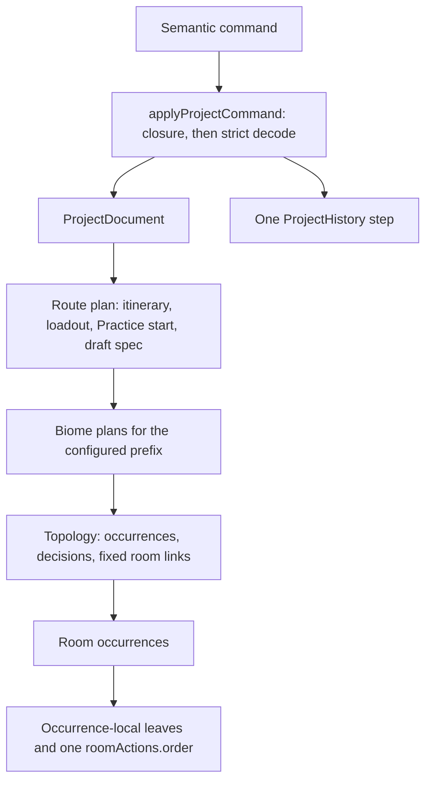

# Authored Project Model

## Purpose

This document defines the durable user-authored planner state: project and route
scope, biome topology, occurrence-local state, semantic addresses, commands,
persistence, and history. Simulation algorithms, candidates, Redux state, and
React rendering are separate concerns.

## Overview



```text
ProjectDocument    durable, possibly incomplete authored intent
ProjectEvaluation  replaceable pure simulation output for one document
EditorSession      transient navigation, focus, search, and expansion state
```

Only `ProjectDocument` is persisted. Simulation output, findings, candidate
lists, canvas positions, selected tabs, and history controls do not enter it.

### Key terms

| Term                 | Meaning                                                                                                                                                                                                                          |
| -------------------- | -------------------------------------------------------------------------------------------------------------------------------------------------------------------------------------------------------------------------------- |
| Room Declaration     | Immutable catalog fact keyed by game room name: kind, occurrence mode, exits, requirements, force, caps, an Encounter Envelope with exact slot bindings, incoming reward binding, local-child descriptors and complete defaults. |
| Room Occurrence      | One repeatable persisted appearance of a declaration in one biome: an opaque `occurrenceId`, the selected `gameName` and complete occurrence-local room state. Several occurrences may share a declaration.                      |
| Exit Decision        | One ordinary next-room source, its normal-door batch and the selection among its normal exits.                                                                                                                                   |
| Normal-door batch    | Batch reward-store state, batch-specific state such as H's cage outcome, and target references keyed by declaration-owned physical or semantic exit keys, never rendered indexes.                                                |
| Hub Decision         | N's persistent board: fixed-slot open references, one ordered action list of room visits and the fountain use, that use's Phial outcome, and the completion predicate. It owns no N Preboss room-local state.                    |
| Local Visit Decision | Parent-occurrence-owned topology for one declared N side-room group: generated slot membership and ordered references to entered side occurrences, each an ordinary occurrence with its own state and `roomActions`.             |
| Preboss              | A Room Declaration role inside a normal-door batch. Offering it does not complete a biome; selecting it creates the fixed Boss and optional Postboss occurrences and their links.                                                |
| Acquisition site     | Sparse occurrence-owned payload for one authorable lifecycle point. It owns generated pickup payload, never a second chronology.                                                                                                 |

Topology owns editable occurrence relationships and decisions. Room state owns
rewards, Shop inventory, one occurrence-owned Room Action order, exact concrete
encounter selections, wheels, cages, side-room state, and fixed completion
occurrence leaves. Boss and Postboss occurrences are not editable room choices
but share ordinary room-local ownership. UI state owns no domain topology.

## Authored Document Boundary

The current schema is the sole engine-authored-project contract. Its codec
rejects other schemas and mismatched catalog versions rather than manufacturing
current topology or leaf state from stale data. The application's shared loader
migrates older documents before invoking the same strict parser; the
[project loader](APPLICATION_SHELL.md#opening-and-migration) owns that behavior and
[`schema/README.md`](../../schema/README.md) the migration history.

### Schema change approval

The document's version is a pair: `schemaVersion` is the major and the
optional integer `schemaRevision` the minor, read as 0 when absent. The
Modeling Rules in [`AGENTS.md`](../../AGENTS.md#modeling-rules) set when a
change needs a major bump (with owner approval), a minor bump or none; a
catalog change that can invalidate a previously valid project counts too, and
changing a catalog-version requirement to reject existing saves needs the same
approval rather than substituting for a bump. The
same-version invariant holds throughout: a project that compiled under a
version still compiles under the same version. A failure is a defect, a missing
bump; the corpus compile test holds every checked-in project to it.

Before proposing a major bump, determine whether the existing persisted
representation can safely carry the choice. Internal naming, presentation and
corrected derived calculations do not justify changing it; an explicit
engine-owned conversion between a stable stored encoding and a clearer
authoring value is acceptable, while silent reinterpretation or domain
conversion in React is not. A proposal states what cannot be represented,
which saves are affected, the compatible alternative and its cost, and the
migration and release implications. Once approved, strict decoding stays and
the migration is deliberate: no permissive parsing, speculative legacy support
or silently discarded choices. The migration boundary distinguishes shipped
formats from unreleased work, and an already-shipped schema version is never
recycled for incompatible semantics.

### Document contents

One document contains one selected route. Every supported main room, fixed
Boss/Postboss room, and generated N side room is an occurrence in the same
topology. Each occurrence owns one `roomActions.order`; sparse acquisition
sites own payload, not another chronology. Derived history, simulation output,
automatic mutations, pending schedules, runtime eligibility, findings, and UI
session state never enter the document.

Generated clocked-pickup entry keys use the stable semantic acquisition
identity rather than a sequence position. Reordering or regenerating unrelated
scheduled effects therefore does not rename an authored pickup or its matching
Room Action reference.

There is one biome plan and one topology language. Room occurrences, sourced
decisions, their selected exits, and the narrow `fixedRoomLinks` relation carry
the complete topology. Fixed Boss and Postboss transitions use
`fixedRoomLinks`; authored exits remain owned by their source decision.

```ts
interface AuthoredBiomePlan {
  biomeKey: string;
  state: AuthoredBiomeState;
  topology: BiomeTopology | null;
}

interface BiomeTopology {
  startOccurrenceId: OccurrenceId;
  occurrences: readonly RoomOccurrence[];
  decisions: readonly NextRoomDecision[];
  fixedRoomLinks: readonly FixedRoomLink[];
}

interface FixedRoomLink {
  sourceOccurrenceId: OccurrenceId;
  targetOccurrenceId: OccurrenceId;
}

type NextRoomDecision = ExitDecision | HubDecision | LocalVisitDecision;
```

`topology: null` is the only representation of a configured biome whose start
has not been authored. A non-null topology always has a real authored start;
it never uses a null start ID or a positional synthetic parent.

## Route Scope

One document persists one route identity, its complete `itineraryBiomeKeys`,
and a contiguous configured prefix of that itinerary. Underworld, Surface and
Fresh File use their catalog presets. Dream creation selects four distinct
biomes in a transient draft. Engine-owned public admission enforces the
catalog start pool and directional successor exclusions for creation, import
and restoration. Structural decoding remains separate from public admission so
internal model fixtures can represent bounded non-public itineraries.
Expansion initializes each biome from its declaration-owned start; shrinking
explicitly removes the discarded plans and their state. `ConfigureRoutePrefix`
is the only normal scope-edit command and undo restores the prior snapshot.
Selecting another catalog route creates or opens another document; it does not
switch a hidden sibling route inside the current one.

```text
Underworld: [] -> [F] -> [F, G] -> [F, G, H] -> [F, G, H, I]
Fresh File: [] -> [F] -> [F, G] -> [F, G, H] -> [F, G, H, I]
Surface:    [] -> [N] -> [N, O] -> [N, O, P] -> [N, O, P, Q]
Dream:      configured prefixes of the four-biome order chosen at creation or re-pick
```

Configured scope is not a claim that a biome is complete or simulation-valid,
and its last configured biome is not necessarily the route's terminal biome.
`resolveRoutePosition` resolves ordinal, neighbors, first/last status and exact
completion identities from the full itinerary. Chronological consumers share
that product rather than infer placement from a biome name. Itinerary order is
not editable inside an existing project.

The route's catalog-declared save profile is part of its identity, not a
separate persisted field. Fresh File's profile resolves its F start to the one
`F_Opening01` opening, which configuring F creates directly; the start codec,
start commands and start candidates share that resolved start pool.
[Fresh File Rules](../biomes/FRESH_FILE_RULES.md) own the route's game rules.

### Route Loadout

Each route persists its weapon/aspect choice, starting keepsake, familiar, an
unordered canonical selection of manually active Arcana cards, and one
declaration-bounded rank for every Fear Vow. A mature-save route requires the
weapon, aspect, keepsake and familiar keys; new routes start with the
catalog's default familiar, Frinos. A Fresh File route stores all four as
`null`, no manual Arcana, every Vow at rank 0, no starting reward and no
keepsake equip result; the codec rejects any other value and native-equipment
loadout commands fail, because none of these is a choice on a brand-new
profile. The engine resolves the run's actual equipment from the profile, the
aspectless Staff, so weapon-dependent rules see the Staff while
aspect-dependent rules see no aspect. Automatic Arcana derive from the empty
selection as none. The catalog owns card order, ordinary automatic-activation
rules, Vow maxima, and Fear increments. The authored model owns only the
player's starting selections; derived automatic cards and the configured Fear
total are not persisted independently.

Familiar-shop upgrades are not authored: a mature save owns every
familiar-shop level, at the catalog-declared rank, as keepsakes are fixed at
rank III. `ReplaceFamiliar` replaces the identity as one route-owned history
edit, preserves identity for a no-op, and fails on Fresh File.

Loadout optionally owns a `runModifiers` record whose keys, kinds, defaults,
stages and display domains come from the engine's run-modifier declaration
table. It is the one tolerant exception to exact decoding: decoding drops keys
the table does not declare, clamps a finite number outside its declared domain
to the nearest bound, and replaces any other malformed known value with its
native value, so modifiers can be added, trialled and retired without a schema
bump. A boolean modifier is persisted only when it differs from its default; an
optional percentage is absent while off and present as a value from 0 to 100
while on; absence of the record means every modifier is native. An `internal`
declaration is authored and published only when the composition enables
internal modifiers. `ReplaceRunModifiers` replaces the complete settings as one
route-owned history edit through the same normalization, preserves identity
for no-ops, and removes the record when every value is native.
[Run-Start Installation](RUN_START_INSTALLATION.md#run-modifiers) owns the
declared modifiers and their publication.

The route optionally owns `practiceStart`, the Practice mode start point;
[Run-Start Installation](RUN_START_INSTALLATION.md#authored-start-point) owns
its decoding, command and eligibility.

`ReplaceRoute` replaces the loadout (keeping run modifiers) and the planned
biome prefix (one to every itinerary biome, in itinerary order). Resource
placements name hosts in the replaced biomes, so they clear unless the command
gives placements hosted in the new biomes, as a draft gives its own; the route,
itinerary, Practice start and draft spec stay.

`ReplaceDreamItinerary` re-picks a Dream itinerary under the same public
admission as creation. Leading biomes whose key and position both match are
kept as authored; every later position is discarded with its biome plan and
its per-biome route settings (Draft per-biome entries, resource placements, a
Practice start there), and fresh default biomes refill the plan to its earlier
length. Run-wide Draft choices and the basket stay. An engine query names the
configured biomes a re-pick would discard, so the editor can confirm first.

The route also owns one always-present `draft` spec, the persisted Draft
settings a draft generates from. It plays no part in plan legality or
execution, decodes tolerantly rather than strictly, and changes through
`ReplaceDraftSpec` as one ordinary history edit;
[Draft Mode](DRAFT_MODE.md#the-draft-spec) owns its fields and decoding.

Loadout also owns the nullable starting reward offer. A mature route reports a
missing offer once any biome is configured; a Fresh File entry binds no
run-start reward, so its null offer is complete. The offer can be selected
before an entry-room variant exists and is retained when topology is cleared or
no biomes are configured. The first entry occurrence owns only its acquisition
payload and actions; composing these with the route offer does not persist a
second copy of the offer. Recreating the entry initializes fresh acquisition
payload, while replacing its variant preserves compatible authored outcomes.

The closed route commands replace the complete manual Arcana selection or one
Vow rank. They validate catalog membership, static rank bounds, and the coupled
starting-Grasp capacity, preserve all topology and downstream authored state,
and participate normally in undo/redo. The codec enforces the same capacity, so
an authored starting loadout cannot retain an impossible manual selection.
Automatic cards and run-local Arcana grants are not part of this starting limit.
Other ordinary Vow gameplay effects remain outside these commands.

Circe's selected effect-backed offer detail is authored beneath its exact trait
option. `activateArcana` and `promoteArcana` store canonical distinct card sets;
`disableFear` stores distinct `vowKeys`. Required counts are resolved at
acquisition from ordinal and the eligible pool. Empty or partial choices remain
repairable; an exhausted activation pool admits an empty result. The codec
checks shape, catalog membership, option disposition, and canonical declaration
order, but does not evaluate current run eligibility. Dormant resolution detail
remains persisted when a user switches away from its owning option, so a later
switch can restore it.

Judgment stores one canonical distinct Arcana-card set on the exact automatic
Boss occurrence's `bossDefeated` phase for each authored biome. It is dormant
unless Judgment is active at that phase. This is a room-local authored outcome,
not a synthetic reward or topology edge.

### Keepsake Authorship

The route loadout owns one exact starting keepsake, or none on a Fresh File
route. Every occurrence of a room whose rack the route offers
(`routeHasKeepsakeRack`; Fresh File has none) owns a `keepsakeRack` leaf, and
no other occurrence may. `keepsakeKey: null` means unchanged: the rack is a
no-op that carries the current keepsake, with no effect, lifecycle event, order
dependency or execution transaction. A key authors a replacement. The
occurrence and its local controls are active for every supported nonterminal
route position. The ordinary terminal I and Q positions have no Postboss
occurrence; physical biome identity alone does not determine finality.

Every structural Postboss state defaults to a `useFountain` action followed,
where the route offers the rack, by the unchanged rack's `interactKeepsakeRack`
action. The rack is a permanent timeline row: the codec requires exactly one
rack action wherever the leaf exists, generic insertion and removal refuse it,
and `MoveRoomAction` reorders it. `ReplacePostbossKeepsake { keepsakeKey:
string | null }` sets or clears the key without moving the row. Each equip
result belongs to one keepsake, so any key change, including null, drops the
equip results. The action order is the sole chronology owner, and the Postboss
occurrence owns its findings and history.

Selection legality is contextual rather than codec policy. Unknown keys are
malformed, while a structurally valid replacement that has already been
removed, conflicts with Fated state, or is blocked by prior Athena history
remains authored and repairable. Commands never silently delete it or move its
effect detail to another frontier. Equip results and other keepsake effect
outcomes each have one exact semantic owner;
[Reward Model](REWARD_MODEL.md#keepsake-outcomes) owns their shapes and
[Echo](REWARD_MODEL.md#echo) its children.

### Acquisition dispositions and pickup effects

Every authorable acquisition role has one exact disposition: `normal`,
`timePiece`, or `artificer` with a complete `RunProgress` replacement reward.
The child belongs to its exact source and acquisition role. Ordinary ordered
acquisition sites represent its later pickup with a collision-safe
source-derived entry key; Fields uses its one room-action chronology. Mandatory
singleton room rewards derive their required classification and pickup
checkpoint, but the activating command persists the exact pickup reference in
the occurrence's one shared `roomActions.order`; there is no separate or
synthetic one-row order. No pending Artificer map or remaining-use counter is
authored.

A reward also owns the result of its concrete acquisition's declared pickup
effect, wherever that reward settles. `anvilResultsByAcquisitionRole` holds one
Anvil of Fates result per role (its removed Hammer, `null` when none, and two
acquired Hammers), or `null` while unauthored. The shared reward codec requires
the entry exactly for roles whose concrete acquisition declares the Anvil
pickup effect and rejects it elsewhere, on every reward-state owner: a Shop or
Contract slot, the Travel Deal refill and the Gold Gold Gold duplicate entry
alike. `ReplaceAnvilResult` addresses the `AcquisitionRoleAddress`, not a Shop
slot; replacing the reward with a non-Anvil offer drops the result. A Path of
Stars screen likewise owns its invested nodes in
`hexActivationsByAcquisitionRole`
([Trait Offers](TRAIT_OFFERS.md#spell-drop-and-hex-trees)).

## Common Decision Model

```ts
type ExitDecisionSource =
  { kind: 'occurrence'; occurrenceId: OccurrenceId } | { kind: 'hubDecision'; decisionKey: string };

type ExitSelection =
  | { kind: 'derived' }
  | { kind: 'unresolved' }
  | { kind: 'normal'; exitKey: string }
  | { kind: 'additional'; additionalExitKey: string };

interface ExitDecision {
  kind: 'exit';
  source: ExitDecisionSource;
  normal: NormalDoorBatch;
  selection: ExitSelection;
}

interface NormalDoorBatch {
  kind: 'batch';
  rewardStore: BatchRewardStoreState;
  batchState: AuthoredBatchState;
  targets: readonly ExitTargetReference[];
}

interface HubDecision {
  kind: 'hub';
  hubKey: string;
  source: { kind: 'occurrence'; occurrenceId: OccurrenceId };
  openTargets: readonly HubTargetReference[];
  actions: readonly HubAction[];
  fountainRarityResult?: AuthoredFountainRarityResult;
}

type HubAction =
  | { kind: 'roomVisit'; hubSlotKey: string }
  | { kind: 'useFountain' }
  | { kind: 'reroll'; rerollId: string; hubSlotKey: string; reward: ResolvedRewardOffer };
```

An `ExitDecision` has at most one semantic source. Occurrence-sourced batches
belong to a layout's normal-decision policy, including N's bounded entry;
Hub-sourced batches belong only to N's completed-Hub Preboss exit, which
every `HubDecision` owns exactly once.

Selection belongs to the enclosing decision: a width-one normal-only batch uses
`derived`; a multi-target or sibling-additional decision may be `unresolved`;
`normal` selects one declared normal target; and `additional` selects one
closed sibling continuation. Additional exits are authored by the source
`RoomOccurrence`, while the active outgoing decision exposes that source's
closed siblings. Supported additional exits are a declared Zagreus contract
beside a Midshop's normal lane and declared Chaos beside eligible source
occurrences. Both remain source-occurrence-owned and are never synthetic
normal targets or generic cross-room-set escapes.

A Chaos additional exit may carry `spawnPointIndex`, a one-based physical
point in the source room's declared SecretPoint domain. Omission leaves native
random placement. `SetChaosSpawnPoint` edits only this leaf, independently of
the selected outgoing door and Chaos destination. Positive out-of-domain
retained indices are finding-backed, not silently reset. Surviving manual or
Ixion-generated gates retain their position; a newly generated gate at another
host starts without a selection.

Decision-array order is not reachability authority. Decoding follows semantic
sources and selected targets to determine the selected spine. An unpicked
target is a real dead leaf but cannot own a downstream exit decision. Cycles,
detached decisions, duplicate sources, multiply-owned occurrences, and orphan
occurrences are contract errors.

### Reanchoring

This section is the command-level owner of continuation changes;
[Game Generation Rules](GAME_GENERATION_RULES.md) own how the targets
themselves are generated.

Changing the picked continuation (`SetExitSelection`) is one authored edit,
assessed against the proposed selected spine. A compatible ordinary decision
reanchors to the new source using its reward-store and physical-exit
declarations. The same primitive serves ordinary targets and Chaos and Zagreus
additional exits. Matching targets and their descendants retain identity and
compatible room-local state. A Hub likewise reanchors only to a
declaration-supported Hub source, preserving its board, visits, main/side
occurrences and completed handoff.

An incompatible continuation is removed, not a reason to reject the selection.
Reanchoring prunes unselected targets at doors the new source does not declare.
A selected ordinary target at such a door keeps its identity and subtree: it
moves to the lowest declared door no kept sibling occupies, after pruning the
unselected sibling at the highest declared door when every door is occupied.
It is removed only when the new source declares no door. Takeover batches are
pruned by door, never re-keyed, and reanchoring cannot invent identities to
fill a wider atomic takeover. Selecting Preboss establishes its fixed
completion chain instead of attaching an ordinary or Hub continuation. The
same reachable Preboss keeps its authored Boss/Postboss state; a different
Preboss receives declaration-owned completion defaults.

Additional exits owned by the old selected target are removed with their
branches; they never transfer to the new host. The parent decision's offered
normal and additional siblings remain. An unresolved selection retains those
offerings but closes the old target's downstream continuation and fixed
completion. The old target becomes an unselected leaf; room-local state never
transfers between it and the new target. A destination that already owns a
decision or takes part in a fixed completion, an actual cycle, and duplicate
ownership are contract errors.

When a progressively authored width-one target already owns the next decision,
adding another declared physical target promotes the derived continuation to an
explicit normal selection. The established downstream subtree stays attached
to that selected occurrence.

## Starts, Batches, Preboss, and Completion

The catalog declares either an `authoredChoice` start or a declaration-fixed
`fixedAuthored` start. Exactly one declared entry is initialized atomically when
its biome is configured; multiple choices remain unset until selected. This
depends on declaration cardinality, not biome identity. Initialization creates
only the entry occurrence, never downstream doors or Hub structure, and does
not bypass assessment readiness. Existing configured prefixes remain untouched.

`CreateStart` requires a selected game name for an authored choice; it derives
the fixed declaration and rejects substitution. Decoding preserves imported
null starts, which remain repairable by explicitly selecting their declared
entry. `ClearTopology` removes the biome's topology and resource placements,
then restores its sole default entry or leaves a multi-choice entry unset.
These are atomic history edits. Automatically created entry IDs are stable and
biome-scoped; imported occurrence IDs are not rewritten.

Entry declarations are intrinsically rewardless. Shared entry resolution first
applies the room's route overlay, if its declaration names the route, then
binds the route-owned reward only at the first itinerary entry, applies narrow
contextual encounter rules, and selects the lifecycle and entered-store
participation consumed by defaults, decoding and simulation. An overlaid room
is decoded and constructed as its realized room. Later entries remain
rewardless. Multi-choice entry identity belongs to biome Overview at every
ordinal; the starting offer belongs to Loadout, and its acquisition
dispositions and outcomes belong to the first room's Timeline.

Completion likewise resolves the exact allowed Preboss/Boss/Postboss chain; a
cross-family completion map does not authorize unrelated foreign rooms.

Generated batches retain their layout's progression, reward-store, and
batch-state contracts. Q's exact room depths are evaluated eligibility, so
wrong-depth ordinary choices remain representable. H's Fields result remains
batch-owned. O can derive a reward store from the active Ship wheel. I remains
a normal Clockwork batch: `I_PreBoss02` may coexist with normal peers but its
one-creation-per-source policy is declaration-owned.

`CreateBatch` and `CreateTarget` create ordinary shape progressively. Target
creation validates the source's current declaration-owned exit key. A source
room replacement may retain structurally represented targets whose keys the
new room no longer supplies; they are context-invalid rather than silently
deleted. The codec accepts only normal exit keys present in the biome's
authored declarations (or the one fixed Hub exit key), never an arbitrary
string as a repair placeholder. `ReconcileBatchExitCapacity` is the explicit
topology-removal repair: it removes unavailable targets and their downstream
subtree, then normalizes selection from the retained keys.

### Empty decision envelopes

An occurrence-sourced normal batch with zero targets remains a supported
authored decision envelope. It has a stable decision address, remains on the
selected spine, may retain declaration-owned ordinary setup (such as a
reward-pool choice or H's Fields result), and is removable and undoable. It
does not add a persisted mode, discriminator, or schema variant.

The editor does not require authors to create that empty envelope as a separate
step. At an uncommitted exit frontier it projects the declaration-owned empty
shape without persisting a phantom decision. The first reward-pool, Fields
outcome, or ordinary target edit atomically creates the envelope and applies
that edit as one engine command and one history entry. A takeover choice uses
the corresponding atomic takeover creation command. Undo therefore returns
directly to the projected outgoing cards.

The envelope is not a realized ordinary generated batch. It consumes neither
ordinary batch/target progression nor a staged ordinal until its first
ordinary target is created. The engine can explicitly create the next envelope
while an ordinary slot remains. At the ordinary bound it can create one further
empty envelope only when the selected source and layout admit a declared
terminal resolution. F/G/H/O/P/Q admit a takeover Preboss; N admits its
required Hub candidate after the bounded PreHub stage; I admits neither because
its Preboss is an ordinary retained peer. These exceptions belong to
declaration-derived topology rules rather than the empty shape itself.

The supported Zagreus command may atomically create a selected Midshop's empty
normal envelope and append its closed additional contract to that Midshop
occurrence. That incomplete normal lane remains authored and finding-backed
until ordinary targets are added; the additional exit neither consumes nor
repairs normal progression.

The first Door 1 choice resolves the envelope. An ordinary or
`retainNormalPeers` choice realizes an ordinary batch and must satisfy the
ordinary bounds at that point. A `takeOverNormalDoors` Preboss replaces the
empty envelope with its atomic batch, discarding ordinary-only setup and
initializing declaration-owned Preboss defaults. Undo restores the exact
empty envelope and any provisional setup; a takeover batch never consumes an
ordinary progression slot.

### Takeover batches

Takeover Preboss declarations F/G/H/O/P/Q own an atomic batch policy.
`CreateTakeoverBatch` and `ReplaceWithTakeoverBatch` receive one occurrence ID
for every declared normal exit and create the whole shape, selection and
downstream cleanup atomically in declaration order. They reconcile existing
targets by physical exit key, not a supplied occurrence-ID order: a retained
key keeps its occurrence ID, and a caller may not move an existing target ID to
another physical door. Individual takeover targets are not room-replaceable or
capacity-repairable, and a single takeover target is never edited in
isolation.

A source replacement, Anomaly revert, or decode can leave a takeover batch
wider or narrower than its source's declared doors. The prior targets remain
structurally represented until `ReconcileBatchExitCapacity` repairs the whole
batch. The repair is minimal: surviving targets keep their occurrence, Shop
purchases, completion chain, and boss-door store. A missing declared door gains
a default Preboss offer whose occurrence ID the engine derives as
`<source occurrence ID>:<exit key>`, so a door removed and added again keeps
its identity. An undeclared door is removed with its downstream topology. A
width-one result with no additional exits is derived; otherwise a surviving
selected door stays selected (a derived width-one selection becomes explicit
`exit1`) and a removed one becomes unresolved; a newly selected door gains its
completion chain. Every automatic narrowing of a takeover batch, such as an
Anomaly switch, uses the same removal. A `none`-policy Preboss fills a single
door only, so its batch has no repair when the source declares more; the
out-of-depth source carries its own `targetRoomUnavailable` finding.

Selecting a Preboss creates and enters its fixed completion occurrences through
the topology links. There is no persisted completion flag, entry mode, or
`closesBiomeWhenPicked` duplicate. The selected Preboss's ordinary peers
remain real unpicked occurrences.

The route declaration names the sole physical Preboss for each route position;
alternative maps are not authoring choices. Underworld therefore uses
`I_PreBoss02`; Dream Dive route support selects `I_PreBoss01` through the same
route-owned field. Each completion declaration similarly names its normal
Boss and, where the game has a distinct map, its Rivals Boss. The resolved Boss
is the Rivals map exactly when the configured Rivals rank reaches that
one-based route position. P and I have no distinct map and retain `Boss01`.

Changing the Rivals rank reconciles every already-created fixed Boss as one
semantic edit. The physical room name and its declaration-fixed encounter
change, while the Boss occurrence ID, fixed links, compatible local state, and
route resource address remain attached to the same occurrence. Boss and
Preboss labels and editor controls remain projections of that resolved
topology; neither physical variant is exposed as an extra picker choice.

## N Hub Progression

N is authored progressively:

```text
N_Opening01
  -> width-one normal exit prehub -> N_PreHub01
  -> exact empty terminal envelope
  -> source-bearing Hub decision hub
  -> completed-Hub exit preboss -> width-one N_PreBoss01 batch
  -> fixed Boss and Postboss occurrences, when the route position has a Postboss
```

The catalog bounds N's normal entry to one `prehub` physical exit and one
staged `N_PreHub01` target at biome depth 1. After PreHub reaches depth 2,
`CreateBatch` may create the exact zero-target terminal envelope.
`ReplaceWithHubDecision` atomically replaces that envelope with a Hub carrying
the PreHub occurrence as its source, together with the Hub's completed-Hub
exit: a width-one `N_PreBoss01` batch whose occurrence ID the command supplies
(`prebossOccurrenceId`), and the fixed Boss and route-position Postboss
occurrences it links. `RemoveHubDecision` removes Hub-owned state, including
that chain, and restores the exact envelope. The Hub declaration owns the fixed
physical slot-to-room mapping, opening bounds and constraints, six distinct
ordered room visits, the one fountain use, side-room policy, restores, and the
dedicated completed-Hub exit. An open slot creates one occurrence; its room
identity is not replaceable. Open unvisited slots remain real offered leaves.

The action list is a chronological prefix: at most six distinct open-slot
visits, one fountain use and any board-door reroll presses, possibly empty.
New Hubs start empty and decoding
never infers a use. `ReplaceHubActionOrder` edits it by action identity; visit
ordinals count room visits only. Reordering keeps the Phial outcome, while
removing the fountain use removes it. `ResetHubBoard` retains the Hub decision
and its source while atomically clearing its open slots, actions, fountain
outcome, and owned main/side rooms; the completed-Hub chain stays.
Unlike `RemoveHubDecision`, it does not restore the preceding terminal envelope.
Resetting an empty board is a no-op; Undo restores all cleared contents together.

The same order also holds board-door reroll presses (`InsertHubReroll`,
`ReplaceHubRerollReward`, `RemoveHubReroll`): each names an open slot not yet
entered and the reward its press drew, carries an engine-allocated `rerollId`,
and may sit in any Hub stay, before the first visit or between later ones. A
press placed after its slot's visit redraws nothing. The slot's target keeps
its first native draw; see [Rerolls](#rerolls).

The completed-Hub exit exists for the Hub's whole lifetime and is removed only
with the Hub. Its source is `{ kind: 'hubDecision', decisionKey: 'hub' }`, not
a rendered visit index or synthetic completion source; decoding rejects a Hub
without it. Board, visit, fountain and slot edits (`ReplaceHubActionOrder`,
`OpenHubSlot`, `CloseHubSlot`, `ResetHubBoard`) never touch it, so its Preboss,
Boss and Postboss state survives them. The declared open-set and six-visit
predicate gates only reachability: while it fails, materialization stops at
the Hub frontier and the chain is an authored, unreached context whose state
stays finding-backed. Fountain placement is not part of that predicate;
completeness separately requires the use before departure. The unreached chain
still counts as structurally active for the command boundary's Room Action
domain closure, so its delivery and pickup rows are kept and seeded like any
other authored room, but it is not assessed until the Hub is complete.

Each entered main occurrence may own a `LocalVisitDecision` whose generated
targets are distinct side-room occurrences. Generation and visit order remain
parent topology, while each selected side occurrence executes its own room
lifecycle. Parent and Hub restoration preserve the canonical walk without
replaying either occurrence's already-settled actions.

Closing an unvisited slot below the declared open-set minimum retains the
already-authored visit sequence and the completed-Hub chain as an incomplete
Hub board.

### Ephyra hidden return door

Every `N_Combat*`, `N_MiniBoss*` and `N_Sub*` occurrence owns `phantomExit`:
the placeholder room the game creates behind its hidden return door and the
reward type drawn for it, each nullable. Rooms whose exit is linked (Opening,
PreHub, Story, Preboss, Boss, Postboss, the Hub) have none. A null field is
not missing: the simulation settles it and publishes the value; a pinned value
never falls back, and a pinned reward requires a pinned room that draws one.
`ReplacePhantomExit` edits both. The door is never entered and owns no
occurrence, acquisition or god.

## Occurrence State and Replacement

Every occurrence begins with complete declaration-owned offer-time defaults and
complete static selections for each of its declaration's pool-backed potential
encounter slots. Fixed slots and slots in an empty Encounter Envelope carry no
redundant authored selection.

Shop inventory is entry-time state: selecting a Shop occurrence materializes
it; changing selection removes unselected inventory. Its materialized state
owns declaration-keyed offers. Exact `interactShopOffer` membership in the
occurrence's `roomActions.order` is both the purchased fact and the purchase
order; no purchased set or Shop-private order is persisted. A counted-free
Preboss keeps its complete resolved offer regardless of selection. A purchased
Mystery Boon stores its hidden source and trait result at the acquisition entry
where it resolves, not in generated Shop inventory. An Anvil of Fates result
is not Shop state either; it belongs to the reward that carries the Anvil.

A present Shrine of Hermes persists its visible initial inventory, each
stocked item (initial slot or Travel Deal refill) holding its reward type and
the delay the game rolls with the stock, so an unbought item keeps its delay
too. A generation is purchased exactly when `roomActions.order` holds its one
`{ kind: 'purchaseHermesShrineOffer', generationKey, rushed }` reference, which
owns its rush and its position among the Shrine's purchases; no purchase state
is persisted beside it. The codec rejects a purchase action whose item is not
stocked, and a same-room Shrine pickup without a rushed purchase action. Its
rushed or delayed delivery owns concrete acquisition payload. A
Stygian Well or Pool of Purging holds its initial stock with no interaction
flag: a blank slot stays native, a pinned one is assessed, and a slot becomes
required only once a purchase or sale uses it; use follows from the room's
actions. Each later roll is a repeatable `rerollStygianWell` or
`rerollPurgingPool` room action with an engine-allocated `rerollId` and
optional slot pins (an unpinned slot stays native); each Well purchase names
its roll and slot, and each Pool sale its list (`rollKey`, absent for the
initial list). A purchase or sale pins a blank slot in the same edit. Travel
Deal refill state is
occurrence-local to its Shop, Shrine, or Well carrier. Pending deliveries,
temporary effects, Spell reservations, and expiry remain derived simulation
state.

An intro room the catalog declares as an Eris host on the project's route may
carry an optional `eris: { spawned: true }` leaf, an observed game condition
the planner does not simulate; absence means Eris did not spawn. The codec
rejects the leaf on any other room or route. `SetErisSpawned` adds it together
with the required `interactEris` action, the fixed gift's `erisGift`
acquisition site and its required pickup action; clearing it removes all four.
[Fresh File Rules](../biomes/FRESH_FILE_RULES.md#eris-at-a-biome-intro) own
the hosts and their game rule.

### Acquisition sites

An acquisition site is sparse occurrence-owned payload state for one exact
authorable lifecycle point. A declaration-produced pickup stores its exact
reward, trait-offer, and level-resolution children in the site's
`pickupEntries`; its participation and chronology are represented only by the
matching `interactAcquisitionEntry` in `roomActions.order`. Shop offers remain
owned by Shop inventory, while their matching `interactShopOffer` references
carry purchase participation and chronology. Mandatory singleton room rewards
derive required classification and lifecycle timing and create no redundant
persisted site state; their activating command still inserts the exact
required action reference, which points back to the existing reward owner
rather than copying its payload.

Gold Gold Gold's free Shop duplicate may retain its complete site payload
without participating. Travel Deal owns `shop.travelDealRefill`, an optional
ordinary `ShopOfferState` outside initial indexed inventory, addressed by
`shopOffer` with the reserved refill key. Its retained `interactAcquisitionEntry`
reference joins chronology; only a purchased Mystery has a separate site child,
reconciled atomically on item replacement and purchase insertion/removal. Other
reward children remain on the slot.

The Zagreus Contract pedestal is a Preboss room feature, not Shop inventory:
`infernalContractPedestal` is present exactly on Preboss occurrences whose
declaration places the pedestal, in the boon form as in the Shop form, and
holds its one free item (an option of the separate pedestal pool and its
reward). Membership of `interactInfernalContractPedestal` in the room's order
is the collected fact. Its own commands replace or clear the item and insert
or remove the collect action. Like a Shop Mystery Boon, it has a sparse
acquisition entry only when its hidden source must be resolved on collection.

Trait-generated and Sea Star duplicate sites are closed source-scoped site
keys, not new site variants. A selected Quick Buck, Buried Treasure, or
equipping Narcissus trait owns its exact generated entries after its normal
trait acquisition. A Sea Star result owns at most one non-recursive duplicate
entry at its normal source acquisition role; toggling that result adds or
removes the entry and its ordinary Room Action as one semantic command and one
undo step. A retained result that becomes inactive remains authored for repair
but has no active child action. The persisted entry is ordinary
`AuthoredRewardState`, so no reward-copy tree or second timeline is needed.

### Shop and pickup commands

`ClearShopOffer` empties one declared inventory slot, removing its
`interactShopOffer` reference and any acquisition-resolved entry in the same
undo step; it is how a slot whose group has become empty is repaired, and it
is a no-op on an empty slot. The Travel refill is not a declared slot.
`ReplaceShopPurchaseParticipation` appends or removes one exact base-Shop
`interactShopOffer` reference. Generic Room Action insertion/removal rejects
that reference family so the purchase commands are the sole membership
interaction; ranked purchases remain movable with the ordinary Room Action
commands. Shrine and Well purchase references are rejected the same way.
Removing participation remains accepted for a retained stale purchase after
its Shop owner disappears, allowing exact repair without deleting unrelated
actions. `PurchaseShopTravelDealRefill` appends the purchase of the Shop's
Travel Deal item and, given a value, first stocks a blank item, as one Undo
step.

`SetHermesShrineOfferDelay` sets the delay of one stocked Shrine item, initial
slot or refill; stocking an empty slot gives it the default delay, and
restocking keeps it. `SetHermesShrinePurchase` adds or clears one generation's
purchase: a new purchase inserts its unrushed purchase action at its canonical
position, and clearing removes that action, its pickup and placed deliveries
while retaining delivery payload. `PurchaseHermesShrineOffer` instead appends
the purchase of one unbought item at the end of the room's actions, bought or
rushed, first stocking a blank Travel Deal refill when given its reward, as one
Undo step. `SetHermesShrinePurchaseRush` changes rush on one exact purchase
action, ranking or retracting its optional same-room pickup. When any of these
commands changes the first rushed initial purchase, the refill's purchase
action and pickup are rescheduled after it; when no rushed initial purchase
remains, the refill's pickup is retracted.

`MoveRoomAction` changes one ranked action's position within the complete
chronology; `ReplaceAcquisitionEntryOffer` edits only a declaration-compatible
materialized pickup. Neither command may infer entries from room names or
rendered rows. Echo's history-derived replay may be effective while its
structural pickup entry is empty or retains a former source. `EditEchoReplay`
seeds that exact entry and applies its first child edit as one command, so Undo
restores the previous payload without a separate identity-confirmation edit.
The command trusts the caller's `sourceOffer` seed; evaluation derives the
replay identity from history, overriding a stale seed with a
`traitOfferMissing` finding.

Required Gold Gold Gold pickups join `roomActions.order` in the edit that newly
activates them, after exact agreeing materialization evidence. Prior optional or
inactive evidence establishes that delta; an unassessed prior Shop does not.
Existing missing required pickups remain explicitly restorable, and loading
stays read-only. `PlaceEchoGoldPickup` materializes unresolved children for
that repair and for optional collection. Retained payload remains available for
exact source mismatch repair; a changed trigger does not reset it. Subsequent
outcome edits use the ordinary acquisition, trait, level, and conversion
commands. Travel uses ordinary Shop inventory commands, not this
derived-pickup family.

### Required Room Actions

The engine classifies every structurally active Room Action as required or
optional from the same action domain consumed by simulation. The semantic
command that newly activates a required reference inserts it in the
occurrence's order at its engine-owned lifecycle default position, preserving
the relative sequence of retained rows. One command and one history entry
therefore contain both the requested edit and its mandatory membership delta.
Optional actions remain membership-controlled by their existing owner. An
active required row may be moved within its legal range but cannot be
generically removed.

This guarantee is delta-only. A deliberately malformed document may already
omit a required reference, and an unrelated edit does not normalize that
omission. Evaluation retains the missing-required finding and publishes one
engine-owned canonical restore intent. Dormant and stale rows likewise remain
authored until an explicit owning command removes them; reactivation of the
same key reuses its retained position rather than adding a duplicate.

### Fields rooms

Every Fields combat occurrence owns one selected optional-reward count,
complete retained optional-reward values through the declaration's exact
capacity, its declaration-bounded spatial layout, and one mixed room-action
order. Entry, cage, optional-reward, and Passive Nemesis points remain
room-local placement facts; the action order alone owns cage completion and
pickup chronology. [H rules](../biomes/H_GAME_RULES.md#authored-shape) own
participation and default ordering.

`ReplaceFieldsCageOrder` accepts an exact permutation of the active cage
identities. It resolves that permutation left-to-right with insertion-style
moves of the existing completion references, retaining all other actions'
relative sequence and each cage's leaves, and reconciles the complete order
once. Context-invalid retained interactions remain repairable through findings.
Commands and decoding use stable phase, slot, and acquisition-role identities,
never rendered ordinals.

### Rerolls

A door, Fields cage or ship-wheel reroll press is a repeatable `reroll` room
action in the source room's order, identified by its engine-allocated
`rerollId`, never by position. It names its target (an exit door and its
occurrence, a cage door with the cage slot the game picks at random, or one
offer of the room's own wheel) and the reward the redraw produced. Rerolls of
different targets interleave freely, because each press's candidates depend on
every target's current reward at that moment; a per-target list could not
represent them. Board-door presses are the Hub's own actions
([N Hub Progression](#n-hub-progression)).

The target keeps its first native draw with its ordinary picker and meaning
(the incoming reward, the cage or the wheel offer). The reward entered or
collected after the presses, with its acquisition children, lives beside it in
`rerolledIncomingReward`, `rerolledCages` or `rerolledOffers`; the first draw
is inert while it is present. Its offer should equal the last press's; a
mismatch is retained for repair (`DropRerolledReward`,
`AdoptRerolledReward`), never rewritten. `InsertReroll` appends a press at an
engine-supplied index (after the doors unlock, or among a wheel's offers
before its use), `ReplaceRerollReward` changes its reward, and presses are
removed and moved as ordinary room actions; a removal keeps later presses it
invalidates.

A rerolled single-pick trait, Chaos or Pom level screen holds its earlier
screens, oldest first, before the final screen that keeps the pick; the reroll
count is their number ([Trait Offers](TRAIT_OFFERS.md#ordinary-initial-screen-support)).
An earlier trait screen may hold the ordered Rarify clicks made on it, with the
final screen's meaning; an absent list is none.
Well and Pool rolls are room actions
([Occurrence State](#occurrence-state-and-replacement)). No reroll count or
pool total is persisted: the pool is derived.

### Room replacement and detours

`ReplaceOccurrenceRoom` preserves occurrence identity and reconciles only
declaration-compatible leaves. It never moves state to another occurrence or
guesses a reward. It resets incompatible state to complete defaults and cannot
bypass a bounded Hub-entry candidate pool, fixed start/Hub identity, or atomic
takeover rule.

Route detours use narrower commands than general room replacement. Anomaly
replacements, the Zagreus contract, and Chaos are the declared detour ownership
forms admitted by decoded topology; their game rules live in the
[G rules](../biomes/G_GAME_RULES.md#anomaly-detour) and the
[route detours audit](../audits/rooms-and-routes/ROUTE_DETOURS_GAME_DATA_AUDIT.md).
Anomaly and Zagreus each have one declaration-owned automatic host return;
selected Chaos instead exposes one fresh, ordinary player-selected host
continuation after its Chaos room.

An Anomaly takeover retains one normal G target occurrence identity, its
incoming reward, and the remembered displaced G game name; it owns the retained
offer plus success state. It resets incompatible room-local leaves, installs
the declared Anomaly defaults, and never creates the remembered room. Map
changes retain that offer, outcome, and provenance. Takeover atomically
reconciles the prior G decision to the Anomaly declaration's one automatic
exit: excess normal targets, their descendants, and source-owned additional
exits are removed, and the retained selection becomes derived. Revert restores
the remembered G identity, retains the offer, restores complete G defaults, and
keeps that width-one `exit1` continuation; any additional exits exposed again
by the restored G declaration are incomplete authoring rather than resurrected
state. An incompatible retained reward remains authored and finding-backed
rather than being silently rerolled or refunded.

The Zagreus command creates or extends the selected Midshop's ordinary decision
and appends a closed `zagreusContract`, owning one `C_Boss01` occurrence, to
that Midshop occurrence. Its active decision exposes the sibling while
preserving the normal lane and its selection; a width-one declaration-derived
normal selection becomes explicit when the sibling makes selection ambiguous.
Removing the sibling deletes only its occurrence and descendants and restores
that derived selection when applicable.

`AddChaos` attaches one declared `chaos` sibling to an eligible source
occurrence; `ReplaceChaosMap` changes only that sibling's concrete map within
the host layout's declared domain, trimming the Chaos room's outgoing
continuation to the new map's doors by the reanchoring rule, and `RemoveChaos`
deletes only the sibling and its descendants. A generated gate carries the
exact Ixion purchase origin; an omitted origin is an authored gate. Contextual
spacing and source requirements do not make the persisted gate undecodable:
evaluation reports them at its additional-exit owner. A selected Chaos room
owns its fixed `Empty_Chaos` encounter and direct `TrialUpgrade` reward, then
its outgoing ordinary decision owns the fresh host continuation. That
detour-owned return envelope remains authorable when the host biome has
already exhausted its ordinary batch bound; the exception belongs only to the
closed detour source.

Room-local commands address an occurrence and declaration-owned leaf key.
They cover incoming rewards, Fields cages, Ship encounter counts and wheels,
Ephyra side-room generation/order/rewards, Shop offers, sparse acquisition
payloads, and the exact occurrence-owned Room Action order. Leaf edits do not
rewrite topology. For existing detours, declaration lookup uses the
occurrence's game name while the address retains its hosting biome. Automatic
outcome edits validate that declaration's encounter phase, not equality
between its room set and host biome.

### Trait Offer Outcomes

Every reward- or encounter-owned trait role persists one closed
`AuthoredTraitOffer`. [Trait Offers](TRAIT_OFFERS.md#authored-outcome) owns its
shape, the Spell Drop and Aspect Hex trees, option-owned trait results and
encounter-owned offers.

### Encounter Choices

`RoomOccurrence.encounters` persists per-phase encounter choices, sparse
customization, Aetos requests and encounter trait offers.
[Encounter Preparation](ENCOUNTER_PREPARATION.md) owns their authored shape,
commands, identity resolution and repair.

## Semantic Addresses

Addresses are immutable discriminated values. `semanticAddressKey` is a
canonical projection for maps and markers, not another identity source.

| Owner                             | Address                                                                     |
| --------------------------------- | --------------------------------------------------------------------------- |
| start and occurrence-local leaves | `OccurrenceAddress`                                                         |
| room-sourced decision             | `ExitDecisionAddress` with occurrence source                                |
| N handoff decision                | `ExitDecisionAddress` with Hub source                                       |
| normal target                     | `TargetAddress` with source and exit key                                    |
| additional continuation           | `AdditionalExitAddress` with occurrence ID and declared additional-exit key |
| decision selection                | `ExitSelectionAddress` with source                                          |
| batch reward store                | `BatchRewardStoreAddress` with source                                       |
| Hub board                         | `HubDecisionAddress`                                                        |
| Hub slot and visit                | `HubSlotAddress` and `HubVisitAddress`                                      |
| Hub fountain use and Phial target | `HubFountainAddress` and its `FountainRarityOutcomeAddress`                 |
| Hub board reroll                  | `HubRerollAddress` with Hub key and `rerollId`                              |
| room reroll press, Well/Pool roll | room action address with its `rerollId`                                     |
| Contract pedestal item            | `InfernalContractPedestalAddress` with occurrence ID                        |
| hidden return door                | `PhantomExitAddress` with occurrence ID                                     |
| local reward and wheel            | occurrence plus declaration-owned child key                                 |
| N local visit topology            | parent occurrence, local group, and declaration-owned slot key              |
| pool-backed encounter phase       | `EncounterPhaseAddress` with occurrence owner and stable phase key          |
| Boss/Postboss occurrence          | `OccurrenceAddress`                                                         |

Every address is anchored to its semantic occurrence, decision, or
declaration-owned child rather than a rendered position.

## Commands

Commands are semantic immutable transitions. Every successful proposal passes
through the project decoder before publication. A structural failure reports
its semantic owner and never leaves partial topology. Commands are the only
topology-removal authority; they reject partial takeover shape, duplicate
target keys, incompatible declarations, impossible selection states, and edits
to a dead leaf with downstream state.

Ordinary and detour commands share command-owned exit-capacity reconciliation:
target pruning, descendant removal, selection retention, and selected-entry
state reconciliation form one atomic transition. Structural source identity
is separate from public semantic-address serialization.

`applyProjectCommand(document, catalog, command)` accepts every transition that
is structurally representable. Command handlers may enforce exact semantic
ownership and address contact, catalog membership and declaration-owned static
domains, topology closure and bounds, fixed-versus-selectable slots, declared
set membership, and complete declaration-owned defaults. They do not consume a
project evaluation, candidate capability, history or reward branch, encounter
activation result, or contextual trait assessment. Contextual impossibility is
derived validation truth, so an authored value remains persisted until an
explicit semantic command changes or removes it.

Before decoding a successful proposal, the command boundary closes it in one
explicit command-local order: newly required source actions, then generated
pickup sites, then the newly active generated actions, with resource topology
cleanup, Shrine-source and inactive clocked-pickup retraction and Chaos
topology reconciliation in the same pass. Each closure compares the
structurally active Room Action domains before and after its step and closes
only the newly required delta. It may seed several newly active occurrences or
one Fields/Ship cohort atomically, but it does not invoke simulation or
materialization, repair pre-existing omissions, or remove rows made dormant by
the command. Source-owned site, entry and action change together, preserving
compatible authored children when their source survives; a later application
projection never repairs the document or synthesizes a missing site. An
extension joins this ordered closure rather than adding a second scheduler or
replaying candidate evaluation; command tests own atomic insertion, retraction,
compatible retention and Undo.

Steady Growth targets (`steadyGrowthTargets` on the giving trait offer) and
Embryo blessings (`transcendentEmbryoTransformations` in the installing
keepsake selection's equip results) are
[timed outcomes](TRAIT_OFFERS.md#timed-outcomes), edited by
`ReplaceSteadyGrowthTarget` and `ReplaceTranscendentEmbryoTransformation` at
one source and cycle. Hermes deliveries and clocked pickups are likewise keyed
by their source. Room replacement and other unrelated edits therefore retain
all of them; edit settlement resets no inherited choice, and one that is
invalid where it lands keeps its finding. Only a changed purchase or a moved
due contact re-places a Hermes delivery without its old payload. Vanished
structural phases are removed under the existing codec and remain recoverable
through Undo.

`UnplaceGeneratedDelivery` removes an exact cross-room Shrine delivery action
and its host-local payload, including nested reward choices, while preserving
the source purchase and sibling deliveries. It validates structural ownership,
not simulated validity; application edit settlement refuses to publish removal
of a reached valid required delivery, proven invalid placements retain this
explicit repair, and due-contact validation continues to
require that delivery before publication. Same-room rushed deliveries are
optional actions ranked by the rush command and removed through
`RemoveRoomAction`, never unplaced; a rushed purchase may stand without its
pickup. Source reactivation uses the existing exact placement support rather
than guessing a replacement host.

Retained clocked-pickup payload alone does not create an optional action. The
simulator's reached due-entry capability exposes unplaced drops; ordered stale
placements remain addressable for repair. Explicitly removing a clocked pickup
removes its host-local entry and action together. A still-due drop remains
available to place again, while other recurring drops from the same source are
untouched. Source retraction may retain dormant payload for repair, but must not
resurrect it as an optional pickup.

### Command families

The command language includes project and route commands; start, batch, target,
takeover, selection, removal, and clear-topology commands; terminal Hub
replacement, Hub board and visit commands; and occurrence-local state
commands including `SelectEncounter` and `ResetEncounter`, plus the closed
Anomaly, Zagreus and Chaos detour commands. The current union is defined by
`packages/planner-engine/src/authored-project/commands/types.ts`.

`RemoveExitDecision` keeps the source occurrence but removes its normal and
additional branches, clearing references on surviving owners in the same edit.
Removal follows ordinary, Hub, local-visit and fixed-link ownership, not array
order. Removing N's Opening decision therefore removes PreHub, its
source-bearing Hub, and its completed-Hub chain through persisted ownership.
Navigation and focus are not commands and do not enter authored history.

`SwapRewardWheelOffers` exchanges a two-offer wheel's offers with their
acquisitions, rerolled rewards and presses, so the same picks stand on the
other sides; it refuses while a pickup or result generated from either offer
exists. Run import uses it; the editor offers no control for it.

## Persistence and Validation

The portable document has exact keys, a validated full itinerary and its
configured prefix, and stable indented JSON with a trailing newline:

```ts
interface ProjectDocument {
  schemaVersion: typeof PROJECT_DOCUMENT_SCHEMA_VERSION;
  schemaRevision?: number; // on disk only; absent means 0
  projectId: string;
  name: string; // trimmed, non-blank, at most 200 code points
  catalogVersion: string;
  route: AuthoredRoutePlan;
}
```

`name` is the plan's name, authored like any other field: a new project takes
`"New plan"`, `RenameProject` replaces it (trimmed; blank or overlong is
refused) as one history step, and the published plan's `displayName` is the
name.

Unknown fields, malformed discriminants, wrong schema or catalog versions,
unauthorized cross-biome rooms, invalid leaf state, and malformed structural
ownership fail at decode contact. The codec preserves structurally
representable incomplete and context-invalid authored choices; simulation
findings, not fallback, describe context invalidity. Decision-form decoding
validates declaration-owned source, target, batch and visit constraints; the
structural coordinator retains global selected-spine, fixed-link, cycle and
ownership checks and returns resolved occurrence roles and entry-active facts
for leaf decoding. Decoding never invokes command repair or silently prunes
representable authored state.

Persistence excludes filenames, library keys, Redux state, editor tabs, graph
positions, candidate sets, findings, simulation output, write status, and an
alternate profile wrapper. A library key is transport metadata, not authored
project identity or name. A new project starts with a unique minted
`projectId`; every write keeps it, and a duplicate, an event copy or an import
whose identity the library already holds takes a new one through
`reidentifyProjectHistory`, which replaces the identity in every snapshot
rather than adding a command step.

## Undo and Redo

`ProjectHistory` holds frozen `past`, `present`, and `future` document
snapshots. One effective semantic edit, including engine-owned timed-effect
settlement, creates one history step and clears redo. A no-op command retains
history identity. Undo and redo restore exact prior snapshots. Derived
simulation and transient UI state remain outside this history.

## Explicit Non-Goals

The authored model contains no generic special-exit placeholder, probability
score, RNG seed, game-profile predicate, generic graph edge, rendered
coordinate, React state, ImGui storage, silent repair, or guessed fallback.
Chaos uses the closed additional-exit envelope without altering the common
biome-plan shape.
