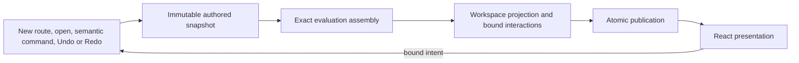

# Planner Application and Editor

## Responsibility

`apps/planner` composes the catalog and engine into an editable application.
It owns persistence, state coordination, projections, interaction binding,
navigation and React presentation. It does not own room legality, topology
repair, reward bags, lifecycle clocks or candidate policy.

[Architecture](ARCHITECTURE.md) defines package direction.
[Planner Engine](SIMULATION_AND_VALIDATION.md) defines semantic products.
This document owns the editor's application architecture: composition and
publication, projection and binding, readiness, contextual queries and
findings. [Application Shell](APPLICATION_SHELL.md) owns Home, the library,
saving, opening, the Game tab and the route-level panels;
[Structured Editor Workspace](STRUCTURED_EDITOR_WORKSPACE.md) owns what the
biome workspace shows; [Contextual Editor UX](CONTEXTUAL_EDITOR_UX.md) owns
picker and popup-editor behaviour.

The editor must preserve incomplete and invalid authored choices. Rendering
a tidy view is not permission to repair, hide or silently replace user intent.

## Composition and Atomic Publication

The composition root constructs the catalog, evaluation and candidate
capabilities, projection services, persistence adapters and application
coordination. Collaborators are complete at construction and passed
explicitly; no mutable registry assembles itself during use.



A new snapshot is evaluated synchronously. A restored immutable identity may
reuse its cached assembly. Public evaluation data alone cannot recreate
candidate capabilities; workspace preparation receives the exact assembly.
No component launches another project evaluation to fill a missing projection.

Redux coordinates authored history and transient session state. Domain changes
remain semantic commands. One effective user intent creates one history step;
no-ops do not. Navigation, focus, search, disclosure and derived results do
not enter Undo/Redo.

These are separate authorities:

| State                                        | Owner                                       |
| -------------------------------------------- | ------------------------------------------- |
| Semantic choices and schema/catalog identity | Authored project                            |
| Undo/Redo snapshots                          | Authored history coordinated by application |
| Stored plans                                 | Project library adapter                     |
| Open item key and pending writes             | Library saver                               |
| Opened snapshot and the latest write failure | Library session slice                       |
| Home tab or editor, Library folder shown     | Library session slice (UI session)          |
| Route panel, focus, open dialogs and drafts  | UI session                                  |
| Evaluation, findings and workspace           | Replaceable derived products                |

The normalized `ProjectDocument` is the stored plan. Keys, file names, Redux
state and session metadata never enter it.

## Workspace Projection

The supported application surface is the deliberate
`projections/structured-workspace` entry. React and composition consume its
exported products and interactions, not private contract/projector modules,
and private modules do not import their own public entry. Each workspace
product family keeps its descriptors, controls and interaction types together
under `contracts/`; the root contract composes families and owns only shared
intent and lookup contracts.

```text
project + matching evaluation + normalized catalog
  → WorkspaceBiomeSource
  → complete semantic assembly
      ├→ presentation and final destinations
      └→ interaction binding and candidate contact
  → exact finding routing
  → immutable workspace service
```

Presentation and binding are sibling consumers. Presentation may read labels
for already-resolved identities; it does not revisit authored policy or obtain
facts by executing interactions. Binding owns executable command adapters; it
does not depend on presentation to decide their semantics.

Occurrence assembly joins complete local reward, workbench, action and feature
products. The final service composes those products rather than constructing
another occurrence/decision/Hub model. Generic markers cannot substitute for
typed semantic owners. A complete occurrence summary or chronological assembly
may remain large when its job is joining these products atomically.

### Authored-First Assembly

Persisted topology determines which decisions, occurrences and offer-time
leaves exist. Evaluation overlays only reached facts by semantic owner.

A complete-valid biome may use its canonical snapshot. Other biomes use the
assessment prefix of their
[selected cut](SIMULATION_AND_VALIDATION.md#selected-cut) when present,
otherwise their reached materialized prefix. Retained materialization beyond
assessment cannot supply entered state, Clockwork outcomes or other evaluated
facts.

`WorkspaceBiomeSource` acquires context-free completeness once for semantic
and interaction assembly. The full document remains the structural base.
Mandatory controls are projected from authored state and declaration
requirements; findings, candidate support and coverage may change a control's
assessed state, availability, reason text or emphasis but never suppress it.
A structurally active set-backed encounter phase keeps its control when
coverage is unavailable; only a genuinely dormant slot is absent. A missing
interaction for a required semantic address is an application contract error,
not a React visibility condition.

Walk the authored start and selected topology, with selected subtrees before
retained peers and peers in current physical-exit order. Do not substitute
history-array order for topology. Retained unavailable targets remain visible
even when a new declaration exposes fewer exits; do not invent blank controls
for merely potential exits.

Offer-time and entry-time activation are different. Incoming and free rewards
remain editable on unpicked offered rooms. Shop inventory and optional
picked-room details appear only when structurally active; retained dormant
values are not evidence of entry. Fields facts and other shared activation
products come from the engine, not a second local lifecycle table.

### Readiness, availability and coverage

The workspace presents the single atomic project evaluation. Evaluated owners
show their interactions and findings; the repair owner at the engine's
[authoring horizon](SIMULATION_AND_VALIDATION.md#authoring-readiness) remains
navigable; retained later authorship stays visible but unassessed and
disabled. The horizon disables controls beyond required incompleteness; it
does not hide them. Invalidity alone leaves repair interactions usable even
when their contextual evidence is unavailable, and an upstream block is never
restated as fabricated downstream invalidity.

Apply the bound availability at the interaction root, including label-triggered
activation, rather than accepting a click and rejecting its command afterward.
A retained invalid value still has an explicit repair path; a low-level command
remaining structurally valid does not authorize the UI to bypass readiness.

Current selection, contextual possibility and structural support are separate:
a selected impossible choice stays visible; an unassessed domain does not
pretend to be validated; a structurally absent feature has no false control.

## Bound Interactions

For policy-bearing controls, application binding returns complete intents:
the semantic command, availability and declared focus behavior. React does not
choose a command variant, allocate occurrence IDs or reconstruct creation
focus. Deliberately retained fixed owner-plus-value mappings may still dispatch
directly; do not add wrappers merely to claim uniformity.

A projected empty outgoing workbench is not a persisted decision.
Its first pool, Fields outcome, room or takeover edit is one atomic
initialization intent. Takeover evidence can be decision-owned while the
visible Door 1 control is target-addressed. Binding preserves that distinction;
React does not create a decision and then issue a second edit.

Room replacement dispatches one command against the stable occurrence.
The engine decides compatible retention, defaults, structural cleanup and
timed-effect reconciliation before publishing one Undo step. Required Hermes
deliveries appear automatically at established contacts and expose Move and
reward controls. Imported missing deliveries retain an explicit Restore delivery
repair; opening a project does not insert them.
React renders the returned state without follow-up resets. Changing a selected
continuation likewise invokes engine-owned reanchoring, not descendant walking
in the application. After any semantic edit the workspace renders the newly
projected snapshot: compatible values stay at their owners, newly active
leaves use declaration-owned defaults, and no rendered position, open picker
or local draft becomes a second source of reconciliation policy. Removal impact is likewise computed by the engine when the
command runs; neither the projection nor React walks descendants to infer it.

Membership and chronological movement use different contacts. Adding an
action (an object entry's pick or an optional action) or deleting its row
adds/removes the participant. Move controls assess its proposed position. Do not require valid chronological settlement merely to toggle the
action needed for repair.

A purchase row owns the inventory identity; its timeline row owns reached
trait, level or acquisition children. Mystery Boon source resolution belongs
to that acquisition child, not to unpurchased inventory. A fixed producer's
pickup has no invented identity editor, while a genuinely authored pickup
payload retains its own editor. The source trait dialog does not contain the
later pickup's acquisition controls.

## Drafts and Contextual Queries

Opening or rendering a workspace/dialog does not evaluate every candidate
domain. Picker activation invokes a prepared, address-bound capability.
Application projections translate its evidence into grouped/searchable options;
React neither constructs engine queries nor recomputes legality.

The application publishes one transient exact assembly and retrieves its
[candidate session](CANDIDATE_EVALUATION_MODEL.md#candidate-session) from it;
the ordinary evaluation selector returns only the data-only evaluation:

```text
Redux authored project + published exact assembly
  -> data-only ProjectEvaluation selector
  -> project-bound candidate projection session
  -> contextual option and picker projection
  -> structured workspace interaction catalog
  -> single UI interaction adapter
  -> React rendering and activation
```

Passing the exact assembly, rather than a general `evaluateProject(project)`
callback or artifacts recovered from public evaluation, keeps identity,
ownership and invalidation explicit. The assembly never enters stored plans or
authored history, and React does not inspect its callable artifacts.

The structured workspace owns the bound session and carries a typed interaction
descriptor for every live candidate control: its semantic owner,
declaration-owned choice domain, labels, authored selection and a
zero-argument lazy loader. React receives neither the session, the unbound
candidate service, a general evaluation callback, nor an API that accepts an
owner and arbitrary domain values. One UI interaction adapter is the only
React-side caller of those loaders. It invokes them on open, focus, pointer or
other explicit activation, caches results against the immutable workspace
interaction identity, and rejects pending results after an edit, Undo, Redo or
profile replacement. React does not walk topology to discover candidate
owners, rebuild grouping, choose a replay horizon or construct queries; room,
reward, batch-store, Fields-outcome, O-wheel, Hub, side-room and Room Action
order controls share this contract. I's bounded non-goal limit is a direct
declaration-owned authored field rather than a contextual candidate
interaction; room-target candidates read its value from their prepared
generation context.

Local compound progress is session state. A complete reward or trait edit
dispatches one semantic command. Candidate availability, selected assessment
and structural child discovery are engine products, including nested targets.

The same typed child collection travels through persisted workspace and unsaved
draft projection; marker traversal and aggregate structural completion consume
it. Each specialized binding supplies its domain, findings, completed update
and presentation, including Concave Stone's contextual completion;
intermediate components must not enumerate every trait's payload fields. Child
queries keep the outer offer's prepared capability and pass the exact child
selector; a child address is not a substitute capability owner. An invalid
selected child cannot remove the control needed to fix it.

Trait dialogs retain a complete local draft. Focused queries hold siblings
fixed and use the exact outer prepared capability with the child selector.
An externally changed authored offer replaces that draft using the complete
authored value, not a handwritten subset of its payload fields. A changed
evaluation context alone retains unsaved edits and rebinds their candidate
capability to the new exact assembly. Keep the draft and its activated binding
coherent so refreshing context does not temporarily remove repair controls.
Sibling findings may prevent saving the complete outcome without disabling an
unrelated focused repair. Supported Start Over and draft-shape transitions are
engine-provided, not ad hoc UI-generated valid traits. Popup-editor drafts
follow the [popup editor contract](CONTEXTUAL_EDITOR_UX.md#popup-editors).

Cache query results by exact assembly, owner, complete draft, focused option
and concrete domain. Reopening an unchanged control, or switching a trait
picker to its rarity view, reuses the batch and issues no further query; an
edit creates a new draft identity, and stale async results cannot replace
newer state. A cache miss for one focused domain issues at most one query
batch, one query per unique prepared concrete variant, including for the
largest Hammer domain. Candidate work never scales with the number of controls
rendered.

## Findings and Feedback

### Routing and navigation

The engine publishes one assessment issue for a blocked route, with its
semantic repair owner and detailed reasons. The application consumes that
selection directly; it does not sort findings into its own repair agenda.
Issue and reason owners resolve through the same destination map for navigation
and inline feedback, never through matching game names or rendered positions.
The route rail, inspector, tabs and repair banner all reference that one
destination; summaries never create a second finding location.

The destination selects route, biome, rail stop, inspector, tab and dialog as
needed. Navigation must work when entering from another biome and when already
inside the same occurrence on the wrong tab. Redirected focus scrolls/focuses
that same repair target rather than independently rerouting the finding.
Finding navigation updates the selected tab; clearing or advancing the issue
removes its selection without restoring an earlier tab or overriding later
manual navigation. Explicit navigation still selects its requested destination.

Timeline navigation follows the application-owned presentation that contains
its control, including nested reward and trait controls. A Ship phase publishes
its tab together with its rows and lifecycle entries; React consumes that
selection without rebuilding phase ownership. Rendering selects an ordinary
room timeline, one explicit Ship phase, or Ship repairs. An omitted phase does
not mean all phases, and a missing action destination does not imply repairs.
Inactive wheel choices navigate to Overview to restore their phase; retained
action rows navigate to their repair controls.
Stale session tabs may recover to Overview after an edit; newly assembled
semantic destinations must name an existing presentation target and an explicit
room tab when hosted by an occurrence. Placement findings target the existing
placement repair row (Restore delivery for Hermes); inline Item and Phial
findings target their own controls.

Fine-grained findings require exact existing destinations. A truly coarse
finding may belong to its biome shell, but a missing child destination is a
projection failure, not grounds for silently falling back to the Timeline tab.
For example, a missing optional reward choice belongs to its Overview control;
the later pickup action does not inherit the mark merely because simulation
encountered the missing value there.

### Outer layer: the repair banner and dialog owners

The compact repair banner shows a title, its location below, and optional
detail only when it adds a constraint or repair choice. It sits above the
biome title in the structure rail, or across the content on Route and
read-only index panels. A valid route reserves no empty banner. Multiple
reasons for one repair do not become multiple tasks or an expanded findings
list, and a blocked or unassessed biome adds no banner of its own; its
navigation marker and rail show its state.

Global counts, highlights and selected-repair identity use this one issue;
detailed explanations and exact child feedback remain in their local editors.
Reasons repaired inside a dialog fold into one finding per dialog owner (trait
offer, encounter customization, Pom resolution), worded as attention plus a
count. A reason is inner when its origin lies beneath the owner or when a
same-origin reason carries dialog-level evidence (trait, option or decision).
That outer finding navigates to the launcher without hiding the occurrence or
opening the dialog; opening the dialog remains an explicit editing action.
Advancing to the next issue does not steal focus, navigate, change authorship
or create an Undo entry.

### Control targets

Repair feedback marks the control whose edit repairs the finding; containers
are navigation anchors and never paint. No numbered inline badge requires
separate placement, and later detailed findings do not become additional
highlighted route tasks. The engine names the exact repair, and the projection
maps it to a control:

- a sequential repair (batch rule, then doors one by one, then the door
  selection) names only its next edit;
- one choice spread over several controls (door or wheel pick radios) rings
  each enabled control;
- a requirement spread across a map marks that map's requirement box;
- an action that should not exist marks its Delete, a misplaced action its
  Move, and an unplaced action its Restore or Add; removing the offending
  action is preferred over requiring an unrelated one;
- a duplicate in an unordered or sequential draw marks the slot that repeats
  an earlier slot;
- a finding that only restates another finding is not published.

An addressless row control is named by the projection, never inferred in
React. A finding never hides or disables its control.

### Inner layer and stable rows

Every visible dialog body (trait offer and its nested Echo choice, Pom, Circe,
Chaos, Anvil, encounter composition and customization, Arcana activation) has
one always-mounted feedback region at its bottom with an empty state. Draft
feedback (branch disagreement, an unassessable retained outcome, a carrier not
yet complete) is reported there by reporter and never between controls.
Controls carry only an invalid marker and a hint; region entries navigate to
the control they correct. Feedback text therefore never moves a control while
the user edits.

A control whose declaration exists stays mounted and is only enabled by
evaluation; a pending control says on hover whether it waits on an earlier
choice or has nothing to target. A message standing in for a control (an
ungenerated side-room reward, a door awaiting its room, a hidden or absent
door reward, a dialog control without a value) keeps that control's label and
value frame. Room Timeline rows (actions, lifecycle boundaries, checkpoints,
automatic effects, insertion points, the Travel Deal line) share one set of
cells, including the placement and delete action slots; action rows keep both
slots, disabled with a hint when no proposal applies, and the door-exit
continuation says on hover whether a door is unselected or the batch is
unfinished. Rows or sections created by an authored decision are expected
changes.

Stable layout means a control has a reserved home when it appears, not that
every control always renders. A timeline control (pickup outcome choices, Sea
Star, Fig Leaf, Gorgon, Aetos) renders only where the engine product says its
context applies at that point, or where an authored value exists; a retained
stale value stays visible and editable with its finding. The application never
computes applicability itself. Explanatory notes sit beneath their owning
control, candidate explanations stay inside the picker (its trigger keeps its
accessible description and invalid state without adding layout space), and placement or
rejected-drag feedback floats outside the layout.

### Session reconciliation

After authored publication, reconcile stale session selections against exact
live owners. Clear a vanished finding selection independently from vanished
semantic focus. Do not select a substitute owner, change route/panel or create
an Undo entry. Native keyboard focus remains local React behavior.

## Presentation Rules

Use game labels for rooms, traits, rewards and features. Internal IDs and
terms such as frontier or canonical remain implementation vocabulary. An
authored continuation is selected; only evaluated history proves it entered.
Explain unavailable evidence without inventing a local error. Reason text
never depends on color alone.

Commands use Primary, Secondary, Quiet or Danger treatment, or a named
specialized surface. At most one local Primary marks the forward/commit
action. Danger communicates subtraction but adds no distinct command or
recovery protocol. Green is status language. Layout helpers arrange controls;
they do not alter command behavior.

## Extending and Verifying

When extending a feature, obtain the complete supported engine product first,
adapt it into the appropriate projection/binding, and render it. A missing
engine fact is not permission to inspect history in React. A missing repair
destination is not permission to hide the control or invent a broad fallback.

Production enforces local construction invariants: declaration contacts,
duplicate semantic keys, coverage overlays and exact required lookups.
Projection closure tests enumerate expected owners, leaves and controls from
catalog plus persisted state without importing the projector or duplicating
engine eligibility. Application tests prove consumption and reachability:
exact project/evaluation pairing and atomic publication, one bound intent per
edit, mandatory controls despite missing or invalid values, finding navigation
to the same inline repair target, readiness at every activation path,
cancellation, ordered library writes and their failures, and representative nested-target,
Hub, generated-pickup and Undo workflows. Guard tests keep finding paint on
controls.
