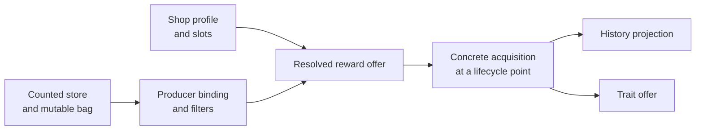

# Reward Model

## Purpose

This document defines the reward vocabulary shared by catalog declarations,
authored room state, simulation and the editor: what reward declarations mean
and how they compose from counted stores and shops through offers to concrete
acquisitions and history.

[Catalog Model](CATALOG_MODEL.md) owns declaration normalization. [Room
Lifecycle Model](ROOM_LIFECYCLE_MODEL.md) owns when a room invokes offer,
purchase and acquisition transitions. [Trait Offers](TRAIT_OFFERS.md) owns the
trait screens that acquisition roles open. [Simulation and
Validation](SIMULATION_AND_VALIDATION.md) owns transition evaluation, branch
composition and findings. The [reward
audit](../audits/rewards-and-acquisition/REWARD_GAME_DATA_AUDIT.md) records the
game evidence and the disposition of each audited mechanic; the biome
documents own their cage, wheel, Clockwork and Hub reward structures.

## Overview



- [Counted stores and bags](#counted-stores-and-bags) and
  [generated-door store resolution](#generated-door-store-resolution) decide
  which store an offer draws from.
- [Producers](#producers) bind a room or encounter to stores, filters and
  forced offers; [shops](#shops) are a separate producer branch.
- [Reward identities](#reward-identities) separate the offer from what is
  acquired and the history it writes.
- [Offer and acquisition](#offer-and-acquisition) settles reached acquisitions
  and generated pickups; [Trait Offers](TRAIT_OFFERS.md) settles the trait
  screens they open.

### Key terms

| Term                                                 | Meaning                                                                                            |
| ---------------------------------------------------- | -------------------------------------------------------------------------------------------------- |
| [Store entry](#reward-identities)                    | One member of a counted bag, consumed when an offer is generated                                   |
| [Resolved reward offer](#reward-identities)          | A reward type plus its complete payload at its resolution point                                    |
| [Concrete acquisition](#reward-identities)           | One most-concrete game identity acquired at a lifecycle point                                      |
| [History projection](#history-projection-profiles)   | The closed ledger writes of one concrete acquisition                                               |
| [Payload domain](#payload-domains)                   | The shape and local validity of an offer payload                                                   |
| [Source-support policy](#source-support-policies)    | How a source-bearing reward resolves its god source, and when                                      |
| [Acquisition role](#acquisition-roles-and-timing)    | A named identity a reward type resolves from its offer; the producer lifecycle binds it to a point |
| [Producer](#producers)                               | The declaration that creates an offer: `none`, `fixed`, `countedChoice` or `shop`                  |
| [Entered-store history](#entered-room-store-history) | The store an entered room records for the run-wide reward-store ratio                              |
| [Shop profile](#shops)                               | Ordered option groups realized as stable slots; entry-materialized inventory                       |
| [Offered-reward lookup](#offered-reward-lookups)     | Reward types offered elsewhere that selected shop entries consult                                  |
| [Settlement site](#offer-and-acquisition)            | The exact lifecycle point at which reached acquisitions apply                                      |

## Reward identities

The model keeps four close but non-interchangeable concepts separate:

`Store Entry`
: One concrete member of a counted bag. It owns multiplicity position,
requirements, `allowDuplicates`, and a reward type such as `Boon`. It is
consumed when the offer is generated, not when its reward is acquired.

`Resolved Reward Offer`
: The complete authored planner offer at its semantic resolution point. It
retains the reward type that explains store behavior and any complete payload,
such as `Boon` plus `ApolloUpgrade`. A payload may contain deferred planner
intent that is not yet game-visible, as for Blind Box. The offer is not itself
a claim that loot entered history.

`Concrete Acquisition`
: One most-concrete game identity acquired at a specific lifecycle point, such
as loot `ApolloUpgrade` or consumable `MaxHealthDrop`. One offer may emit zero,
one, or several acquisitions.

`History Projection`
: The declaration-owned closed profile applied when one concrete acquisition
occurs. It updates the exact loot/use ledgers for that acquisition kind and
belongs to the concrete acquisition identity, never to the store entry that
happened to produce it.

The core sequence is:

```text
StoreEntry(Boon)
  -> ResolvedRewardOffer(Boon, ApolloUpgrade)
  -> ConcreteAcquisition(loot, ApolloUpgrade)
  -> HistoryProjection(ApolloUpgrade)
```

`Boon` remains observable for bag depletion, room filters, reward-type
duplicates, and source selection. `ApolloUpgrade` is the concrete loot identity
observed by downstream loot-history requirements. Neither identity replaces
the other.

Counted rewards and shops share reward types and concrete acquisition
declarations but are separate producer branches. A shop is not a counted bag
with different presentation.

Offer identity, acquisition identity, and semantic effect are separate. Big,
Triple, and self-consumed wrapper variants retain the exact ledger keys written
by the game even when they have a related base effect. Spawn wrappers such as
`WeaponUpgradeDrop` and `ShopHermesUpgrade` remain exact offer identities but
resolve fixed concrete loot identities. A typed semantic-effect alias may
support deeper resource or trait simulation, but it cannot replace the ledger
identity consumed by requirements. Labels need only be unambiguous inside one
rendered option domain; changing a label does not migrate authored state.

### Acquisition roles and timing

A reward type names its acquisition roles and how each resolves an identity
from the complete offer. The resolution vocabulary is deliberately small:

- `self` resolves to the reward type's own game name and one declared
  acquisition kind;
- `fixed` resolves to one declared concrete acquisition address;
- `payloadSource` resolves one semantically named field from the reward type's
  typed payload domain.

Producer and encounter declarations bind the roles to lifecycle points.
Concrete acquisition declarations project history. No generic `acquiredAs`
alias or arbitrary payload-property path crosses those layers.

Reusable producer timing is normalized separately from reward identity. A
producer-lifecycle profile enumerates the reward types it supports, supplies
one default point for their roles, and may explicitly override the complete
role binding for a supported reward type. The `RoomReward` profile binds
ordinary roles to `roomRewardPickup`, while its declaration binds Devotion's
`chosenSource` to `beforeCombat` and `spurnedSource` to `afterCombat`. Catalog
normalization expands that declaration into one exact role-complete lifecycle
per supported reward type. It does not invent timing for reward types outside
the profile or dispatch on reward names in core code.

The reward type owns what can be acquired, but not when. Having no roles
represents a structural offer such as Story or Shop. The producer lifecycle
owns when each role occurs. The same concrete loot must not encode whether it
came from a room reward, a cage, a shop purchase, or a multi-stage Devotion.

A concrete acquisition may declare a pickup effect; Anvil of Fates
(`ChaosWeaponUpgrade`) is the only one. The reward that carries the acquisition
owns the effect's authored result on that role, wherever the reward settles: a
Shop slot, the Travel Deal refill, a Contract pedestal or a Gold Gold Gold
duplicate. Shop purchase versus later pickup is a settlement difference, not an
ownership difference. Role settlement applies the result only under the
`normal` disposition, since a Time Piece or Artificer conversion destroys the
object uncollected; an applicable missing result is `rewardMissing` and an
illegal one `rewardAcquisitionUnavailable`, both at the acquisition role.

Offer payload authorship and game-visible resolution timing are also separate.
Most payloads are both authored and resolved at offer generation. A Blind Box
instead resolves its source at acquisition. For optional generated pickups
such as Narcissus's drops, creation exposes the object, while timeline
participation activates its acquisition choices: source, trait offer, level
target and conversion. Their validation and candidates use the pickup's own
history, not the producer's. Removing a pickup may retain dormant choices for
reinsertion, but does not keep their findings or editing context active.
Initial Shop inventory likewise persists only the visible box identity, and a
participating purchase creates the acquisition entry that owns the eventual
source.

## Payload Domains

A payload domain owns the shape and local validity of one resolved-offer
payload. The supported domains are:

| Domain         | Value                                | Local rule                                   |
| -------------- | ------------------------------------ | -------------------------------------------- |
| `BoonSource`   | one source game name                 | source belongs to the declared source domain |
| `DevotionPair` | chosen and spurned source game names | both sources belong and are distinct         |

Payload domains do not know rooms, bags, topology, history, or UI widgets.
Every payload-bearing reward type declares a complete payload default.
`Boon`, `RandomLoot`, and `BlindBoxLoot` share the `BoonSource` value shape.
Their role and lifecycle declarations distinguish offer-time source resolution
from Blind Box's acquisition-time validation; a second payload domain would
duplicate shape without expressing that timing. The distinct
`BoostedRandomLoot` shop entry resolves an ordinary `RandomLoot` offer while
retaining its exact generated-item rarity context for the later trait-offer
ledger.

Defaults therefore recurse to a terminating value:

```text
RunProgress default entry -> ResolvedRewardOffer(Boon, ApolloUpgrade)
BoonSource payload default -> ApolloUpgrade
Boon primary acquisition role -> ConcreteAcquisition(loot, ApolloUpgrade)
```

An active payload is never empty. Replacing a reward type installs that type's
complete resolved-offer default atomically.

A resolved offer is one reward type plus its complete payload. Fixed reward
types may have payloads: a forced Devotion still needs its authored
chosen/spurned pair even though it does not come from a counted bag. Its
chosen source resolves to one concrete loot acquisition before combat and the
spurned source to another after combat; both precede downstream room
generation, but their roles remain explicit for execution intent.
Payload-free structural types such as `Story` need no authored leaf state and
emit no concrete acquisition.

## Source-Support Policies

A source-bearing reward type selects one normalized source-support policy and
one semantic resolution point. Payload shape alone is insufficient: the same
`BoonSource` value is supported differently for an ordinary door Boon, a shop
Boon, and a Blind Box. The policy vocabulary is closed:

`ordinaryBoonPeer`
: Resolve one ordinary source while its offer is generated. Within one door
batch, exclude sources already offered by earlier peers. The ordinary
four-source cap counts the union of acquired sources and those earlier peer
sources; once that union reaches four, the primary pool narrows to acquired
sources before peer exclusions are applied. Unpicked sources therefore affect
the cap and exclusion while remaining absent from acquisition history. If peer
exclusions empty the primary pool, game setup retries with weaker exclusions
and finally none; the unrestricted retry recomputes support without the peer
set. Source uniqueness is strict only while the primary pool remains nonempty.
A live Olympian keepsake's
[provider force](../audits/loadout-and-progression/OLYMPIAN_KEEPSAKE_AND_MOON_BEAM_REWARD_PRESSURE_AUDIT.md#ordinary-boon-source-selection)
replaces this resolution for a counted door or wheel Boon: its provider is
offered without the cap, and every other source is refused.

`ordinaryNoPeer`
: Resolve one ordinary source at the declared lifecycle point using current
ordinary-source eligibility and the four-source cap, with no generated-peer
exclusion. `BlindBoxLoot` uses it at its authored-source acquisition role after
purchase.

`ordinaryInteracted`
: Resolve one shop boon source during shop generation. Start from the
`ordinaryNoPeer` eligible gods (four-source cap, then declared loot
requirement) and intersect them with the gods picked up on the save file. When
that intersection is empty, every eligible god remains supported.
`RandomLoot` and `BoostedRandomLoot` use it.

`devotionAcquiredPair`
: Resolve two distinct sources from ordinary god loot already in the current
run's history at offer generation. The game first constructs the unordered
offered pair; the authored `chosenSource` and `spurnedSource` order records
which member is acquired before and after combat. Both ordered realizations of
any supported pair are possible. Ordinary generated-peer exclusion and the
four-source offer cap do not re-filter this already-acquired pair.

Ordinary policies apply each god's declared loot requirement after the
four-source cap; Hestia and Aphrodite require Poseidon or Demeter to have been
used on the save file. Save-file god history is derived, never authored: a
mature file is seeded with every ordinary god used and picked up, while a
closed file starts empty and accrues use at each real concrete god-loot
acquisition and pickup at each completed upgrade-screen selection. Offers and
trait removal change neither, and neither fills the current-run god pool.
Hermes remains outside the ordinary source domain.

The normalized bindings are:

| Reward type    | Source support         | Resolution point                 |
| -------------- | ---------------------- | -------------------------------- |
| `Boon`         | `ordinaryBoonPeer`     | offer generation                 |
| `Devotion`     | `devotionAcquiredPair` | offer generation                 |
| `RandomLoot`   | `ordinaryInteracted`   | shop offer generation            |
| `BlindBoxLoot` | `ordinaryNoPeer`       | authored-source acquisition role |

Catalog normalization rejects a source-bearing payload without both fields, a
source policy on a payload-free reward type, or an acquisition-role resolution
point that does not reference a role declared by that reward type. Simulation
dispatches through the policy registry; it never switches on reward names to
reconstruct source support.

## Offer Projections

Every generated offer emits the common canonical offer-history event. Counted
offers also consume one store entry, and batch-local source or duplicate rules
advance while peers are generated. Those are shared offer-point mechanics, not
reward-type history aliases.

A reward type declares an additional `offerProjection` only when merely
materializing that type changes a persistent current-run fact. The closed
vocabulary is `none` and `devotionSpacing`: Devotion's offer setup writes the
current `runDepthCache` to `lastDevotionDepth`, including when its target is
never entered. Later `minRoomsSinceEvent(Devotion)` requirements read that
offer-time marker. Neither chosen nor spurned acquisition owns it.

Encounter selection performed while setting up Devotion remains part of the
resolved offer and the room's concrete encounter composition. Presentation-only
global encounter records have no supported downstream consumer and are not
projected.

## History Projection Profiles

Every supported concrete acquisition selects exactly one closed history
projection profile. The profile is independent of acquisition `kind`: kind
identifies the concrete game entity, while the profile identifies the ledgers
written by its actual pickup path.

`lootAndUse`
: Increment current-run use, biome-use, current-room use, loot-type history,
and loot-biome history under the exact concrete loot game name.

`consumableAndUse`
: Increment current-run use, biome-use, current-room use, and consumable history
under the exact concrete game name.

Most loot uses `lootAndUse`. `SpellDrop` is deliberately a `loot` acquisition
with `consumableAndUse`: its custom spell-screen path records use and
`CurrentRun.ConsumableRecord`, but does not write `LootTypeHistory` or
`LootBiomeRecord`. Ordinary consumables and resource pickups also use
`consumableAndUse`. Resource identity remains explicit through acquisition
`kind`; resource quantities follow [resource
quantities](#resource-quantities), and affordability remains deferred.

The planner does not project persistent `GameState.UseRecord`; save/profile
history is outside the project input boundary. It also does not collapse Big,
Triple, self-consumed wrapper, or random-Stack identities to a semantic base
name. Ordinary god loot resolves its trait-bearing role through the
[equipped-trait ledger](TRAIT_OFFERS.md#equipped-state-and-acquired-effects).
Devotion's chosen and spurned roles retain their distinct lifecycle points, and
Hermes remains a separate provider. Other health, mana, armor, resource, Stack,
Talent, weapon-trait, and Last Stand effects remain governed by their
documented simplifications or deferrals rather than hidden projection aliases.

## Counted Stores and Bags

A counted store declaration owns:

- a stable `storeKey` such as `RunProgress` or `MetaProgress`;
- the ordered game bag entries, including multiplicity;
- entry-level current-run requirements;
- entry-level `allowDuplicates`, defaulting to `false`;
- optional entry-level `routeKeys`: the routes whose bag holds the entry, so
  fill and refill skip it elsewhere;
- one explicit default reward type and complete offer payload for authoring.

The catalog exposes an immutable option domain from that declaration. The
simulator creates a mutable scratch bag for one route simulation. Exact store
provenance is resolved by the owning generated batch or fixed producer and is
carried by canonical offers. A counted room leaf authors only its complete
resolved offer; it is not a second store authority.

Counted bag consumption occurs when an offer is generated, including unpicked
targets. RunProgress Boon entries allow duplicate reward types; ordinary
non-Boon Run entries and MetaProgress entries do not. Repeated Boon reward
types are separate from source selection, which follows the offer's
[source-support policy](#source-support-policies).

Repeated bag entries do not duplicate editor options. Their multiplicity and
requirements remain available to simulation. When several eligible entries can
produce one authored value, possibility simulation preserves every distinct
reachable post-consumption bag state. A store may explicitly certify repeated
same-name entries as interchangeable when their simultaneous eligibility makes
their remaining exact identity permanently future-neutral; those transition
results collapse by aggregate count. Uncertified entries remain distinct. This
canonical representative does not invent a deterministic declaration-order
tie-breaker for the game's random choice.

When no entry in the entire bag is eligible, the game appends a complete base
set without discarding ineligible leftovers. It can do this twice. If no entry
is eligible after the second refill, the offer falls back to
`RoomRewardHealDrop` without drawing from the bag, which keeps both appended
sets. This is one global picker rule, not repeated store data: the reward
kernel declares `countedStoreFallbackRewardType`, and every bag-drawn counted
binding admits it regardless of its room filters. The simulator reproduces the
rule for every store and route; an appended set holds only the route's
entries. The fallback is an ordinary `RoomRewardHealDrop` offer for
acquisition, Run State and peer duplicate blocking. An offer other than the
fallback on an exhausted bag reports `rewardBagSupportEmpty`.

The reward audit's [refill
proof](../audits/rewards-and-acquisition/REWARD_GAME_DATA_AUDIT.md#refill-reachability-proof)
establishes that a mature-save route always finds an eligible entry after the
first refill, so mature bags never reach the fallback and their counted-reward
domains omit it. A fresh profile's MetaProgress bag can exhaust, and its
domains list the fallback. The normalized `MetaProgress` store is the game's
complete 19-entry store with its lifetime-resource tiers expressed through
`resourceGains`; a mature bag holds the thirteen route-filtered entries it can
draw, and the [audit](../audits/rewards-and-acquisition/REWARD_GAME_DATA_AUDIT.md#metaprogress)
owns the tier arithmetic.

## Producers

The semantic producer kinds are:

`none`
: Produces no modeled reward and owns no reward state.

`fixed`
: Produces one declared reward type. It authors only that type's offer payload,
when present.

`countedChoice`
: Authors one complete resolved reward offer from the store resolved at its
offer point.

`shop`
: Declares an entry-materialized [shop profile](#shops). Its owning occurrence
authors complete offer and purchase state only when picked for entry; it does
not carry a counted `storeKey`.

A counted-choice binding names its accepted `storeKeys` and optional
`eligibleRewardTypes`, `ineligibleRewardTypes` and `defaultRewardTypesByStore`.
The effective static domain is:

```text
union of referenced store members
intersect eligibleRewardTypes when non-empty
subtract ineligibleRewardTypes
```

Filters apply to reward type names, not Boon source names. Positive and
negative filters cannot overlap. Every referenced reward must exist and every
positive member must be produced by at least one referenced store. Filtered
bindings do not create named surface types: there is no
`RunProgressNoDevotion`, `TartarusBoonOnly`, or similar public taxonomy.
History-dependent bag-entry requirements remain visible in the normalized
binding provenance but do not remove options from the static authored domain;
the simulator evaluates them.

A counted binding may also declare the room's source `ForcedRewards`: complete
offers, each with an optional requirement over the offer contact's reward
facts, including save-file god records. At offer time the first entry whose
requirement holds is the only supported offer; it records offer history
without drawing the bag or consuming a reward priority, as native
`ChooseRoomReward` returns it first. Another authored offer reports the
ordinary unavailable-offer finding. When no entry holds, the counted draw is
unchanged. Each forced offer must be an allowed, locally valid offer.

The binding's `storeKeys` declare which resolved store contexts the producer
can accept. They do not select the active store and do not own a default store.
New generated batches receive their base-store default from the biome layout
policy. A target reward default normally comes from its currently resolved
store. When a room's positive or negative filter removes that store default,
`defaultRewardTypesByStore` must name an allowed member of the same store. This
is only a complete leaf-initialization default; it neither changes bag order
nor creates a second store-selection authority. Tartarus Boon-only minibosses
use this form while ordinary I combat retains the Tartarus store default.

Fixed and forced producers do not borrow requirements from a same-named
counted bag entry. A forced Devotion is validated as a fixed Devotion producer,
not through `Devotion`'s `RunProgress` bag-entry requirements.

Concrete producer bindings belong to Room Declarations and their biome
authorities. Every target Room Declaration embeds its applicable producer
binding and forced-store override. Shared code consumes that normalized fact
and never switches on room name or biome to reconstruct it. Biome slices add
structural composition around these producers—`localSlots` for H cages and N
side rooms, a derived incoming realization for the I Goal/NonGoal branch, and
`offerPoint` for O encounter wheels—without redefining bags, reward types,
acquisitions, payloads or peer/history validation. The
[H](../biomes/H_GAME_RULES.md), [O](../biomes/O_GAME_RULES.md),
[I](../biomes/I_GAME_RULES.md) and [N](../biomes/N_GAME_RULES.md) rules own
those structures.

### Authored and materialized counted offers

A counted room leaf authors one complete resolved offer. Canonical
materialization combines it with the store resolved by the owning offer point
into `{ storeKey, offer }`.

Changing an authored generated-batch base store retains its target resolved
offers. Changing a source-offer-point store likewise retains the outgoing batch
and target resolved offers. The next simulation may report a retained offer as
unavailable from its newly resolved store; it does not silently replace
authored intent. Changing a reward installs the selected reward type's
declared offer-payload default. The editor may retain inactive bounded state
inside a later structural wrapper, but every active counted choice is a
complete resolved offer.

Incoming and free-reward leaves materialize on the physical door and therefore
remain complete, offered facts even when their target is unpicked.

## Possibility Contract

Reward simulation models possible outcomes, not their probability.

For a store-selection ratio or chance value `p`:

- `p <= 0` makes the corresponding outcome impossible and its alternative
  forced;
- `0 < p < 1` keeps both outcomes possible;
- `p >= 1` forces the corresponding outcome.

The authored project selects one concrete outcome from the resulting support
set. Validation rejects non-membership; it does not grade possible outcomes by
likelihood. Store-entry multiplicity still matters because offers consume bag
entries and change later support, not because the app computes a probability.

## Generated-Door Store Resolution

[Game Generation Rules](GAME_GENERATION_RULES.md) owns when physical target
creation and reward assignment occur. This section owns the reward-store
algorithm applied at that point. Possibility-only evaluation and this
base-store/resolved-offer split apply to every biome; route-specific topology
does not change them.

A generated batch's base store follows one of three biome layout policies:

- **Authored.** An ordinary batch owns one authored `baseRewardStoreKey` only
  when its policy exposes an otherwise-unrepresented observable generated
  store. The policy derives the possible base-store set from current history,
  and validation proves that the authored value belongs to it.
- **Source offer point.** An O ShipCombat batch reads the concrete
  RunProgress/MetaProgress store of its final active wheel, which the game
  reuses for outgoing generation; the batch authors no duplicate value
  ([O rules](../biomes/O_GAME_RULES.md#shipcombat-phase-and-wheel-contract)).
- **None.** A reward-free batch such as Q's combat spine, or a batch whose
  every target resolves declaration-owned provenance (H Fields, I Clockwork,
  the N Hub), authors no base store. Forced or individual target stores still
  produce resolved offers, so Q miniboss targets can use `TyphonBossRewards`
  without inventing a RunProgress or MetaProgress batch value.

The game then resolves actual target stores in two physical-order passes:

1. resolve the initial base store from the authored batch value or addressed
   source offer point when the policy exposes one;
2. scan targets and let each valid `ForcedRewardStore` replace the working
   shared store, so a later forced target can affect earlier ordinary targets;
3. resolve every target using its `IndividualRewardStore`, otherwise its own
   valid `ForcedRewardStore`, otherwise the final shared store.

The Room Declaration owns forced or individual overrides. A generated batch
owns the base store only under the authored policy; a source-offer-point policy
reads the room-owned store without moving its authority. Each room occurrence
owns only its concrete authored reward. Canonical materialization publishes the
final shared store on the batch and records the resolved `{ storeKey, reward }`
offer for every rewarding target, including fixed producers whose resolved
store still contributes to later entered-room store-ratio history. A target
with no producer and no resolved store emits no reward offer. No supported F/G
room uses `IndividualRewardStore`; H's biome-wide pin is described in the
[H rules](../biomes/H_GAME_RULES.md#fields-constraints).

The engine publishes what entering each exit of a batch records for the store
ratio—a store, nothing, or not yet resolved—for every normal target and
additional exit, and marks the selected one. It reads the authored batch
through the same shared-store pass before evaluation, and the materialized
rooms' entered stores after it. A normal door records its resolved target store
under its room's entered-store history policy; an additional exit records its
own room's store, since that room receives no door store.

### Entered-room store history

Reward production and entered-room store history are related but separate
declaration facts. Every concrete Room Declaration selects exactly one history
policy:

`resolvedOffer`
: Record the store resolved by the owning generated offer point. This includes
fixed Story and Shop producers created from a generated batch.

`fixed`
: Record one declared store independently of generated-batch resolution, when
the game explicitly assigns a store independently of ordinary door generation.

`none`
: Record no store contribution even when the room has another fixed
acquisition, or because it produces no reward. This mirrors the game's
`IgnoreForRewardStoreCount` rooms.

The simulator never infers this policy from room name or visible reward kind.
A resolved store is bookkeeping provenance, not a claim that a visible reward
was drawn from that store's bag. Linked G/P boss doors first receive a
RunProgress or MetaProgress store; automatic Mixer and weapon-dependent drops
then occur outside the modeled reward surface, and the entered boss still
counts under that resolved store in the game's ratio ledger. Modeling that
ledger effect needs no boss reward types, leaf state, bag depletion, concrete
acquisitions, history projection or editor controls. The biome documents name
each room's policy.

## Rerolls

A door, Fields cage, ship-wheel or Hub board-door reroll press is a real draw:
it takes one more entry from the target's own store, with the store's refill,
`RewardPriorities` and other side effects, and never returns the entry it
replaced. Its candidates follow the ordinary door legality, excluding the
target's first-drawn reward and every door's (wheel offer's, cage's) current
reward at that moment. The target's current reward after its last press is
what it offers onward: the next room's incoming reward, the entered reward,
the wheel offers or the cage rewards. Each press costs 1 from the run's reroll
pool and needs a held card that enables door rerolls.

A door is rerollable when it allows a reroll or its destination forces one,
the destination does not refuse rerolls, and its first-drawn reward is not a
type that blocks them (`Shop`, `ClockworkGoal`). The rule is read when the
doors unlock, and a press is legal only on a room's first visit. Ephyra side
and return doors and Story, Shop and Boss destinations never reroll; O and Q
exits into their Mini-Boss and Reprieve rooms do. Hub board doors may be
pressed in any Hub stay while their room is unentered: a restore re-assigns
every unentered door its persisted offer without a store draw, so a press
excludes that offer and the current rewards of the doors still open, and
overwrites the persisted offer for later stays.

The run's reroll pool counts every equipped reroll card at run start, a
mid-run card grant's full amount, a Circe rarity upgrade's difference and
Narcissus's collected reroll pickup, less every spend: door presses, screen
rerolls and Well and Pool rerolls. While Barren removes the enabling card no
reroll kind is enabled; the pool is unchanged. A new spend that the pool at
its own point cannot pay is refused as a fixed budget; an earlier spend takes
precedence, and later spends it starves are kept and reported over the pool.
Screen rerolls draw nothing from any store. The
[arcana audit](../audits/loadout-and-progression/ARCANA_AND_FEAR_GAME_DATA_AUDIT.md)
owns card amounts.

## Hidden return-door draws

When an `N_Combat*`, `N_MiniBoss*` or `N_Sub*` room first unlocks its doors,
its hidden return door is filled before any side door, as an ordinary door the
player never sees. `ChooseNextRoomData` creates a placeholder room (from the
`N` set for main rooms, `N_SubRooms` for side rooms) that counts toward its
creation cap, and unless the placeholder's fixed or Shop reward returns first,
one reward is drawn from the placeholder's own store (HubRewards for a combat
room, RunProgress `Boon` for a Mini-Boss, the side-room store for a side room)
with every native side effect: removal, refill, `RewardPriorities` and
Devotion depth. A Boon draw takes the first eligible god. Revisits never draw.
The planner's per-biome appearance cap does not apply, so a visited combat room
is a legal placeholder; bosses and `N_PostBoss01` never are.

An unpinned placeholder settles to the first eligible room in declared set
order, the no-draw `N_PreBoss01` first for main rooms, so it needs no profile
predicate; an unpinned reward settles to the type every branch can draw with
the most entries left in the placeholder's store on its scarcest branch, ties
in declaration order. Board doors left unopened are not modelled as
creations.

## Offered-Reward Lookups

Two lookups record reward types offered elsewhere. They are separate from
counted-bag depletion and acquisition history, and are not global reward bans:
inventory-entry declarations select their consumers.

The run-persistent `hubRewardLookup` receives every open offered reward type of
the completed N Hub board at departure, including unvisited doors
([N rules](../biomes/N_GAME_RULES.md#persistent-board-generation)). Inventory
validation and candidates consume its exact generation-time snapshot,
including Travel Deal. The early Hammer entries of `WorldShop`, `I_WorldShop`
and `Q_WorldShop` and the Spell entries of the ordinary `WorldShop` and the
Hermes Shrine consult it; I/Q Spell entries do not.

The transient per-map offered set is its short-lived neighbor. The transition
into a room offers reward types on every door of its batch, chosen or not,
including Fields cage identities; the branch state publishes that set when the
batch's last target completes generation and clears it at room entry, before
the entered room generates anything of its own. Its only consumer is the
ordinary World Shop Spell entry. A shop's own outgoing offers may constrain a
later restock but never that shop's initial inventory, which the World Shop
lifecycle orders before entry.

## Shops

This section owns shop inventory: profiles, groups, slots and option identity.
[Room Lifecycle](ROOM_LIFECYCLE_MODEL.md#world-shop) owns when inventory
materializes and purchases settle.

Shops are assembled from reward types through option entries, ordered groups,
and profiles:

```text
reward type -> option entry -> ordered group -> stable emitted slot -> shop profile
```

A shop profile owns ordered groups. Each group declares its eligible option
entries, per-option current-run requirements, and `offerCount`. Selection is
without replacement inside one group. Positive option weights affect
probability only and do not enter possibility validation. An option entry
names one reward type and may carry a requirement and a sparse boon-rarity
override.

Every emitted slot is explicit declaration data rather than an index
synthesized from group order: a stable semantic key, presentation label, group
key, default option key and the resolved default offer it selects. The ordered
slot `groupKey` sequence must exactly realize every group's `offerCount`, and
defaults in one multi-offer group must select distinct option entries.

Entry keys remain distinct when the same reward type appears with different
requirements or effects. Authored Shop state stores, for each slot, the exact
option key and the complete resolved reward, plus an optional Travel Deal
refill. A null option key is a repairable state, not a second way to author
inventory. Simulation validates the exact options jointly against eligibility
and without-replacement selection.

Native `FillInShopOptions` appends a group only when some option is eligible,
with no replacement or minimum fill. The engine's inventory assessment
therefore classifies each declared slot in its generation context as
`complete`, `validEmpty` (its group has zero eligible options and the slot is
unset), `incomplete` (eligible options exist but nothing is authored) or
`selectedInvalid` (the authored item is not eligible; it is retained for
repair). Valid emptiness is derived, never authored: it reuses the nullable
slot value and keeps the declared slot and its address. An empty slot emits no
item, offer, spawned pickup or purchase, the editor omits it, and existential
candidate completion treats an empty group as complete. Generation witnesses
keep declared slot order with a null option key at each empty slot. Only zero
eligible options is modeled; a group with fewer eligible options than its
`offerCount` is not.

`RandomLoot` and `BoostedRandomLoot` remain distinct shop-option entries. Both
resolve the same authored `RandomLoot` plus source shape, but only the boosted
entry carries its sparse item-owned boon-rarity override. The authored option
key selects that identity, the derived generation witness confirms it, and
later trait offers consume the exact item context. The reward model does not
infer that context from a Shop profile, biome name, slot, or entered-biome
count.

### Profiles

The ordinary `WorldShop` has three one-offer groups and therefore three stable
slots labeled `Offer 1` to `Offer 3`; internal slot keys may remain
category-bearing without leaking into presentation. `I_WorldShop` has five
one-offer groups. `Q_WorldShop` has six slots because its first of five groups
emits two distinct offers.

`WorldShop`, `I_WorldShop`, and `Q_WorldShop` are distinct profiles. Their
early Hammer entries consult the [Hub lookup](#offered-reward-lookups); the
late entries retain independent acquisition-count and ordinal requirements.
These entry-owned rules apply wherever the profiles are used, not only in N
preboss. `I_WorldShop` and `Q_WorldShop` consume the normalized entered-biome
requirement at entry: counts through 2 admit first-half option entries, counts
from 3 admit second-half entries, and phase-independent entries remain
available. Requirements are conjoined at the option entry, so existing Hammer,
Hermes, Spell, Talent, Last Stand, and other guards remain authoritative. Group
and slot cardinality do not change; Q's first group still selects two distinct
option keys without replacement after phase filtering. The evaluator supplies
the resolved itinerary ordinal as `enteredBiomeCount` and the saved route
identity for mode-conditioned option membership. The same facts govern initial
inventory and the captured Travel Deal generation contact; neither is inferred
from the physical biome. The exact generated option identity is also the
source witness consumed by the offer-local boon-rarity ledger.

Shop requirements that inspect the current shop (`notInCurrentRoomShopOptions`
for Hammer, Hermes, Spell and Talent entries) see the complete generated
inventory, not a post-purchase remainder; this query is not a counted-store
lookup.

### Entry materialization

Shop state is entry-materialized rather than door-offer state. Every picked
shop occurrence must own a value for every slot in its declared profile,
complete except where the slot is validly empty. An unpicked shop occurrence
may omit that state entirely; if it was previously picked, the authored project
may retain its complete value dormantly. Selecting an unconfigured shop
occurrence as the picked target atomically installs the profile's recursive
defaults. Materialization ignores shop state on every unpicked occurrence.

Exact prices, money, health, last-stand inventory, discounts, and affordability
are deferred. The model authors purchases under a sufficient-resource and
valid-use assumption. This deliberately admits some purchases that one concrete
resource state could not make; it does not weaken offer-generation requirements
or downstream acquisition effects.

### Purchases and payloads

Purchase participation and chronology are the exact `interactShopOffer`
references in the occurrence's one `roomActions.order`; the [Authored Project
Model](AUTHORED_PROJECT_MODEL.md#occurrence-state-and-replacement) owns that
membership and [Room Lifecycle](ROOM_LIFECYCLE_MODEL.md#room-action-order) its
ordering semantics. An empty order is complete authored state for an optional
Shop; references control purchase, not whether an inventory offer exists.

A Shop Blind Box slot persists only `BlindBoxLoot`. Selecting its purchase
creates the acquisition entry where the eventual `BoonSource` and trait screen
are authored. Shop settlement owns only inventory membership, purchase
requirements and purchase order; after that gate succeeds, ordinary acquisition
settlement resolves the Mystery source and trait outcome, evaluating the source
against history from earlier authored actions within the one fixed order and
retaining ordinary source possibility branches. Removing the purchase clears
that child atomically and retains inventory.

Payload and order are deliberately separate. For fixed Shop, Shrine and Well
slots, Overview inventory owns reward identity and its Purchased marker, while
the participating action row owns chronology, Shrine rush and acquisition-time
resolution children. Generated pickup entries whose payload is owned by the
action row retain the full reward editor there.

### Contract pedestal

The Zagreus Contract pedestal is a Preboss room feature, spawned at room start
in every Preboss that declares a pedestal destination while the hero holds
`InfernalContractBoon`, whatever the room's reward: the boon-form F, G, H and P
Prebosses as well as the Shop-form N, O and Q ones. It never reads the room's
reward or store, and the Shop form keeps its own inventory unchanged. Its one
item comes from `ZagPedestalOptions` without touching any Shop profile's slots
or group rules; its activation and concrete item are captured at room start,
separately from its optional `roomExit` acquisition. An active pedestal
requires an authored reward identity even when left uncollected. Collection is
its own free acquisition: it triggers neither Travel Deal nor Gold Gold Gold.
Native store objects cannot duplicate via Sea Star; eligible pedestal Poms and
Paths may still be converted with Time Piece.

The candidate frontier uses those frozen generation facts: buying the first Hex
in the same Shop cannot enable an initial pedestal Path of Stars. Mystery Boon
source resolution and trait/level choices remain acquisition-owned; an
uncollected pedestal requires none of them. A missing or generation-invalid
item points to the pedestal owner, not its optional pickup action.

### Refills

Travel Deal is dynamic inventory in the Shop's `travelDealRefill`, outside the
initial profile's slot counts. It is a paid replacement derived after the first
accepted paid acquisition when Travel Deal was already equipped. Its exact
option is validated against the captured source group and post-trigger
generation context; structural commands and decoding use only the host
profile's option domain. It uses the ordinary reward editor, is edited on the
Room Timeline under the purchase row that triggers it, and keeps its
`interactAcquisitionEntry(roomExit, travelDealRefill)` participant.
Non-Mystery children remain on the refill slot; a Mystery's sparse acquisition
child exists only while purchased and resolves against the later
pre-acquisition context, not the refill-generation context.

A Shrine of Hermes refill is caused by the first rushed initial
`purchaseHermesShrineOffer` in timeline order made while every branch holds
Travel Deal, when it closes the Shrine screen, not by collecting the rushed
item; a rush without the trait leaves the refill to a later rush. The refill is
realized at that purchase, replaces its slot, and removing the optional rushed
pickup leaves the refill and its own delivery intact. Reordering or re-rushing
purchases, or gaining Travel Deal earlier or later in the room, can change the
source; a retained refill item outside the new source's group is kept and
reported `hermesShrineTravelDealRefillUnavailable` at the refill offer. A
purchased refill ranked before any rushed initial purchase, or before any rush
made with Travel Deal, keeps its item and reports the same finding at its
purchase row with reason `noRushedPurchase` or `travelDealInactive`. Authoring
keeps the refill purchase after the first rushed initial purchase only, since
trait state is a simulation product.

Refill activity comes from the reached simulation capability, not the presence
of retained authored refill detail. Clearing the triggering Shop/Well purchase,
or changing a Shrine rush to delayed or unpurchased, leaves an unused refill
dormant. Its saved choice neither creates a finding nor publishes a refill
transaction, and the editor hides the inactive row once assessed. Restoring a
qualifying trigger reuses that choice. A retained refill purchase still needs
its repair control; hiding dormant detail must not hide an authored
interaction. The same capability boundary governs Contract pedestals: retaining
an unpicked reward after losing Infernal Contract does not publish a pedestal.
A selected stale pickup remains a validation finding and a repairable authored
action.

Gold Gold Gold is a free pickup under the `roomExit` acquisition site, derived
from the first accepted paid non-`SpellDrop` purchase while its one-use Echo
trait is equipped; see [Echo](#echo).

## Offer and Acquisition

Offer and acquisition are separate facts:

```text
source generates incoming reward  -> resolved_reward_offer.emit
producer reaches lifecycle point  -> concrete_acquisition.emit
picked shop room enters           -> resolved shop offers become active
purchased shop slot               -> purchase-time concrete acquisition(s)
```

Every generated peer occurrence contributes its complete resolved incoming
offer and counted-bag consumption, including unpicked peers. Only the picked
and entered occurrence advances its producer's acquisition lifecycle. That
lifecycle may resolve zero concrete acquisitions, as for Story and Shop, or
several at different points, as for Devotion. A shop exposes its resolved
offers only on entry and advances exactly its purchased slots through
purchase-time acquisition.

The lifecycle point is producer-specific. A normal room reward emits its
concrete acquisition on pickup, a Devotion emits its chosen and spurned source
at distinct points, and a purchased Blind Box first emits its box use and then
validates and emits its authored hidden source. The concrete acquisition
declaration then projects the typed history writes. Store-entry identity never
enters history through an implicit alias.

Every reached concrete acquisition is applied through one canonical settlement
product. A settlement site is the exact lifecycle point inside its occurrence,
local reward, wheel, or Hub visit. Each entry retains its producer-owned
source, declaration-owned acquisition roles, participation, and chronological
address. The reward kernel remains the sole authority that turns those roles
into loot/use history, trait acquisition, and level effects. Required and
optional entries share the occurrence's one `roomActions.order`; no producer
owns a parallel purchase or pickup order
([Room Action order](ROOM_LIFECYCLE_MODEL.md#room-action-order)).

Run start separates these owners explicitly: Loadout stores the starting offer,
and the first entry occurrence stores its acquisition payload. The catalog's
single run-start binding supplies the offer domain without requiring a room
variant. Selecting that offer does not acquire it in Loadout. Entry realization
composes the two authored products at the existing room lifecycle contact;
offer findings address the route source, while acquisition findings retain the
room-owned address. Later entry occurrences do not bind the starting offer.

### Generated pickups

Declaration-produced and interaction-produced pickups use the same settlement
site and action order. Narcissus, Quick Buck, Buried Treasure, Artificer, Echo
last-reward, Sea Star, and Nemesis random-event results differ only in their
source owner, lifecycle binding, and requiredness; each generated entry is
still one ordinary concrete acquisition. Nemesis's free-item and contest
results are optional, while an accepted trade result is required after its
required encounter interaction. Quick Buck and Buried Treasure entries are
optional. Artificer replacements and fresh full-Pom Sea Star duplicates are
required. A spawned pickup owns its exact authored reward and acquisition-time
children at the site; the action row references that payload owner and does
not duplicate its editor.

Narcissus demonstrates the producer/acquisition distinction. The selected
player-rarityless trait enters equipped history and may emit zero or more
declaration-owned pickups at the Story room's post-outgoing `roomExit` site.
Its producer descriptor owns no separate nested outcome control. A random Pom
target or Mystery Boon offer belongs to the concrete produced pickup and is
evaluated only when that entry participates in the site's exact order. Ashes,
Psyche, and Bones are independent concrete pickups beside Max Magick, Max
Health, and Death Defiance; Psyche owns ordinary consumable/use and
last-reward history but no counted-store membership.

Eris's gift uses the `ErisCursePickup` producer: one required pickup generated
at the `erisGift` site of a Fresh File intro by her talk
([Fresh File rules](../biomes/FRESH_FILE_RULES.md#eris-at-a-biome-intro)). The host declares
the gift (Ashes in G, Psyche in H, Bones in I); the producer carries the native
overrides (20 Ashes, 300 Bones; H's native 50 Psyche is untracked and declares
no amount), `resourceBonusExempt` for `NPCDrop`, `duplicationExempt` for
`CanDuplicate = false` so Sea Star never duplicates it, and Artificer-blocking
bindings for `MetaConversionEligible = false`.

Paid Shop entries are a different lifecycle: purchase is their sole atomic
interaction and cannot open Time Piece, Artificer, Sea Star, or another
post-purchase pickup action. This applies to Shop Poms too: their declaration
can be duplicable in a free lifecycle, while the paid instance cannot
duplicate. A Shop room may nevertheless contain a separate free
acquisition-entry pickup; that entry is evaluated from its own source lifecycle
and can expose the ordinary pickup alternatives.

### Resource quantities

Resource quantity is a fact of the produced object, not of its acquisition.
When a resource pickup spawns—an incoming reward at its encounter's end or
start, a Ship wheel reward, Fields cages and optionals at entry, World Shop
items at entry, a Gold Gold Gold duplicate or Travel Deal restock, or the
generated pickups of a completed screen (Buried Treasure's gift, Echo's last
reward), after that screen's selection is equipped—its amount is resolved from
the declared grant, the producer's override or `NPCDrop` exemption, and the
resource bonuses equipped then, rounded per object. The branch keeps that
amount by room until the object is collected or the room is exited. Only
producers with no earlier native spawn contact resolve at collection: Hermes
deliveries, Nemesis results, Artificer replacements and Blind Box hidden loot,
none of which grants a tracked resource. Eris's gift spawns natively through
`GiveRandomConsumables` when her talk ends, but it is bonus-exempt, so its
fixed override resolves identically at its collection.

Each normal acquisition credits the stored amount to the reward history's
`resourceGains`; a Sea Star-retained object keeps its amount for the
duplicate. Time Piece and Artificer destroy the object without a credit,
nothing debits gains, and a mature file starts at zero. Gains reach requirement
contexts as the summed `resourceGains` record, so outgoing generation sees only
acquisitions settled before its checkpoint. Only declared grants (Ashes and
Bones) are tracked; Psyche has no declared grant and is untracked, not zero.

### Acquisition dispositions

Normal acquisition, Time Piece, and Artificer are one mutually exclusive
disposition on each exact acquisition role. Artificer is supported only for a
free eligible concrete instance. A successful conversion consumes one use and
one exact currently reachable `RunProgress` bag entry with Devotion and Spell
excluded, records the replacement offer, and destroys the source without
folding its acquisition history. The complete replacement remains a separate
source-owned entry and reaches this same concrete-acquisition fold only at its
later required or optional checkpoint, within the declaration-owned lifecycle
window. No pending registry, private order, or second bag transition exists.

A retained Sea Star consumable/resource duplicate keeps the exact source
participation, producer-lifecycle conversion capabilities, and concrete
identity for its second use; only its Sea Star capability is cleared. A fresh
full Pom instead uses the `RoomReward` lifecycle with fresh unresolved Pom
detail and no copied Shop or source payload state.

### Keepsake outcomes

Only equip outcomes are persisted beneath a keepsake selection. Jeweled Pom,
Experimental Hammer and Transcendent Embryo use one closed
`KeepsakeEquipResultAddress` family with effect-specific complete children; the
Embryo's later transformations are
[timed outcomes](TRAIT_OFFERS.md#timed-outcomes) beside its marked blessing.
The result is reached on start or replacement. A route-start result is dormant
while another starting keepsake is selected; a rack result does not survive a
change of the rack's keepsake. Calling Card row actions stay on their exact
trait offers, Time Piece conversion choices on exact acquisition roles, and Fig
Leaf/Gorgon results on exact encounter phases, so every authored effect
decision has one semantic owner rather than a keepsake-owned result bag.

Gorgon Amulet owns one strict phase-local Athena child. It persists only three
ordered distinct Athena trait identities and the selected option key. Athena
provider, offer kind and reached rarity are derived; the Death Defiance
condition (`athenaTriggerConditionMet`, an observed game condition the planner
does not simulate) remains on the parent Gorgon phase. Keepsake rank and the
result of Cherished Heirloom are never authored: ordinary selection is fixed
at Epic and simulation derives both Cherished transitions from catalog facts
and canonical trait history.

### Echo

Echo's active authored children add no generic effect-state container. Pom
persists one selected greatest-level target or the explicit empty-domain
`null` result. Boon persists one to three distinct trait-key rows whose giver
identity and equipped rarity are explicit, plus only the selected trait's
declaration-owned acquisition detail. Reward persists only the exact recreated
acquisition's conversion, trait-offer and level children; the replayed source
descriptor remains derived history. Gold uses the sole stable
`echoDoubleShopReward` key: its complete payload may persist sparsely in
`pickupEntries` before participation, and it enters the Shop's
`roomActions.order` only when picked up. No source selector or source-keyed
Gold child is persisted. Gift's captured keepsake, replay schedule and replay
count remain chronological trait history; only a reached Experimental Hammer
replay persists its selected-compatible or explicit exhausted result beneath
that succeeding biome's start address. Dormant Echo option detail remains
structurally retained but is not active authorship.

Echo also reuses the acquisition boundary in two ways; the
[acquisition audit](../audits/rewards-and-acquisition/ACQUISITION_DELIVERY_AND_ROOM_SETTLEMENT.md#echo-reassessment-after-current-settlement-delivery)
owns the native contacts.

Reward Reward Reward reads the latest successfully settled acquisition whose
concrete declaration opts into last-reward replay, then creates one mandatory
Echo-room acquisition from that exact recreation descriptor. A loot source owns
a fresh offer and a consumable reuses its ordinary pickup path; replay does not
synthesize a generic Boon, Pom, or consumable alias. That fixed replay identity
is effective without a separate authored confirmation. If earlier history
changes it, the new identity replaces a retained stale payload in evaluation;
its children start unresolved rather than carrying choices from a different
reward. The first child edit atomically saves the current identity and its
outcome. Only a replay source that cannot be agreed across branches blocks at
this contact. `SpellDrop` has no last-reward recreation descriptor, so a settled
spell selection never becomes the replay source; `TalentDrop` retains its
declaration-owned descriptor. This is an acquisition-catalog and reward-history
boundary, not an Echo presentation filter.

Gold Gold Gold observes the equipped one-use Echo trait while folding a World
Shop's authored order: once the Shop kernel accepts the first paid
non-`SpellDrop` source, Gold is consumed and the singleton free duplicate
materializes before that paid entry's acquisition roles run; a pre-kernel
rejection leaves Gold armed. Materialization does not acquire the duplicate,
and Gold may retain its complete free-pickup payload before participation. A
duplicated Anvil is a second Anvil use with its own result, assessed against
the branch after the paid Anvil settles. A native loot duplicate (Boon, Hermes,
Hammer, or full Pom) requires pickup; a consumable duplicate, including an
unopened Mystery Boon, may remain unpicked. An edit that newly makes the pickup
required inserts its Timeline membership even before the paid source's child is
resolved; the [Authored Project
Model](AUTHORED_PROJECT_MODEL.md#occurrence-state-and-replacement) owns those
commands and their restore and repair rules.

Both paths keep acquisition-time choices with the reached concrete entry. Blind
Box recreation retains the box as the acquisition while resolving a fresh
hidden source independently; a Gold duplicate of Nectar follows the Shop
duplicate profile and does not invent the run-progress Pom effect. That effect
is route-conditioned: a route whose profile lacks
`WorldUpgradeGiftDropRunProgress` (Fresh File) gives Nectar no level, so its
reward state has no level-resolution child and a persisted one is rejected at
decode. Commands, decoding and settlement evaluate the effect with the route.
Missing or context-invalid active children remain exact finding-backed repair
owners, while dormant or not-yet-generated entries publish no acquisition
child. Recreated and duplicated loot follows the trait
[generation-time context](TRAIT_OFFERS.md#generation-time-context) rule like
any other offer.
