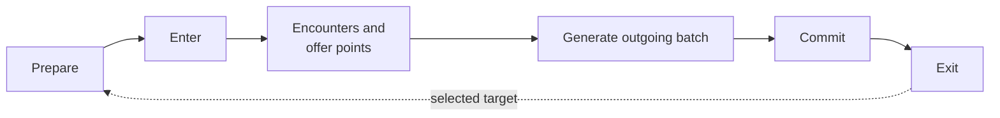

# Room Lifecycle Model

## Purpose and Authority

This document defines the ordered single-room lifecycle that turns one entered
Room Occurrence into a canonical history fragment. It owns the semantic timing
of room preparation, entry, encounters, counter effects, room-owned offer
generation, reward acquisition, outgoing-door generation, purchases,
room-history commit, and exit, and the ordering semantics of the occurrence's
Room Action order.

[Game Generation Rules](GAME_GENERATION_RULES.md) owns how an outgoing batch
selects and creates its targets. [Reward Model](REWARD_MODEL.md) owns what
offers and acquisitions mean. [Encounter Preparation](ENCOUNTER_PREPARATION.md)
owns how encounter phases resolve and record before entry. [Simulation and
Validation](SIMULATION_AND_VALIDATION.md) owns how the simulator composes room
fragments, folds their events into ledgers, and reports findings. Concrete
biome documents own exceptional local phases and select the lifecycle profiles
used by their rooms.

The lifecycle is catalog-derived simulation behavior. It is not persisted UI
state and is not an execution script authored by the user. The separation
between target generation, entry, acquisition, outgoing generation, encounter
counters, room-history commit, and biome reset is verified against the game;
the [room action audit](../audits/rooms-and-routes/ROOM_ACTION_ORDER_GAME_DATA_AUDIT.md)
owns the source inventory and call sites. This document owns the normalized
semantic boundaries derived from that evidence. Biome authorities verify that
each special room selects an accurate profile, and a new profile is not closed
until its ordering has a game-data audit and a canonical fixture
([checklist](../../CONTRIBUTING.md#lifecycle-seams-and-profiles)).

## Overview



- [Prepare](#lifecycle-operations) resolves encounter phases and entry-time
  inventory from the predecessor's committed history.
- [Encounters and offer points](#encounter-phases) start, complete and apply
  end effects; room-owned offers and acquisitions settle at their points.
- [Generate outgoing batch](#core-model) freezes the next doors and their
  offers from the history visible at that point.
- [Commit and exit](#counter-and-cache-timing) advance depth caches and hand
  control to the already-generated selected target.

Within this skeleton the occurrence's [Room Action order](#room-action-order)
places purchases, pickups and interactions in their legal windows.

### Key terms

| Term                                                  | Meaning                                                                                                                       |
| ----------------------------------------------------- | ----------------------------------------------------------------------------------------------------------------------------- |
| [Lifecycle profile](#canonical-lifecycle-profiles)    | Reusable declaration deriving one entered room shape's ordered operations                                                     |
| [Operation](#lifecycle-operations)                    | One member of the closed vocabulary that expresses observable game ordering                                                   |
| [Effect](#operations-effects-and-events)              | A typed state transition a declaration activates while an operation runs                                                      |
| [Event](#operations-effects-and-events)               | An immutable room-addressed fact emitted after an effect applies                                                              |
| [History fragment](#history-views-and-composition)    | The event sequence produced by executing one profile against one entered room                                                 |
| [Outgoing-generation checkpoint](#core-model)         | The point at which the next batch is evaluated and permanently materialized                                                   |
| [Preparation history](#history-views-and-composition) | Post-predecessor-commit state, later than the predecessor's outgoing generation, that selects entry-time phases and inventory |
| [Entry history](#history-views-and-composition)       | State after preparation and entry, before room-local encounter or acquisition effects                                         |
| [Exit history](#history-views-and-composition)        | State after every local acquisition and exit effect, threaded into the picked target                                          |
| [Doors open](#lifecycle-operations)                   | The player-facing Cleanup interval that begins when a continuation becomes usable                                             |
| [Room Action order](#room-action-order)               | The occurrence's one persisted chronology of purchases, pickups and interactions                                              |
| [Room stages](#room-stages)                           | Overview, Timeline and Exit: the three ordered stages in which an entered room settles                                        |

## Core Model

A generated target and an entered room are different semantic objects in time.
The predecessor creates the target occurrence and resolves its incoming reward
offer. Only the picked target is later entered and executes a room lifecycle.

```text
source room reaches outgoing generation
  -> create every target occurrence in physical exit order
  -> resolve every incoming target offer
  -> complete any remaining source-room operations
  -> leave through the selected target
      -> execute that target occurrence's room lifecycle
```

The lifecycle is an ordered transition over immutable simulation state. Every
operation reads the state produced by earlier operations and returns the next
state plus zero or more canonical events. No later operation rewrites an event
or generated target that already exists.

The critical rule is:

> An outgoing batch is validated and materialized from the exact history visible
> at its generation operation. Later acquisitions never retroactively change
> that batch's room identities, rewards, offer projections, or legality.

This freeze also governs progressive retention. If the first blocking region
occurs in a picked target's acquisition or later room lifecycle, the
already-generated batch remains one complete source-owned product, including
unpicked peers and their incoming offers. The blocked child remains a repair
contact, but its unresolved effect does not enter history and cannot make a
later target or decision assessable. If the block occurs during physical batch
generation, retention stops at the reached physical prefix and keeps only the
bounded repair contact at the blocking target; later targets have not yet been
generated. These are two views of the same lifecycle boundary, not a second
history or a rule-specific exception.

Preparing the next entered room also starts its empty current-room use record.
Current-run and biome-use records persist. This reset occurs at preparation,
before an entered WorldShop materializes its inventory, because that room is
already the game's current room at that point.

## Ownership

| Concern                                                 | Owner                             |
| ------------------------------------------------------- | --------------------------------- |
| Ordered room operations and their state visibility      | Room lifecycle profile            |
| Concrete room, envelope-slot, encounter, and exit facts | Room Declaration                  |
| Encounter counting and phase-local effects              | Encounter/phase declaration       |
| Target structure and outgoing batch attachment          | Biome layout                      |
| Biome transition resets                                 | Route/biome layout                |
| Incoming and room-owned authored reward values          | Room Occurrence leaf state        |
| Acquisition roles emitted at lifecycle points           | Reward producer/type declarations |
| Counter and ledger effect implementations               | Pure simulator registries         |
| Event folding and possibility branching                 | Simulator                         |
| Legality at an operation's pre-state                    | Validator                         |
| Rendered controls and sequencing explanation            | Editor projection                 |

The simulator must not switch on a concrete room name to reconstruct ordering.
The editor must not persist lifecycle operations or history snapshots.
Application and React code may label and group lifecycle facts, but must not
position a semantic boundary by comparing display labels, biome names, or
incidental numeric action ranks when the profile or roster already owns the
relevant window or checkpoint relation.

## Lifecycle Operations

The operation vocabulary is deliberately small and closed. Each boundary is
**exact** (a directly observable game-state transition), **grouped** (a
closed ordered sequence treated as one operation) or **derived** (an interval
or capability implied by game state rather than one callback). The table
describes semantic visibility, not elapsed time or presentation callbacks; an
effect belongs at the earliest operation after which a supported game rule can
observe it.

| Operation or seam                                         | Kind                               | Observes                                                 | Meaning, effects and emitted facts                                                                                                                                                                                                                                            |
| --------------------------------------------------------- | ---------------------------------- | -------------------------------------------------------- | ----------------------------------------------------------------------------------------------------------------------------------------------------------------------------------------------------------------------------------------------------------------------------- |
| `prepareRoom`                                             | Grouped                            | Post-predecessor-commit history                          | Resolves encounter sequence, optional phase support and other entry materialization; consumes the room and incoming reward already attached to the chosen door rather than regenerating them                                                                                  |
| `materializeOfferPoint`                                   | Grouped with preparation at entry  | The operation's current state                            | Resolves room-owned offers—entry-generated shop inventory, O reward wheels—consumes bags and applies offer projections; never an incoming door offer                                                                                                                          |
| `enterRoom` (editor **Room entered**)                     | Exact                              | Prepared room state                                      | The target is already current and its entry-time preparation exists; emits appearance/current-room facts. Excludes predecessor commit and target generation                                                                                                                   |
| `spawnRequiredObjects`                                    |                                    | Entered-room state                                       | Emits declaration-owned required-object spawns and activates their exit blockers                                                                                                                                                                                              |
| `startEncounter(phase)` (editor **Start encounter**)      | Grouped around an exact transition | State before the declared phase                          | Begins the closed mandatory start sequence and ends with the encounter active; emits occurrence/start and increments declared encounter-depth axes. A required pre-combat choice may share the sequence only when no unrelated player action can interleave                   |
| `completeEncounter(phase)`                                | Exact internal checkpoint          | State after the phase's combat or noncombat work         | Completion identity, encounter-local offers and phase blockers settle, even for noncombat, Fig Leaf-skipped and end-effect-suppressed phases; releases phase-local blockers. Not a player-facing row                                                                          |
| `encounterEndEffectsApplied` (editor **Encounter ended**) | Distinct effect checkpoint         | State after completion and any intervening required work | The visible boundary starts the post-combat interval; end effects apply at the profile's declared point, after required rewards in O ship phases. Suppressed phases keep the boundary without the effect event                                                                |
| `completeRequiredObjects`                                 |                                    | State after the declared required-object work            | Emits paired completion facts and releases the corresponding blockers                                                                                                                                                                                                         |
| Required-object barrier cleared                           | Derived                            | Room Action dependencies and fixed roster checkpoints    | No authored clear-barrier action: required object and encounter completion change the inputs until the fixed next transition becomes available                                                                                                                                |
| `advanceProducer(point)`                                  |                                    | State at the producer's named point                      | Advances an already-resolved producer, emitting its acquisition roles; projects loot/use history and updates acquisition-driven counters. Never regenerates an offer                                                                                                          |
| `generateOutgoingBatch`                                   | Exact internal checkpoint          | Current state before this room commits                   | Creates targets sequentially, resolves incoming offers, consumes counted bags and applies offer projections. Target identities and incoming rewards are then frozen. Not a player-facing row                                                                                  |
| `exitUsable` (editor **Doors open**)                      | Exact capability; derived interval | Roster checkpoint                                        | Anchors the Cleanup interval: begins when required work is resolved and a door or equivalent continuation is usable. Required actions cannot follow it; eligible optional actions may occur on either side and do not mutate the frozen batch; using the continuation ends it |
| `settleAcquisitionPoint(point)`                           |                                    | Already-generated outgoing batch plus active inventory   | Executes the exact active Room Action acquisition references assigned to this point                                                                                                                                                                                           |
| `commitRoom`                                              | Exact                              | State after supported room-local work                    | Appends declared room history, recomputes depth caches, advances the route ordinal and records entered-store policy before the selected target prepares; distinct from the earlier moment exits become usable                                                                 |
| `exitRoom`                                                | Grouped transfer                   | Committed source state plus selected generated target    | Closes the fragment and hands the already-generated target to preparation and entry; does not choose or regenerate it                                                                                                                                                         |
| `roomDeparted` event                                      | Exact                              | Native `LeaveRoom`                                       | One per door use: after each non-Hub first `roomExited`, at each Hub departure after its fountain use, and at each restored main-room departure. Departure clocks advance here, not at `roomExited`                                                                           |

The editor boundary order describes semantic visibility, not a literal call
stack. **Doors open** is the one player-facing final-room interval. Outgoing
generation and `exitUsable` remain distinct engine facts because candidate
history and required-object validation need their exact positions, but neither
is a separate rendered row, and the timeline must not imply that an optional
cleanup action is required before leaving.

Two grouped operations compose encounter sequences:

- `runEncounterSequence` executes every already-prepared active phase of one
  Encounter Envelope in declaration order, emitting start, definition-owned
  depth advancement and completion for each phase. H uses it for the passive
  Fields phase followed by the active cage prefix; cage offers and
  acquisitions remain separate local producers.
- `runRewardEncounterSequence` adds declaration-owned phase offer points around
  that sequence. For every selected O ShipCombat phase that declares an offer
  point it emits the phase offer before encounter start and the picked
  acquisition after completion. Intro has no offer: the ordinary Intro
  definition is non-counting, while a selected Heracles Intro increments
  encounter depth once. Combat1 and the conditionally selected Combat2 each
  increment encounter depth once, materialize one complete active wheel, and
  acquire only its selected offer. The executor receives the selected phase
  prefix and rejects a non-prefix selection or the omission of a required
  phase.

History exposes both materialization and acquisition checkpoints for each
phase offer point. Reward simulation evaluates all active offers at the former
state, consumes only the picked offer at the latter, and resolves the room's
outgoing store from the final active wheel. The acquisition event also records
that wheel's selected store in entered-store history before a later phase or
room can evaluate reward-ratio support, so a two-wheel room contributes two
ordered store entries; dormant wheel capacity emits no lifecycle or
store-ledger event.

Do not introduce an unrestricted callback or event DSL. Add or split an
operation, effect, or event kind only when audited game behavior has an
observable distinction that the closed vocabulary cannot represent correctly.

### Operations, effects, and events

```text
RoomLifecycleProfile selects an operation
  -> operation reads its exact pre-state
  -> declarations select applicable typed effects
  -> simulator applies each effect
  -> immutable RoomLifecycleEvents record what occurred
  -> next operation receives the resulting state
```

A profile is a normalized reusable declaration; rooms select one through their
declaration or template/encounter composition, and bounded authored phase
choices may select operations within it without authoring the operations. An
effect is activated by its owning declaration; the profile determines when it
can run. An event is addressed to the room (fixed-linked rooms use their
occurrence address), folded into ledgers and retained as ordering evidence. An
operation may emit zero, one, or several events.

For example, `startEncounter(main)` does not hard-code counter arithmetic into
a one-phase room profile. It resolves the already-prepared concrete encounter
definition and, when that definition counts, applies the room, biome, and
route encounter-depth effects. Likewise, `commitRoom` applies the Room
Declaration and layout's commit policy rather than incrementing every depth
axis. A biome reset is a later layout transition effect, not a hidden part of
an arbitrary room profile.

The effect families are room preparation and resolved encounter-sequence
facts; room appearance and current-room facts; required-object spawn and
completion; encounter occurrence, start, completion, end-effect application
and counting-depth changes; room creation, offer, counted-bag and
offer-projection changes; concrete acquisition and acquisition-driven
counters; shop purchase and active-option changes; room-history commit,
depth-cache and route-ordinal changes; and biome transition resets outside the
completed room fragment. Effect and event kinds use closed registries with
strict normalization: an unknown kind is a catalog or construction error, not
a silent no-op.

## Encounter Phases

[Encounter Preparation](ENCOUNTER_PREPARATION.md) resolves and records every
active phase at `prepareRoom`. Phase structure prepared before entry reads
preparation history; a counter increment from an earlier phase cannot
retroactively add another phase.

`encounterStarted` applies only the resolved definition's encounter-depth
effect. `encounterCompleted` stays at its declared later lifecycle point.
`encounterEndEffectsApplied` follows that completion only for a resolved phase
whose declaration permits the game's end effects. In reward-bearing O ship
phases, required post-combat interactions intervene: native encounter events
wait for them before applying end effects. Completion still makes those
interactions available; it does not imply that end effects have already run,
and the visible End Encounter boundary stays before this interval. The event
is absent for noncombat and `skipEndEncounterEffects` phases; Fig Leaf's
skipped execution does not by itself remove it. N entered side-room
occurrences execute their own preparation and lifecycle in authored
`enteredOrdinal` order before the corresponding parent restore. The same
ordered history therefore supports ordinary rooms, O/P/H multi-phase rooms,
and N side-room occurrences without a second encounter engine.

**Noncombat and Story encounters.** The game still records and runs a Story
encounter through `StartEncounter`, but its `EncounterType = NonCombat` skips
combat start/end effects. The planner preserves the encounter identity,
history, NPC interaction, trait offer, and any exact pickup timing while
omitting the player-facing Start encounter and Encounter ended boundaries. The
same applies to all `nonCombat` phase kinds; only `combat`, `miniboss`, and
`boss` phase kinds render a combat spine.

**Automatic outcomes.** Fixed automatic outcomes (Steady Growth, Transcendent
Embryo, Judgment, Crystal Figurine) settle at their seam (encounter end for
[timed outcomes](TRAIT_OFFERS.md#timed-outcomes)) and are never
reorderable Room Actions. One encounter-end checkpoint settles every fixed
outcome before it publishes pickups created by matured clocks; the
[scheduled-outcomes audit](../audits/rooms-and-routes/SCHEDULED_AND_AUTOMATIC_TIMELINE_OUTCOMES_AUDIT.md#encounter-end-and-boss-contacts)
owns the order and the Personal Loan and Steady Growth contacts.

## Room Stages

Each entered room settles in three ordered stages, and each settles before the
next starts:

| Stage    | Question                                   | Contains                                                                                                                                                                                                   |
| -------- | ------------------------------------------ | ---------------------------------------------------------------------------------------------------------------------------------------------------------------------------------------------------------- |
| Overview | What is the room and what does it contain? | Everything fixed on entry: every phase's encounter identity and customization, and Shop, Shrine, Well and Contract inventory. The room's own door reward was generated with its source room's doors.       |
| Timeline | What happens in the room?                  | Ordered room actions, encounter banners naming each phase with its per-encounter events, acquisitions, purchases, refills, deliveries, and the doors opening, which settles the door offers at that point. |
| Exit     | Where to go next?                          | The door selection, then the room's exit work (pending Shop completion, resource element grants, the `beforeRoomExit` snapshot). The source room exits before anything in the next room is prepared.       |

The native order is the previous room's exit work, then the next room's content
generation, then room setup, so an Overview product reads only entry state; one
that reads a Timeline product is a modelling error. The doors opening is a
Timeline fact of the source room: the door offers settle when the doors open,
usually at the room clear, and later Timeline actions (purchases, digging,
Shrine and Well use) follow it without changing the frozen batch. Room Doors is
where those offers and the selection are authored; it does not move their
chronology.

A picked host's resource placements are fixed on entry, so their legality is
an Overview fact; the element a legal placement grants is exit work.

Every phase's encounter identity and composition are fixed on entry from
predecessor state and earlier phases' records, including Ship phases (whether
the optional Combat 2 plays), P's two phases, Fields Passive and cages, NPC
encounters and introductions; the Nemesis random-event family is part of that
identity. The Timeline keeps each phase read-only at its start and end, the
order it controls (Fields cage order, Ship phase seams and wheel picks) and the
events decided in the encounter: Fig Leaf (including P's pre-combat cascade,
which suppresses execution without changing the recorded identity), Gorgon,
Aetos, NPC trait offers, the Nemesis response, the Anomaly capture-point
outcome (which decides whether the room reward spawns) and encounter-end
checkpoints. Fig Leaf, Aetos and Gorgon keep their own phase-child addresses.

The editor presents the stages as Room Overview, Room Timeline and Room Doors.
These are transient views over unchanged semantic owners, not persisted
lifecycle events or a second room model. The
[simulation authority](SIMULATION_AND_VALIDATION.md#selected-cut) owns what a
block in each stage publishes.

The Postboss Purging Pool inventory is the declared exception: Overview content
pinned at fountain use. The Pool unlocks only when the required fountain is
used, and nothing between that use and opening the Pool removes a listed boon or
changes its rarity, so it opens with the inventory present at fountain use
([source audit](../audits/room-features/ROOM_FEATURES_GAME_DATA_AUDIT.md#source-contacts-and-realized-hosts);
[Room features](#room-features-at-cleanup)).

## Room Action Order

Every entered occurrence owns one persisted `roomActions.order`. The [Authored
Project Model](AUTHORED_PROJECT_MODEL.md#occurrence-state-and-replacement) owns
which references it may hold and the commands that change membership; this
section owns what the order means.

Presence forms the unordered participant set exposed by Purchase and Picked up
controls; position is the chronology. Membership insertion or deletion is
structural, preserves the relative order of retained participants, and never
requires the current chronology to settle. New participants append until the
author uses the separate move controls. The simulator applies the one authored
order, evaluates each action against history from earlier authored actions,
and never retries another permutation; it retains ordinary reward-source
possibility branches within that fixed order. A later plan compiler consumes
the same order without choosing a different witness order.

Mandatory entries derive their required classification and legal lifecycle
window from the engine's structural action domain; membership and position
are the required participation and chronology. The activating command inserts
the reference (the authored model owns that membership delta) at the default
position the [roster](#roster) schedules. Optional Shop purchases, spawned pickups
and Fields optionals use the same order with explicit membership controls. A
deliberately malformed missing-required reference remains explicit repair
state. No producer owns a parallel purchase or pickup order, and an outgoing
decision never adopts the source room's chronology: the editor derives
per-row membership and one ranked Room Timeline surface on the producing
occurrence.

### Roster

Semantic action producers contribute explicit action contributions. One roster
assembly receives them with the occurrence's authored order and returns the
complete roster consumed by lifecycle, validation, candidate, and workspace
products. Producers do not register callbacks, mutate a hidden registry, or
communicate action membership through sidecar state.

Roster assembly reconciles every authored and derived key exactly once: ranked
active actions become the executable chronology, active but unranked actions
remain explicit incomplete rows, and ranked keys whose action is no longer
active remain stale repair rows. Invalid or incomplete authorship is therefore
retained for correction rather than dropped or silently reordered. There is no
parallel Fields, Shop, Acquisitions, or presentation-owned action assembler and
no second order authority.

Insert and move proposals retain all typed dependency and fixed-window blockers
from their existing order assessment, including the affected action and its
prerequisite or conflicting action windows; an action marked
`windowFollowsOrder` (the Postboss rack) never takes part in window crossing.
The application labels this evidence for placement explanations; it neither
infers legality nor attributes an existing blocker to the proposed action.
Authorable proposals, canonical required restores, and removals carry no
blocker evidence.

When a command newly activates required actions, the engine extends the order
with their deterministic latest legal schedule: lifecycle windows and
dependencies constrain placement, existing rows keep their relative order, and
stable contribution order breaks otherwise equal ties. An unrelated
retained-invalid row or a pre-existing missing prerequisite does not reject the
edit or become silently repaired. Missing required authorship remains a
supported incomplete state with one canonical late restore position.

Active required roster rows also expose `requiredScope`: `phase` when their
fixed window or dependency chain constrains them to encounter progression,
otherwise `room`. Optional and stale rows have no required scope. This derived
classification does not change participation, legal order, or authored state.
Fields cage rewards remain room-scoped despite their source phase; a contact
that blocks a later cage inherits a phase obligation. Scope is recomputed when
the active lifecycle is narrowed and is independent of an action's placed rank.

### Lifecycle structure and authoring timeline

The engine constructs one closed lifecycle structure from the resolved profile
and its active declaration-owned phase scope. Its ordered points are the rigid
room skeleton: `roomEntered`, each exact `encounterStart` then `encounterEnd`,
Ship `nextPhase` seams, internal outgoing generation, and final `cleanup`. The
same frozen structure is carried by the roster and consumed by required-action
scheduling, lifecycle execution, checkpoint assembly, and the room timeline.
None of those consumers may reconstruct phase membership or boundary order
from authored action ranks. Structure construction, active-phase scoping, and
window ordering share that owner; the action domain retains action
contributions, required participation, and dependency assembly.

When encounter preparation assesses a suffix as dormant, the engine scopes
that same structure and roster to the assessed active phase prefix for both
execution and workspace projection. An invalid terminating selection does not
fabricate a shorter structure; its later phase remains available for repair.
The application consumes the engine's phase status and scoping operation
rather than deciding suffix activity from the selected encounter label.

The roster remains authoritative for active action rows, dependencies,
proposals, stale repair, and structural validity. The timeline places those
exact roster keys into the structure's flexible intervals. It may carry
declaration-owned phase identity and before/action/after placement, but never
tabs, labels, callbacks, or another eligibility/order calculation.

An action rank selects only the inter-action slot to which a boundary is
anchored. The profile and its active phase order independently own the
structural boundary sequence: Room entered, each phase's Start then End, the
next-phase seams between phases, and the profile-specific final seams. If
retained-invalid action ranks imply contradictory boundary anchors, the
timeline keeps the authored action order for repair and moves the later
semantic boundary forward to the earliest compatible slot. It never sorts
Start and End by display priority or permits End to precede its matching Start.

The player-facing timeline renders one final **Doors open** at the
`exitUsable` rank and renders neither outgoing generation nor `exitUsable` as a
peer row. Encounterless and Shop profiles omit invented encounter seams. Fields
Passive is Room Entered setup, while every structurally active cage owns a
rigid Start/End cycle in the structure's authored cage permutation. A missing
cage-completion action remains a repair row but cannot erase that cycle. Ship
phase grouping consumes the same structure's phase attachment; the application
does not place wheel or action rows by rank arithmetic.

## Canonical Lifecycle Profiles

### Standard Reward Room

```text
prepareRoom
enterRoom
startEncounter(main)
completeEncounter(main)
advanceProducer(roomRewardPickup)
generateOutgoingBatch
commitRoom
exitRoom
```

The incoming offer was resolved by the predecessor. Its concrete acquisition
updates history before the outgoing batch is evaluated, so the next rooms and
rewards observe it. The reward pickup is also represented by the canonical
acquisition-settlement product for its exact producer point; its participation
and order are derived, and the lifecycle does not persist or render a second
control for an unavoidable singleton reward.

### Opening Reward Room

```text
prepareRoom
enterRoom
advanceProducer(roomRewardPickup)
startEncounter(OpeningGeneratedF | OpeningGeneratedN)
completeEncounter(OpeningGeneratedF | OpeningGeneratedN)
generateOutgoingBatch
commitRoom
exitRoom
```

F and N Opening declarations share this ordering: their encounter starts late
and the room waits for its reward pickup first. `N_PreHub01` uses the standard
combat-then-reward profile, while its encounter declaration keeps that combat
non-counting. The mandatory-action scheduler reads the Opening declaration's
exact profile, so a newly created Opening places its incoming pickup before
`startEncounter` rather than applying the ordinary after-combat reward alias.

### Devotion Room

```text
prepareRoom
enterRoom
advanceProducer(beforeCombat)
startEncounter(main)
completeEncounter(main)
advanceProducer(afterCombat)
generateOutgoingBatch
commitRoom
exitRoom
```

The chosen-source decision and acquisition occur before combat, followed
immediately by the encounter start; the spurned source is created only after
combat. Both precede outgoing generation. The game exposes no unrelated room
feature, door, or free room action between the required first choice and
combat activation, so the player-facing Start encounter boundary groups that
closed mandatory sequence without moving the two roles: chosen remains before
combat and spurned after Encounter ended. Devotion's spacing projection is an
offer-time event that occurred when the predecessor generated this room.

### Narcissus Story Room

```text
prepareRoom
enterRoom
advanceProducer(beforeCombat)
startEncounter(main)
completeEncounter(main)
advanceProducer(afterCombat)
advanceProducer(roomRewardPickup)
generateOutgoingBatch
settleAcquisitionPoint(roomExit)
commitRoom
exitRoom
```

The selected Narcissus trait is resolved during the encounter-owned choice and
enters equipped history. Its declaration-owned pickups settle at the
occurrence-owned `roomExit` point after the outgoing batch is frozen, so their
authored order affects later route state without regenerating the current
doors. A pickup owns its exact reward, trait offer, or level-resolution child;
those children are not nested under the outer Narcissus option. Each
consequential pickup remains optional and independently ordered.

The same acquisition-entry seam hosts every current generated pickup. A normal
Quick Buck, Buried Treasure, equipping Narcissus acquisition, or selected
Nemesis random-event result activates its declaration-owned entries at its
declared pickup window; source selection alone does not. Sea Star adds one
later source-scoped entry after an eligible normal free pickup. Nemesis
event-family selection configures the encounter separately from its required
interaction. Concrete offer and response detail is authored at that interaction
and assessed against its exact incoming inventory, including any earlier Fields
pickups. Missing family belongs to the event; missing or invalid interaction
detail belongs to the interaction action. Every active result entry depends on
that action. The source and generated actions remain in the occurrence's one
order, so a generated result can affect later rooms without regenerating the
current outgoing batch.

### Ephyra Main Target

```text
prepareRoom
enterRoom
spawnRequiredObjects(SoulPylon)
advanceProducer(beforeCombat)
startEncounter(main)
completeEncounter(main)
completeRequiredObjects(SoulPylon)
advanceProducer(afterCombat)
advanceProducer(roomRewardPickup)
generateOutgoingBatch
commitRoom
exitRoom
```

Devotion, when supported by a producer, still emits its chosen and spurned
roles at their declared points. The required Soul Pylon spawns at entry and
completes after combat but before reward pickup, local side-room generation, or
exit. Ephyra side rooms use the standard combat-then-reward order without
outgoing generation; the persistent Hub uses entry, one stable-board
generation, commit, and exit without a producer. Hub, main and side traversal,
restoration and departures are topology between fragments
([N rules](../biomes/N_GAME_RULES.md#restoration-and-departures)).

### World Shop

```text
prepareRoom
materializeOfferPoint(shopInventory)
enterRoom
generateOutgoingBatch
settleAcquisitionPoint(roomExit)
commitRoom
exitRoom
```

Shop inventory is prepared from the committed predecessor's history and
materializes before the shop's outgoing doors are generated; the outgoing batch
is then generated from the same pre-purchase history, with the full generated
inventory as the current-room shop option set. Participating
`interactShopOffer` actions run in the post-outgoing Shop window and derive
exit history; the shop then commits and the already-generated picked target
prepares and enters. Calling purchase simulation before outgoing generation
would violate this contract even if the final acquisition ledger looked
plausible.

Purchases therefore remove options and update history after the outgoing batch
exists. They cannot change that batch or the selected next room's
already-resolved reward; their first effect on room generation occurs when that
selected room later reaches its own outgoing-generation checkpoint. This is the
precise meaning of shop purchases having a one-room-delayed effect on room
generation; the acquisition itself is not delayed.

```text
commit predecessor with 3 acquired ordinary sources
  -> prepare WorldShop and materialize its inventory
  -> enter WorldShop
  -> shop inventory offers a 4th source
  -> outgoing batch offers a 5th source
  -> player purchases the 4th source
  -> player enters and may acquire the already-offered 5th source
```

This trace is valid. Validating the outgoing fifth source against post-purchase
history would be an ordering bug.

The Purchased marker only inserts or removes the purchase reference; the engine
walk performs the purchase when it reaches the ranked action. Unpurchased
initial offers do not become active timeline or generic repair rows, and a
retained stale purchase remains removable through its specialized
participation intent. The purchase action settles the paid acquisition
completely ([Reward Model](REWARD_MODEL.md#generated-pickups)); free
declaration-produced entries in the same occurrence are independent pickup
actions.

Travel Deal and Gold Gold Gold derive their trigger from the true action order.
The selected source slot is not a complete payload-authoring context: the
generated payload is evaluated against the exact history prefix at the
triggering action. A forced or ordinary Hermes delivery in `Q_PreBoss01` may
lock the god pool if acquired before the World Shop purchase and cannot do so
retroactively if acquired after it.

### Room Features at Cleanup

Purging Pool sales and Well purchases use feature-local checkboxes to opt into
their host occurrence's ranked action order. An unchecked sale or purchase
remains on its owning feature and is not duplicated in the generic Optional
actions pool; once checked, it is an ordinary ranked timeline participant. A
Pool and Well may use their feature-local **Interact** boundary: until then
their live random inventory remains dormant and no action is active. World Shop
and Shrine inventories are always fully authored; neither receives that
convenience because their visible identities affect outgoing generation. Shop,
Shrine and Well purchase rows have no generic insert or remove proposal; their
feature commands own membership.

A Well host, Purging Pool or keepsake rack declared with `excludedRouteKeys`
(the rack's `keepsakeRackExcludedRouteKeys`) is absent on those routes: defaults
create no forced Well, Pool or rack state, commands refuse to add a Well or
equip at the rack, the codec rejects a rack, and the forced Postboss Well is
not required. Well and Pool state retained from before such an exclusion still
decodes but is context-invalid: a Well reports
`stygianWellPlacementUnavailable`, and an interacted Pool reports
`purgingPoolUnavailable` and is never assessed, so its sales have no effect. A
Fresh File attempt has none of these features; the H Postboss Pool object it
shows natively is locked and is not an authorable inventory.

Postboss Purging Pool inventory is assessed once immediately after the required
fountain action and its rarity effects settle, before cleanup sales. Its
candidates and inventory findings consume that post-fountain state, not room
entry; an unresolved Phial outcome withholds the pool frontier. This models
the inventory available when the fountain unlocks the facilities, including
native regeneration caused by a changed offered rarity. Later sales consume
the retained inventory and the current equipped traits; they do not regenerate
the candidate set.

Well purchases settle immediately as paid effects and never invoke free-pickup
alternatives. A purchased Shrine generation, including a purchased Travel Deal
refill, gains one required `purchaseHermesShrineOffer` row in the room's
post-outgoing purchase window (an Ephyra side room, having no outgoing
generation, opens with it). The row authors that purchase's rush and its order
among the Shrine's purchases; the walk still schedules every initial Shrine
purchase together at the Shrine checkpoint, while each row's position settles
the Travel Deal refill and the refill's own purchase. Shrine purchase rows never become timeline
transactions: each purchase's delay and rush publish through the room Overview
inventory, and the execution room guide carries the row only as an
informational reminder.

A rushed Shrine purchase, including a Travel Deal replacement, ranks one
optional same-room pickup at the post-outgoing action rank; the author may
remove it, and an item left behind vanishes at room exit. A rushed pickup
follows its purchase row, and the refill's purchase row follows the first rushed
initial purchase row; both dependencies constrain authoring only and are not
published. The [Reward Model](REWARD_MODEL.md#refills) owns which purchase
triggers the refill.

A delayed purchase is scheduled at source cleanup without consuming a delay use
and derives a later required pickup at the reached encounter-end host. At the
Preboss of the fourth entered biome, entry expires every still-pending delivery
into a required phase-less pickup that gates the exit; it does not decrement
the ordinary encounter clock or acquire a reward. A shorter itinerary never
flushes: its pending delivery keeps counting down into the Boss encounter, and
one still pending when the planned route ends stays pending; the purchase is
valid, and the game owns the item's arrival after the last planned room, so no
finding is reported. Each purchase's delivery is one engine obligation (source,
generation key, reward type, rushed, and once due its host, encounter phase and
cause: rush, countdown or flush); the frontier, placement assessment, due
spawn, edit settlement, authored domain and execution assembly all read that
obligation rather than recomputing the due contact. A Hub side-room source is
ordinary for scheduling, but cannot advance an older pending delivery; later
qualifying main Hub visits can advance or host it. Fixed Boss occurrences are
ordinary later delivery hosts. The Shrine source action and its later required
pickup remain distinct room owners in the same ordered room fold; no feature
owns a private purchase order or a completion-only settlement path.

### Boss and Postboss

The fixed Boss occurrence has the `BossRoom` lifecycle. Its player-facing
timeline is `Room entered -> Start encounter -> Boss defeated -> Encounter ended
-> Doors open`. `Boss defeated` is an exact lifecycle seam before generic
encounter-end effects. When Judgment is active, it is one engine-owned fixed
effect at that seam, not a Room Action or persisted ordering value. The
occurrence-plus-phase Judgment Arcana address owns the editor, candidate
frontier, finding, and semantic command. Encounter ended remains the later seam
for post-encounter delivery. A reached Steady Growth threshold then settles
after Encounter ended and before Cleanup.

The fixed Postboss occurrence uses the same timeline presentation without a
combat interval. Its active shape is `Room entered -> ranked actions -> Doors
open`. The route enters it with the keepsake used for the Boss, so Boss
Judgment observes the old keepsake. Every declared Postboss fountain
contributes required `Use fountain`, and every rack-bearing Postboss has the
permanent `Keepsake Rack` action, a no-op while the keepsake is unchanged. The
rack never holds the doors and is not a required room object: it may be
ordered anywhere, before or after the fountain and the Well or Shrine
purchases, and its window follows that position. It applies the selected
keepsake and its immediate equip result at its ranked position, so the
fountain observes the old or new keepsake according to the authored order and
later acquisitions observe the resulting state. Only a selected replacement
emits `keepsakeRackUsed`; an unchanged rack produces no window, order
dependency or execution transaction, and changing or clearing the selection
keeps the row's position. Cleanup follows the fountain, and the purchases
follow Cleanup. The occurrence lifecycle still runs its noncombat entry
sequence after `roomEntered` and before the first ranked player action, but
those internal boundaries are not rendered as encounter rows.

These interactions emit exact ranked-action events. `fountainUsed` and
`keepsakeRackUsed` carry the Room Action semantic address: an ordinary
Reprieve event is owned by that occurrence, a Postboss event by its occurrence
action address. The Hub fountain is the one exception outside a room timeline
([N rules](../biomes/N_GAME_RULES.md#restoration-and-departures)). The event
owners are the same semantic owners consumed by the roster and history fold;
neither event is reconstructed from a rendered row or a generic room
checkpoint. Postboss features exist only when the route-position table supplies
a Postboss occurrence; terminal I/Q endings do not expose this interaction set.

### Ordered Multi-Encounter Room

O and later multi-phase rooms compose the same operations rather than owning a
separate history engine:

```text
prepareRoom
enterRoom
runRewardEncounterSequence
  intro: start, complete
  combat1: wheel1 offer point, start, complete, wheel1 acquisition, end effects
  ... optional declared phases ...
generateOutgoingBatch
commitRoom
exitRoom
```

Encounter completion emits end effects unless the phase suppresses them; a
phase carrying a reward wheel applies them after its wheel acquisition. The
[O rules](../biomes/O_GAME_RULES.md#shipcombat-phase-and-wheel-contract) own its
active phases, offer points and the derived `nextPhaseUsable` barrier between
Ship phases; O has one room-level Cleanup after its final active phase.

P consumes the same ordered engine without a P-only profile. Its
declaration-owned `Intro` and `Combat` positions are prepared sequentially, so
the terminal position observes the first position's recorded identity. A valid
`terminateSuffix` first selection leaves the stored Combat choice dormant and
executes only that first position; otherwise both positions start and complete
in order. The ordinary pre-combat declaration completes but suppresses end
effects, while the terminal declaration completes and emits
`encounterEndEffectsApplied`. A successful Fig Leaf result propagates skipped
execution across the prepared prefix without deleting either completion or the
terminal end-effect event.

The H Fields room has a fixed cage-cycle skeleton with an authored cage
permutation; the [H rules](../biomes/H_GAME_RULES.md#physical-doors-and-cage-lifecycle)
own its lifecycle.

### Preboss and Persistent Structures

A selected Preboss completes its declaration-owned normal-door batch, enters
through its normal room lifecycle, and then follows its fixed Boss/Postboss
links. A persistent Hub may generate a stable board once and later emit
restore fragments. Those are structural compositions of room-addressed
fragments, not reasons to weaken the ordering contract or introduce UI-shaped
rows into history.

### Inserted Rooms

Anomaly, `C_Boss01` and natural Chaos rooms use the ordinary
entered-occurrence lifecycle; the [detour
audit](../audits/rooms-and-routes/ROUTE_DETOURS_GAME_DATA_AUDIT.md) owns their
source facts. Each following host target is generated at the inserted room's
outgoing-generation checkpoint: after entry-time and room-local effects
(including reward acquisition), but before its own commit-time room history,
route ordinal, `runDepthCache` and host `biomeDepthCache` effects. Anomaly and
`C_Boss01` then commit and enter that target automatically; it is a distinct,
normal host target with a normally selected and consumed reward, since
automatic and hidden are presentation and traversal facts, not an
accounting-free callback. Chaos instead continues through an ordinary
player-selected decision.

Anomaly's fixed `GeneratedAnomalyB` uses the normal counting encounter path,
and its retained incoming offer is acquired only when authored success is true.
`C_Boss01` is classified as Combat with the contract-specific template and the
standard reward lifecycle: it runs fixed `BossZagreus01` and requires acquiring
`InfernalContractBoon`, but does not emit `bossDefeated`, advance encounter
depth, or complete the host biome. A selected Chaos room runs `Empty_Chaos`,
acquires direct `TrialUpgrade` and adds its own room-history record; skipped
and selected gates consume the same source offer, while only selected Chaos
runs the inserted lifecycle. Anomaly's and Zagreus's once-per-route limits are
consumed only when the inserted occurrence enters, not when an authored
replacement or additional exit is created.

## Run State Checkpoints

Room-local Run State projects the authoritative state captured at exact
lifecycle checkpoints; the [simulation
authority](SIMULATION_AND_VALIDATION.md#run-state-snapshots) owns its
projection and cache contract. An ordinary occurrence publishes `roomEntered`
and `beforeRoomExit`; a ShipCombat occurrence instead publishes one
`beforeEncounterStart` checkpoint for each active phase plus `beforeRoomExit`.
Entry consumes the existing entry history, each Ship phase consumes the history
fold captured immediately before its `encounterStarted` event, and pre-exit
consumes post-commit room-local settlement immediately before `roomExited`.

These checkpoint addresses and snapshots are not authored or persisted. A
structurally retained occurrence beyond progressive coverage may expose a
disabled launcher, while an occurrence absent from the materialized prefix
publishes none. The `beforeTargetGeneration` product remains internally useful
for generation assessment, but only N's Hub-board and Hub-sourced Preboss
generation exceptions retain public launchers. A literal pre-exit snapshot must
not replace or relabel either exception. Hub departures capture conformance
snapshots described in the [N rules](../biomes/N_GAME_RULES.md#restoration-and-departures).

Separately, each Preboss and completion Boss occurrence captures the raw states
its preparation receives as the source of a mid-run start installation: after
its predecessor's departure clocks and before its own preparation and entry
effects. Those states already include the room's creation (its incoming offer
and bag effects). The capture is owned by the occurrence and is never a Run
State.

## Counter and Cache Timing

Counter names that sound similar are not interchangeable, and they do not
advance at one generic "room completed" point.

### Encounter depth

When a declared encounter phase counts, `startEncounter` increments the current
room's encounter depth, `biomeEncounterDepth` and route-wide encounter depth.
The increment occurs before the encounter's combat work, completion, reward
pickup, and outgoing generation. A room with several counting phases can
therefore increment encounter depth several times while contributing only one
later room commit. A non-counting phase emits its occurrence/start facts but no
depth effect. Phase structure the game prepares before room entry reads
preparation history and cannot become active because another phase increments
`biomeEncounterDepth` later in the same room; O's conditional Combat2 is the
first concrete fixture for this rule.

### Depth caches and room-history ordinal

`runDepthCache`, `biomeDepthCache`, and the route-wide room-history ordinal
advance at `commitRoom`, after the source's outgoing batch has already been
generated. Consequently:

- the source room's outgoing room and reward choices read its pre-commit depth
  caches;
- the source room's counting encounters may already have changed encounter
  depth when those outgoing choices are generated;
- committing the source updates depth caches before the picked target executes
  `prepareRoom`;
- the picked target's prepared encounters and shop inventory see the committed
  predecessor depth;
- the picked target does not advance the depth caches until it later commits.

The biome depth cache follows native `GetBiomeDepth` (`RunLogic.lua`), which
`UpdateRunHistoryCache` stores at `StartNewRun` (only once `RoomHistory` is
non-empty), on map load and in `LeaveRoom` after the room left joins
`RoomHistory`. It is 1 while the current room has `NextRoomSet`, and otherwise
counts back through `RoomHistory` to the nearest room with `NextRoomSet`. The
engine applies that rule once; rooms declare neither a history nor a depth
step. Each room-history record advances the cache by one: a room's commit
records its first exit, and a restored N main room or Hub adds a record only
when it is left again (the restore's map load recomputes the same value).
Leaving a `NextRoomSet` room (F and N Openings, every Postboss and
`Dream_PostBoss`) leaves it at 1. Preboss and Boss rooms reset nothing, so a
Boss is entered at its Preboss's exit depth and left one higher.

Room entry applies two absolute values. A `NextRoomSet` room's map load sets
the cache to 1 after the run's first room; then `StartRoom` applies the room's
`RunOverrides`, declared as `enteredBiomeDepthCache` (only F Openings, 0). A
Dream N Opening is therefore created, entered and left at 1; a Dream F Opening
is created at 1, entered and generates its doors at 0, and is left at 1. Either
way the rooms after a Dream Opening share the ordinary run's depths.

The semantic `enterRoom` event may record that an occurrence was entered, while
game-shaped room-history caches remain commit-time effects apart from these
entry-time values. Consumers must name the exact ledger they require rather
than treating "appearance" and "committed room count" as the same timestamp.
Candidate evaluation consumes the recorded source view directly and must not
advance the cache speculatively.

### Biome start

Composition begins each biome with one addressed `biomeStarted` event whose
payload owns the biome's resolved initial counters, the state before its fixed
start commits:

- A non-Dream route's first biome (F or N) begins at `biomeDepthCache = 0`
  with `biomeEncounterDepth` unset, route encounter depth `1` and room-history
  ordinal `0`: `StartNewRun` creates the first room before any biome record is
  set. An unset encounter depth reads as each native reader defaults it, and
  the first counting `startEncounter` makes it `2`. The opening's later commit
  applies its declared `biomeDepthCache = 1` delta.
- A Dream start and every later biome begin at `biomeDepthCache = 1` and
  `biomeEncounterDepth = 1`, matching the game's between-biome baseline; route
  encounter depth and room-history ordinal are carried from actual predecessor
  history after its declared biome-local resets. Native `EndBiomeRecords` sets
  that `1` when the start room starts, after the room and its encounter were
  created; no such encounter reads encounter depth (Intros use non-combat or
  fixed encounters, and a Dream F or N opening forces `OpeningEmpty`), so the
  planner seeds it at biome entry.
- N's Hub history additionally initializes generated-side-room and Soul Pylon
  spawn/completion counters at zero; I seeds its [Clockwork
  counters](../biomes/I_GAME_RULES.md#clockwork-state-and-physical-capacity).

An Intro has no `NextRoomSet`: it generates its outgoing target from the
initial source depth and advances the cache at commit. These are separate
events so generation contacts never depend on an implicit fold initializer or
a hidden opening exception.

### Generation and acquisition counters

Each physical target creation inside `generateOutgoingBatch` immediately
updates creation history before the next peer is evaluated. Incoming offers
likewise consume counted bags and apply offer projections in physical order.
None of those target offers enter acquisition history unless that occurrence
is later picked and its producer advances.

Acquisition-driven counters update at their producer point. Examples include
loot/use histories, ordinary-source history, and I's Clockwork Goal and
non-goal counters. A final room aggregate cannot safely reconstruct these
intermediate views.

### Biome transition resets

Biome-local resets occur after the fixed-linked Boss/Postboss sequence at the
layout transition boundary. They are not `exitRoom` defaults and are not
repeated by every room profile. The next biome starts from the reset state plus
any route-wide history retained by its declared transition policy. The closed
transition vocabulary is one ordered `resetCounter` effect over
`biomeDepthCache` or `biomeEncounterDepth`; every current layout declares both
effects in that order. Route encounter depth and room-history ordinal are not
biome-local and receive no reset event.

## History Views and Composition

Every fragment exposes conceptually distinct states:

```text
predecessorOutgoingGenerationHistory
  -> predecessor remaining local operations
  -> predecessorCommittedHistory
  -> prepare selected room
  -> preparationHistory
  -> enter selected room
  -> entryHistory
  -> ordered local operations before outgoing generation
  -> outgoingGenerationHistory
  -> generate and freeze outgoing batch
  -> ordered remaining local operations
  -> commit current room
  -> committedHistory
  -> exitHistory transferred to the selected target
```

The simulator need not persist a full state snapshot at every operation. It
must preserve the event order and be able to evaluate each rule from its exact
pre-operation view.

Fragment composition threads state while following the picked target:

```text
current RoomHistoryFragment
  -> generated target occurrences and incoming offers
  -> remaining current-room operations and commit
  -> picked target preparation and RoomHistoryFragment
  -> generated target occurrences and incoming offers
  -> ...
```

Unpicked targets contribute creation, offer, bag-consumption, and
offer-projection events at the source room's outgoing checkpoint. They never
execute an entered-room fragment and never emit concrete acquisitions.

Each physical target has a `roomCreated` event followed by a
`targetGenerationCompleted` marker. Room/reward legality, incoming-offer, bag,
and offer-projection events occupy that interval in physical order without
moving either boundary or changing the target's pre/post generation views.

### Biome reward walk

The biome reward chronology applies each history event through one seam table.
A seam reads the fixed walk context and the current walk state and returns the
next state, a possible Run State capture or target-slot history checkpoint, and
ordered accumulator emissions. Events with no reward seam only advance the
branches to their sequence.

| Walk seam                                               | Reward handling                                                                                                                       |
| ------------------------------------------------------- | ------------------------------------------------------------------------------------------------------------------------------------- |
| Biome start                                             | The Echo keepsake replay transition, before the first event.                                                                          |
| Room prepared                                           | Opens the room's reward lifecycle; Fields optional reward counts; a Preboss first captures its received start state.                  |
| Room entered                                            | Room entry with The Centaur's cycle, Shrine and Well assessments, the room-entry Run State capture; halts for a delivery placement.   |
| Encounter started                                       | Fig Leaf and Gorgon start; the Ship pre-encounter Run State capture.                                                                  |
| Encounter completed, boss defeated, interaction reached | One settlement handler, shared by encounter completion and the cleanup-window encounter Room Actions.                                 |
| Encounter ended                                         | End effects; halts when a Shrine delivery needs placement.                                                                            |
| Offer point materialized, acquired; role advanced       | Offer materialization and reached-offer settlement.                                                                                   |
| Acquisition point reached                               | Acquisition settlement and Purging Pool sale nodes.                                                                                   |
| Outgoing generation, room created, target generated     | Batch generation, the pre-outgoing Run State capture and target-slot history; the Hub board flushes once every Hub slot participates. |
| Room exited                                             | Room exit and its Run State capture.                                                                                                  |
| Room departed                                           | The Chaos rooms clock, Fight Fight Fight decay and room-clocked Well uses; a Hub departure first captures its Run State.              |
| Fountain used (Room Action)                             | Fountain rarity and the Purging Pool assessment.                                                                                      |
| Keepsake rack used (Room Action)                        | Rack equip and its equip results.                                                                                                     |
| Eris interacted (Room Action)                           | Eris's curse.                                                                                                                         |
| Well purchase (Room Action)                             | Stygian Well purchase and refill realization.                                                                                         |
| Shrine deliveries scheduled (Room Action)               | Hermes Shrine initial delivery scheduling.                                                                                            |
| Shrine purchase reached (Room Action)                   | The Travel Deal refill realization at a rush made with the trait, and the refill purchase's delivery.                                 |

After the last event the walk captures the Hub frontier's Run State,
evaluates every boss-door store, then records the blank exit-decision
frontier's target history. Boss-door stores are therefore evaluated after the
history loop, and their findings publish last, although each store belongs to
its source room's exit boundary.

Trait settlement within these seams settles a level-resolution role from the
opened branch. A selected offer's settled branch takes reward history from the
opened branch and keepsakes from the Calling-Card-adjusted branch.

## Possibility and Validation

An operation may branch when several outcomes have positive support, including
counted-bag explanations, generated-store outcomes, or reward-source outcomes
within one authored `roomActions.order`. Each branch still has one total event
order. Equivalent post-operation states may be merged while retaining at least
one witness.

Validation occurs at contact points in that order:

1. catalog normalization validates profile operation kinds and references;
2. room/template normalization validates profile compatibility;
3. lifecycle execution validates authored offers and acquisitions against the
   state visible at their operation;
4. outgoing generation validates the authored batch against its exact
   generation history;
5. fragment composition validates the picked continuation and folds the result;
6. findings address the owning occurrence, offer point, acquisition, or batch,
   never a rendered row.

A final flattened history is insufficient evidence that every intermediate
decision was possible. The simulator must retain ordered events or equivalent
operation witnesses so validation cannot accidentally use a later state for an
earlier decision.

## Extension

The lifecycle model is intentionally extensible, but it is not a mirror of all
game callbacks. A new operation, effect, or event kind is justified only when
its ordering changes a supported declaration, authored choice, history ledger,
validation result, execution instruction, or runtime conformance finding.
Reuse an existing operation with a new declaration-owned effect when only state
mutation differs, and add an operation only when existing operations cannot
express the required ordering. [Contributing](../../CONTRIBUTING.md#lifecycle-seams-and-profiles)
lists what a new seam or profile must record.

Persistent NPC entities may transform or insert encounter phases during
`prepareRoom`. A Chaos or Anomaly detour changes route structure and therefore
composes at outgoing generation through a layout/route feature; it must not be
disguised as a local room event. Presentation-only callbacks remain excluded.
Unknown or deferred behavior is documented in audits and suppressed according
to the owning feature contract; it does not become a generic production
`unsupported` operation.

Runtime mismatch reports identify the room occurrence, lifecycle operation,
expected pre-state, observed event, and subsequent divergence. A mismatch
updates the relevant lifecycle profile or audit; the game module must not grow
an independent timing workaround.
