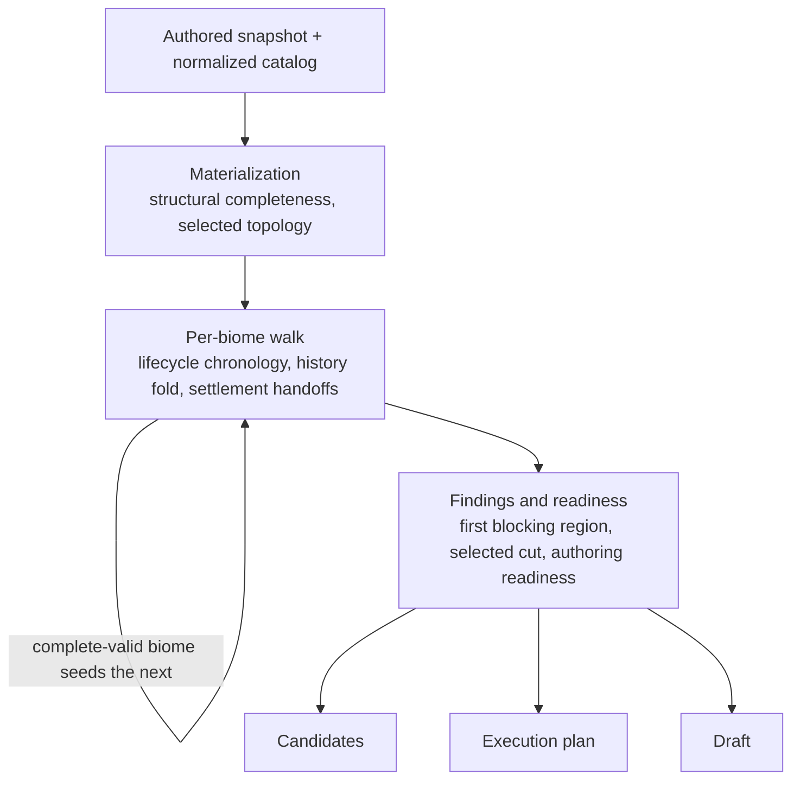
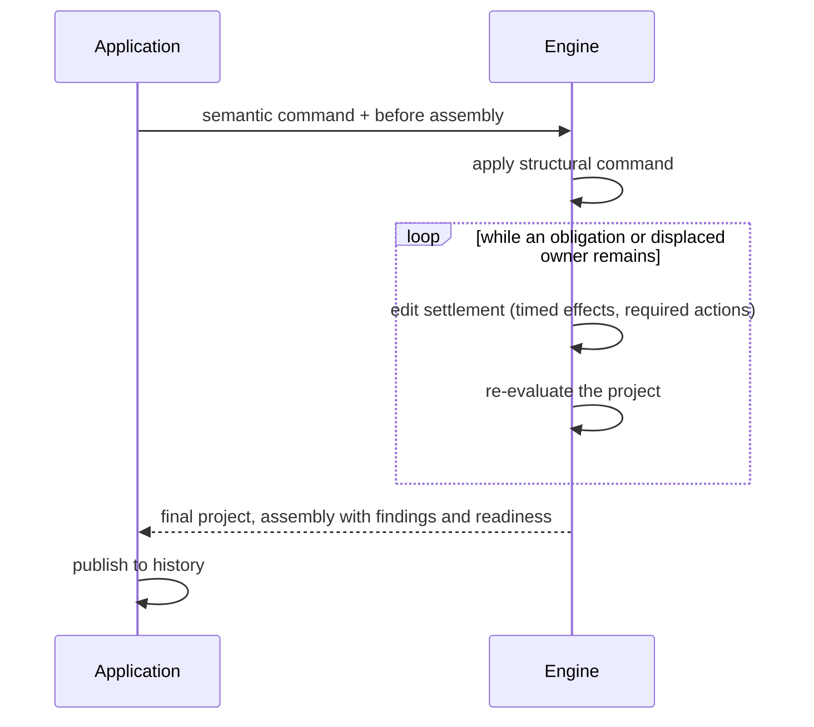

# Planner Engine: Simulation and Validation

## Responsibility and Authority Map

The planner engine interprets an immutable authored project against an immutable
normalized catalog. It produces exact derived facts for validation, candidates,
the editor and execution publication. It is pure, deterministic and independent
of the catalog implementation, application framework and game runtime.

This is the engine entry document. Detailed contracts have narrower owners:

| Authority                                                   | Responsibility                                                             |
| ----------------------------------------------------------- | -------------------------------------------------------------------------- |
| [Authored Project Model](AUTHORED_PROJECT_MODEL.md)         | Persisted choices, addresses, codecs, atomic commands and topology closure |
| [Game Generation Rules](GAME_GENERATION_RULES.md)           | Physical batches, generation support, takeover and completion              |
| [Room Lifecycle Model](ROOM_LIFECYCLE_MODEL.md)             | Operation order, Room Action order, clocks, room history and resets        |
| [Encounter Preparation](ENCOUNTER_PREPARATION.md)           | Encounter choices, identity resolution, composition and introductions      |
| [Reward Model](REWARD_MODEL.md)                             | Stores, producers, shops, offers, acquisitions and settlement              |
| [Trait Offers](TRAIT_OFFERS.md)                             | Trait outcomes, generation-time context, screen support and trait history  |
| [Candidate Evaluation Model](CANDIDATE_EVALUATION_MODEL.md) | Exact alternative queries and repair capabilities                          |
| [Execution Protocol](EXECUTION_PROTOCOL.md)                 | Engine-owned execution products and downstream responsibilities            |
| [Run-Start Installation](RUN_START_INSTALLATION.md)         | Start installations, loadout, run modifiers and snap mode                  |
| [Draft Mode](DRAFT_MODE.md)                                 | Draft spec meaning, search contract, steering and share codes              |

This document owns their composition, evaluation coverage, finding chronology,
readiness and the explicit handoffs that keep these authorities coherent.

## Engine Neighborhoods

Code sits with the semantic neighborhood that owns its policy, not the first
caller that needs a result. A folder is not another processing stage. Shared
normalized contracts sit below their consumers; assembly does not become policy
merely because it joins those consumers. Large coordinators are appropriate
when they own one chronological or atomic invariant.

## Key Terms

| Term                                                              | Meaning                                                                                                             |
| ----------------------------------------------------------------- | ------------------------------------------------------------------------------------------------------------------- |
| [Selected cut](#selected-cut)                                     | The one chronology position of the selected attempt at which a block is published; nothing after it is evaluated    |
| [First blocking region](#first-blocking-region)                   | The earliest atomic region holding a finding; its findings are retained and later-region findings withheld          |
| [Authoring readiness](#authoring-readiness)                       | Which regions stay editable for required incompleteness, independent of the exact assessment stop                   |
| [Horizon](#authoring-readiness)                                   | The normalized boundary after the region the user must be able to repair; the first locked region lies past it      |
| [Settlement handoff](#settlement-handoffs)                        | A complete settlement product, branches with their findings and frontiers, merged once at its chronological handoff |
| [Run-state snapshot](#run-state-snapshots)                        | A read-only projection of the folded state captured at a checkpoint, never a second simulation                      |
| [Canonical vs retained product](#canonical-and-retained-products) | Only a complete-valid biome publishes a canonical product; otherwise the reached prefix is retained and assessed    |

## The Evaluation Pipeline

Stages: [materialization](#materialization-products) and
[retained products](#canonical-and-retained-products);
[chronology](#chronology-and-history) and
[settlement handoffs](#settlement-handoffs);
[first blocking region](#first-blocking-region),
[selected cut](#selected-cut) and [authoring readiness](#authoring-readiness);
[candidates](CANDIDATE_EVALUATION_MODEL.md),
[execution plan](EXECUTION_PROTOCOL.md) and [draft](DRAFT_MODE.md).

These are responsibilities, not independent passes that may be freely reordered.
Reward acquisitions can affect later generation, and generation determines
later acquisition context. Their owning coordinators preserve that chronology.

`simulateProject` exposes data-only evaluation. Exact assembly construction
also carries opaque candidate artifacts from the same execution. Candidate
queries do not rerun the project to reconstruct them.

The result contains status, route processing regions, covered histories and
snapshots, findings, an optional selected assessment issue and summary. An
unconfigured project has explicit empty status; incomplete and invalid authored
plans are ordinary results. Malformed input, impossible catalog construction
and violated internal contacts throw contract errors rather than masquerading
as user findings.

`settleProjectEdit` composes a structural command with exact delivery and
pickup reconciliation and derived required-action activation before
application history publication. It consumes the before assembly and returns
the final project and its exact assembly.

- Required Hermes obligations are inserted at reached due contacts read from
  the Hermes delivery obligation product; optional clocked pickups are never
  accepted automatically.
- A placement the edit proves displaced (valid before, invalid now) is
  removed. Deliveries and clocked pickups are keyed by their source, so no
  inherited choice is reset for being newly reached; one that is invalid where
  it lands keeps its finding.
- Each repair consumes an explicit obligation or displaced owner. A repeated
  repair is not replayed: settlement stops and returns the last evaluated
  assembly with a settlement fault naming the owner. A
  [timed outcome](TRAIT_OFFERS.md#timed-outcomes) whose reached branches
  disagree on its landing is also a fault. A fault signals an engine defect,
  not an authoring task: the application publishes it beside the assembly,
  never as an editor finding; dev builds warn in the console and bug reports
  carry the current one.

Loading and projection remain read-only, and Undo/Redo restore the settled
snapshots.

Evaluation rebuilds synchronously for a new authored snapshot. Application
caching may reuse a complete assembly for the identical immutable project,
including Undo/Redo. Within the engine, decoding and the route walk reuse
untouched biome plans and complete biome results by identity, so a changed
input misses for its biome and every later one and nothing is invalidated.
There is no semantic dependence on a background worker, incremental
invalidation graph or mutable application singleton.

## Authored State Is Not Evaluated Truth

Commands answer whether a transition is structurally representable. They check
ownership, supported shapes, static domains and topology closure; they do not
require a successful simulation or erase choices that later become invalid.

The [ordered command reconciliation](AUTHORED_PROJECT_MODEL.md#commands)
closes source changes and generated state atomically, so a generated pickup's
source, entry and action agree when the command returns.

Materialization does not repair missing authorship either. It resolves every
fully authored structural fact it can and leaves the first missing value
addressed. Only referenced occurrences participate. Unpicked offered rewards
can be active while the same room's entry-only Shop or feature state is dormant.

### Materialization products

Room templates produce complete declaration-specific reward, encounter and
lifecycle leaves. Common room assembly adds acquisition sites, features,
action domains, roster and timeline in their required order. Template products
such as Ship state may also support local authoring without a separate
materialization interpretation.

Generated-batch construction resolves source, physical targets, store/batch
state and continuation. Progressive traversal determines how much of that
structure can be assessed. A retained target with an unresolved acquisition
child must not erase its already-generated siblings.

Occurrence identity is independent of game name. Repeated room declarations
create distinct offered occurrences; only selected entry contributes appearance
and room-local effects. Boss/Postboss are ordinary fixed-linked occurrences,
not an evaluation unit merged with Preboss.

### Canonical and retained products

Only a complete-valid biome publishes a canonical snapshot, final history,
completion transition and seed for the next biome.

`materializedPrefix` retains the maximum structurally materializable prefix.
`assessmentPrefix`, when present, is the smaller structure reached by the
[selected cut](#selected-cut) through the first blocking product. Coverage,
history, findings and candidate artifacts refer to the assessed product, not
every retained materialized leaf. The authored document retains any remaining
suffix.

Canonical rooms retain addresses, resolved identities, active local products
and the one action roster/timeline. They do not copy catalog predicates,
labels or candidate arrays. A canonical snapshot is not execution JSON.

## Completeness, Validity and Coverage

Completeness asks whether the required concrete choices exist. Validity asks
whether reached choices are possible. Coverage says which facts were actually
assessed. These axes must remain distinct.

| Biome state                                         | Available product                                                          | May seed the next biome? |
| --------------------------------------------------- | -------------------------------------------------------------------------- | ------------------------ |
| Start or required field not materializable          | Exact incomplete frontier, no assessed snapshot                            | No                       |
| Incomplete with a reached prefix                    | Materialized prefix, assessed history and repair contacts                  | No                       |
| Complete or incomplete with a reached invalid value | Retained materialization and the selected cut through the blocking product | No                       |
| Complete and valid                                  | Canonical snapshot, final history and completion transition                | Yes                      |

Route evaluation composes a complete-valid prefix, at most one progressively
evaluated active biome and an unassessed suffix. A downstream page may expose
authored structure and declaration domains, but never simulates from a guessed
predecessor completion. Earlier invalidity and later incompleteness may coexist;
invalid presentation does not erase the missing owner's identity.

Completeness follows active ownership: offered targets require offer-time
leaves; picked rooms require their entry-time leaves; active generated pickups
and selected children require their own choices. Dormant retained values do not
create findings. An empty optional purchase order is complete, while a missing
required action remains a repairable incomplete state.

### Authoring readiness

The exact assessment stop and the authoring lock are not the same point.
The engine normalizes required incompleteness to the next boundary after the
region the user must be able to repair:

| Missing input       | Region still editable      | First locked region      |
| ------------------- | -------------------------- | ------------------------ |
| Route-start loadout | Loadout                    | First occurrence         |
| Occurrence interior | That occurrence's interior | Its outgoing decision    |
| Outgoing decision   | That outgoing decision     | Selected next occurrence |

Earlier regions stay editable and later authored values remain visible.
Invalidity alone creates no readiness lock, and unassessed is not itself a
lock: past a blocking product, a control that needs a reached context has none
and shows read-only with the unreached hint, which follows coverage, not
readiness.

The same semantic chronology locates the missing owner, normalized horizon and
queried command owners. Jointly unordered products, such as a Hub board or
side-room sibling generation set, remain atomic. The application applies this
product; it does not infer chronology from tabs, rail order, a target index or
the component containing the finding.

An unresolved delivery or nested trait child must not prevent arranging and
repairing actions within the same occurrence. Conversely, opening-room editing
cannot bypass an incomplete loadout merely because it uses another control.

### First blocking region

Producing authorities attach exact semantic owners to findings, and aggregate
evaluators attach an internal atomic-region key while producing them.
Progressive retention uses existing materialization, generation and lifecycle
chronology to locate them; the locator never infers grouping from finding
codes, finding-array order or UI sections. Every finding in the first region is
retained, and later-region findings are withheld.

An incomplete or invalid configured route publishes exactly one assessment
issue: its semantic repair owner, stable region identity, incomplete/invalid
kind and nonempty collection of reasons. Valid and empty routes have none.
Related reasons retain their exact child origins even when repair belongs to
the containing offer. Exact duplicates collapse by semantic identity and
evidence. Independent repairs sharing a checkpoint follow the engine's
semantic ordering, never presentation order. An unlocatable finding is a broken
engine contract.

Detailed findings remain available to their owning repair, candidate and
delivery-placement consumers. They are not a competing route-level agenda.
The selected issue comes from the same assessment stop that governs coverage;
its containing repair owner neither moves that stop nor sets edit readiness.
A picked host's resource-placement error participates at its room's Overview,
while an unpicked generated host retains its structural repair at its door.
Invalid Fig Leaf choices remain repairable but cannot publish a normally
executed encounter as assessed continuation.

The blocking owner retains its repair capability when reached. Later history
effects, findings and capabilities do not become true merely because their
authored controls still exist. The candidate session answers whether an
exact context exists for a native setting's owner (Ship phase count, reward
wheel, Hub slot and action order, side-room generation and order, Fields point)
by reading retained products or authored structure only; it evaluates no
candidate and replays nothing. No candidate-only evaluation or UI fallback may
restore withheld semantic facts.

### Selected cut

Every block, in an ordinary, fixed Boss or Postboss, opening or Hub-visit room,
on the Hub board or its Handoff, or at the biome start, is published through
one cut of the selected attempt.
History, the reward walk, door generation and encounter support are cut at the
same chronology position; products before it are the selected attempt's own,
with their candidate capabilities, and nothing after it is evaluated. Every
blocking finding carries that position; an unpositioned block is a broken
engine contract.

Where the cut falls follows the room's
[stages](ROOM_LIFECYCLE_MODEL.md#room-stages):

| Block                                                                                                                                                                                                  | Cut and published products                                                                                                                                                                                                                                                                                             |
| ------------------------------------------------------------------------------------------------------------------------------------------------------------------------------------------------------ | ---------------------------------------------------------------------------------------------------------------------------------------------------------------------------------------------------------------------------------------------------------------------------------------------------------------------- |
| Overview: anything fixed on entry, such as Shop, Shrine, Well or Contract inventory, any phase's encounter identity, composition, customization or introduction, or a picked host's resource placement | After the whole Overview. The room is entered with its `roomEntered` snapshot, its entry effects (Preboss delivery flush, forced-Chaos spark, Fields forfeits) and the continuations created on entry, as on success minus the failed product. The Overview is the repair region; the Timeline and Exit are unreached. |
| Timeline, including the doors opening                                                                                                                                                                  | At the start of the blocking product. Earlier Timeline products are kept. Coverage publishes the room's `roomTimeline.blockingRowKeys`: every Timeline row that settles an owner of the blocking region, whether or not it carries a finding. Later rows, the Exit and later rooms are unreached.                      |
| Exit work                                                                                                                                                                                              | At the failing exit contact. The Timeline, door selection, commit and `beforeRoomExit` snapshot are kept; the room does not exit.                                                                                                                                                                                      |
| The next room                                                                                                                                                                                          | The source room has committed and exited first: its Shop completion, resource element grants and `beforeRoomExit` snapshot are kept. Nothing in the next room changes the source room's door selection.                                                                                                                |

Overview assessments read only entry state, never a Timeline product. The
blocking product is the engine atomic region of the blocking finding, so every
row it owns stays editable at row level (order, removal, purchase
participation). Inside it, only rows at or before the failing contact have
reached inner capabilities; later rows show their inner pickers read-only.
Findings arise only at or before that contact, so no repair is locked.

Encounter support follows the same cut. Every phase of a room prepared through
the cut keeps its identity, composition, generation and roster support, since
those read only the room's preparation and entry state. A phase that started
before the cut keeps its status and Fig Leaf and Gorgon support; a phase
blocked at its own start by a Fig Leaf, Aetos or Gorgon finding keeps its
status without execution and its Fig Leaf support.

### Generated-batch retention

Outgoing generation publishes one decision-owned assessment, including its
ordered target assessments and any batch-policy evidence. Each target retains
its exact generation pressure and target-local evidence.

A block before generation publishes no assessment. The doors opening is one
blocking product because door offers share one offer-time store: an invalid
door offer keeps the whole batch, every door's generation and offer
capability, and blocks at the source room's Timeline, not its Exit. A physical
target generation failure retains completed targets and the bounded repair
contact at the failing target. A block in a later acquisition child retains
the already-generated batch. An unresolved trait or Pom must neither equip its
effect nor retroactively discard the source doors. Shared generation rules
serve selected validation, candidate support and workspace consumers.

## Chronology and History

`SimulationState` is the immutable, branch-local authority for live equipment,
trait history, Arcana/Fear, keepsakes, Hex progression, Well effects, reward
bags/history/priorities, persistent offered-reward lookups, the transient
per-map transition-offered reward types, pending Shop or Shrine work,
pending trait offers and uncollected resource objects' stored amounts. It also
carries the reached route position and history view.

Pending trait offers record each spawned, unopened trait-bearing loot by room:
the substates its options were built from, or a stale mark. They change only
through spawn, open, room exit and one closed context transition: a screen
completion rebuilds every record in the room, while Steady Growth, Transcendent
Embryo, fountain rarity and a Nemesis trade mark them stale. The
[Trait Offers](TRAIT_OFFERS.md#generation-time-context) owns the policy.
Transitions return a new state while retaining unchanged substates; replacing
trait history also updates the reward kernel's derived trait facts and, when
Barren starts or ends, the per-card Arcana it unequips or re-adds at Epic,
atomically. Echo's Common keepsake copy is a keepsake-ledger fact recorded at
the biome start that found the captured keepsake unheld.
Catalog declarations remain separate from acquired instances and their clocks.

Eligibility consumes the exact reached state plus explicit operation context:
source policy, generation view, store contents or peer-generation contact.
Callers must not assemble parallel copies of live player facts or silently
default a missing state. Pure adapters derive narrow kernel requirements from
that state. Whether a contact consults a fact is distinct from the fact itself;
for example, inventory consults persistent Hub offers while ordinary acquisition
settlement does not.

Earlier source witnesses remain explicit when they differ from current state,
such as Travel Deal's post-purchase generation facts and a pending trait
offer's generation context. Branch evaluation products and executable candidate/continuation
capabilities remain outside `SimulationState`. The state is neither a service
container nor an inspector summary used to authorize transitions.

The lifecycle authority determines operation order. History folding owns
sequence validation, paired-event closure, counters, room/ledger views and
the immutable result. Reward chronology owns possibility branches, findings,
producer frontiers and candidate capture alongside that fold.

Each operation consumes explicit pre- or post-operation facts. Important axes
must never be collapsed into a generic room number:

- creation includes unpicked offers; appearance requires entry;
- counted bags deplete on offers; loot/use history changes on acquisition;
- entered-store history follows declaration policy, not visible reward kind;
- encounter depth and room-history/depth-cache advancement are independent;
- outgoing generation reads its declared source checkpoint, not later pickups;
- biome resets change only declared local state; route history carries onward.

Exact timing and source concordance belong to
[Room Lifecycle Model](ROOM_LIFECYCLE_MODEL.md#counter-and-cache-timing).

### Persistent and multi-phase rooms

All room shapes compose through the same history fold and generation
authorities; the biome documents own concrete policies, and none needs a second
validator or history fold. N's board generates in physical order and is
traversed in authored visit order; a main-room restore reuses its occurrence
without creating a room, reoffering its reward or replaying its lifecycle.
Side-room generation and entry stay separate events that the same fold composes
with exact visit/restore identity. Multi-phase H, O and P rooms take their phases from declaration-resolved
envelopes (P preparing them sequentially); phase completion, end effects,
reward readiness and pickup are separate facts, and several encounters still
make one room commit. Anomaly, Chaos and Zagreus keep their distinct topology
forms.

### Clocks and trait history

Lifecycle decides when clocks advance or due effects run. Effect transitions
return complete history and due products; they do not create independent
schedulers. An automatic mutation and a newly available pickup are different:
the pickup's appearance does not apply its eventual acquisition.

Trait history separates chronological events from current equipment.
Removal does not erase prior acquisition, one-time selection, provider or
Denial history. Shared predicates derive slots, elements, rarity counts and
upgradeability from the same ledger.

Within a sequence group, trait folding applies element derivation and
rarity-floor promotion for newly activated or rechecked sources after the whole
group, not as independent handlers in arbitrary order. Source-time target
generation and application against current history remain distinct.

## Settlement Handoffs

### Complete products, not shared side effects

A settlement result is more than its surviving branches: ordered findings,
entry and role frontiers, derived-entry frontiers, trait-child checkpoints and
timeline facts travel with the branches when produced. Callers merge once at the chronological handoff, preserving distinct
evidence from divergent cohorts.

Site traversal owns entry order and unpicked candidate probes. Conversion
generation returns replacement sources, roles, branches and findings. The role
coordinator owns immediate recursion versus deferred pickups. Neither passes
a mutable accumulator into the other or replays settlement to recover a lost
frontier.

For example, a reached All Together child with no target needs both its finding
and exact pre-effect context. Returning only an outer successful branch loses
repair context. Returning only the finding allows navigation but leaves the
picker unable to propose a correction. The unresolved effect must not enter
history while its exact repair contact remains available.

Artificer uses the current bag at each conversion; a prior conversion can
change the next one's support. The generated replacement is separate from its
later pickup. Source capabilities, conversion history and replacement
acquisition must not be conflated.

### Shop settlement

Shop inventory generation and acquisition settlement are different products.
The ordered Shop coordinator retains inventory witnesses, purchase cohorts,
branch survival and pending state across interleaved actions.

Travel Deal uses its settled triggering purchase and post-purchase generation
facts. Echo Gold consumes its use and registers the duplicate as a pending
trait offer before the source acquisition, and the source screen's completion
rebuilds it. Resuming the
room must not regenerate inventory, replay the first purchase or substitute
Shop-entry history for those captured contacts. Room exit closes pending
inventory. Exact ordinary/boosted item witnesses remain distinct even when
their resolved god is identical.

The [Shop contract](REWARD_MODEL.md#shops) owns inventory, participation,
supplemental entries and sufficient-resource policy. Paid purchases and free
pickups share acquisition authorities without losing their instance-specific
capabilities. Mystery Boon source settlement belongs to its acquisition, not
a dormant unpurchased inventory row.

### Reroll settlement

Every reroll spend and every hidden draw is settled in the walk at its own
point, never by a side pass. Door, cage, wheel and Hub presses settle at
their rank as real store draws against every target's current reward; a
rerolled owner then offers its current reward onward and acquires the reward
held beside its first draw. A hidden return door settles at its room's first
outgoing generation, publishing the placeholder and reward it settled when
either was unpinned. A rerolled screen's whole chain settles with its offer:
the earlier screens are judged against the final screen's generation context
and spend once, when the screen closes. Well and Pool rolls settle at their
reroll actions.

The run's reroll pool is part of the folded Arcana state. A spend past the
pool is still spent and reported, so a preserved over-spend never stops later
settlement; adding one is refused by edit settlement under the fixed-budget
rule, judged by the pool at the new spend's own point, so an earlier spend
takes precedence over the later spends it starves. Engine-owned authoring
queries publish, at each reached reroll surface, the pool there, whether a
held card enables it, each target's settled current reward and why a press
would be refused, candidates for a press not yet inserted, and each Hub
stay's board as it was assigned and after its presses.

### Selected traits and alternative candidates

Selected settlement answers what the authored outcome does. Candidate
capability answers what can replace it at the exact pre-effect frontier.
They use the same policy but are not interchangeable products.

All offer options are assessed against the same immutable generation-time
context, while selected effects settle against the current branch;
unselected alternatives do not equip traits. Selected children, Hex effects
and Concave Stone residuals return complete products to their coordinator.
Structural child discovery and alternative probes do not become another
selected-acquisition history.

Acquisition settlement records on each screen's evaluation the one-use effects
it spent when the screen closed (Hymn, Yarn, an Ordinary curse use) and orders
the screen only after the latest earlier screen in its room from the same
giver. The screen's expectation joins those spends with the uses, Concave Stone
and rarify state held when the screen opens; execution publication copies the
fields every reached branch agrees on and never derives a spend again.

Candidate artifacts capture branch-local context before selected settlement
and before equivalent post-states merge. A target cannot borrow its eligibility
from one branch and its prerequisite from another. An invalid selected child
must not destroy its repair domain, and a child address must not be used as a
substitute for the outer prepared capability.

The [Candidate Evaluation Model](CANDIDATE_EVALUATION_MODEL.md#trait-offer-candidate-boundary)
owns the full contract.

### Branch equivalence

Merge only states equivalent to every downstream consumer. Distinct active
Arcana, keepsake history, pending effects, pending trait-offer contexts or
stale marks, or future bag support remain distinct.
Declaration-certified interchangeable entries may collapse; arbitrary
first-entry selection cannot replace possibility branching.

Reward-generation contacts require agreement on the history families they
consume. If those exact inputs diverge where the contract requires agreement,
report a contract failure rather than selecting a convenient branch.
Aggregated diagnostic ranges are not authorization to merge semantic states.

## Findings and Repair

Every finding is a simulation blocker; there is no severity. A finding
carries a stable semantic origin, code and typed evidence. Why a reward-offer
candidate is impossible is a candidate product, not a finding: see
[Offer exclusions](CANDIDATE_EVALUATION_MODEL.md#offer-exclusions).
Instance identity belongs in the address, not the code. Messages and display
labels are application products. An actual lifecycle action block retains each
matching dependency or window violation as invalid ordering; a missing required
action remains incomplete. Dormant stale roster rows do not create findings.

Three responsibilities stay separate:

1. the effect or validation authority identifies the narrowest proven owner;
2. progressive evaluation locates that owner's chronological region;
3. the application maps it to one repair destination shared by navigation and
   inline feedback.

Generated pickup placement assessment is separate from required participation
and reward completeness. Hermes deliveries and clocked trait pickups publish
exact source, entry and reached-contact evidence as valid, invalid or unassessed.
Universal rejection across reached branches proves invalidity; mixed or empty
cohorts do not. Missing candidate capability is not evidence of a stale source.
A valid placement with missing or mismatched reward details retains its reward
repair instead of becoming an obsolete placement.

Lifecycle assessment travels explicitly through chronology publication and
first-blocking retention, independently of reward candidates. The blocking
placement keeps its repair even when it has no candidates; later lifecycle
claims remain withheld. Authored source absence or inactivity is independent
structural proof and remains available for retained hosts beyond coverage,
without synthesizing entered rooms, timelines or history. Existing authoring
readiness still governs invocation. Application projections bind the supported
unplacement or optional-removal intent to the same semantic repair owner used
by finding navigation; local generated required pickups retain source-owned
repair rather than acquiring arbitrary relocation.

An N side-room acquisition is not located by its parent rail position.
A Supply Chain Pom's target belongs to its generated level-resolution owner,
not the original trait's offer. Extending an address family therefore requires
a chronological-location test and a real application repair witness, not just
a codec test.

Shop purchases settle one row at a time over forward-only shared state, so
each purchase owns its own region: purchase, Contract, refill and Gold Gold
Gold duplicate findings belong to their acquisition entry, and a Travel Deal
refill inventory finding to the refill offer. Inventory generation failure
belongs to the Shop's Overview with the relevant slots in evidence; only the
close-time Echo Gold pickup placement finding is Shop-wide. A purchase order
that loses every branch without an entry finding is a broken engine contract.
A sequence failure belongs to chronology, not every supported sibling. Missing
trait or target authorship retains the exact child finding rather than an
additional generic purchase failure.

Encounter identity, composition and
[introduction](ENCOUNTER_PREPARATION.md#enemy-introductions) findings stop
assessment at the room's Overview; the Fresh File introduction finding on the
exact phase of a retained enemy withholds execution. Fig Leaf, Aetos and Gorgon findings have
their own phase-child owners and stop assessment where the phase starts.

Reroll findings belong to the press, the roll or the screen that made the
spend: an unavailable target, reward or roll at its press or roll action, an
over-spend at the spend that exceeded the pool, a rerolled reward that no
longer matches its last press at the rerolled owner, and an earlier-screen
finding at that screen of the offer. A hidden return door's unavailable
placeholder or reward belongs to its room's door.

Toggling a participant changes membership without replaying chronological
legality; only a move assesses position, so an unresolved earlier item cannot
prevent adding the action that repairs the room.

## Run-State Snapshots

Run State is a read-only projection of captured `SimulationState` snapshots,
not a second simulation. All branches at a checkpoint share its exact reached
history view and route position; sequence and counters derive from those
snapshots rather than separately supplied values. It publishes semantic owner,
checkpoint, counters, bags and ledgers without exposing the internal state.

Projection caches account for both the source/view/store/peer contact and the
state inputs consumed by the derivation. Shared reward-history identity alone
does not establish equivalent eligibility: pending deliveries, Hex progression
and persistent reward lookups can differ. Immutable substate identities permit
reuse without serializing the whole state or recomputing every projection.

Ordinary occurrences expose entry and pre-exit snapshots. Ship phases expose
pre-encounter snapshots and the occurrence exposes pre-exit. N also retains
the meaningful pre-board and pre-handoff generation contacts. The
[lifecycle checkpoint contract](ROOM_LIFECYCLE_MODEL.md#run-state-checkpoints)
owns their precise timing.

A retained owner beyond coverage is unavailable with an explicit coverage
reason; it receives no fabricated state. A later failure cannot erase an
already-reached snapshot. Presentation may group equivalent branches and show
ranges for real differences, but must preserve correlated condition groups.
Lazy bags show their declared initial contents without materializing a branch.

The snapshot type is the field catalogue. Every field is derived from the
checkpoint's folded state, never reconstructed from the current selected key
or counted again:

- The generated base-store controller's inputs at the checkpoint's own settled
  boundary: the run-wide entered and Meta-entered tallies and their ratio, read
  from the door controller's ledger rather than recounted, and the target Meta
  rewards ratio this biome's rolled doors consult. The ratio is null before
  anything is counted. Where no door in the biome rolls, the target is absent
  and the snapshot reports instead the distinct store keys the biome's room
  declarations can bank (a room's fixed key, or a resolved offer's
  individual or forced pin); the biome documents own which keys those are.
- Max health, Magick and lasting armor are derived from folded state; their
  settlement-time grants are folded by their owners. Armor follows the
  planner's no-damage assumption, so it is never consumed.
- Configured Fear and effective suppression remain distinct; spent effects are
  not restored by later suppression. Acquisition identities distinguish
  repeated temporary effects, and running clocks and activation-gated traits
  come from the engine's folded products.
- Keepsakes form one chain per entered biome; a Postboss rack's choice belongs
  to the biome that ends with it.
- The reroll pool's remainder and whether door and screen rerolls are enabled
  come from the folded Arcana state and trait history.

Offer-local rarity and level context is not a global Run State table.
Exact room/item witnesses, generation-time contributions and history govern
each offer; sibling selection cannot rewrite that frozen context. Detailed
rarity, level and effect facts belong to the
[trait audits](../audits/README.md#traits) and their owning reward/candidate
contracts.

A Practice mode start point installs a pure projection of these folded states,
which also supplies every snapshot's held-keepsake rows and exact store
contents; [Run-Start Installation](RUN_START_INSTALLATION.md#engine-start-installation)
owns it.

## Extension and Verification

Before changing a sensitive boundary, identify its complete input/output
product, chronological owner, downstream consumers and primary tests.

- A new generated child needs command insertion/retraction and retained-source
  tests, then lifecycle maturation and repair coverage.
- A new selected trait child needs complete settlement and exact candidate
  context, including incomplete and stale-target repair.
- A new room shape needs declaration/materialization and chronology evidence,
  not a parallel biome evaluator.
- A new snapshot fact must come from existing folded state, not a diagnostic
  reconstruction.

`npm run test:equivalence` is the behaviour-preservation witness for engine
refactors; its digests include every settled trait child's attached Run State
captures. Retain representative real-plan witnesses across acquisition,
maturity, upstream change, removal and Undo for long-lived effects.

A materially unmodeled rule requires implementation, a narrower supported
surface or a documented bounded approximation, not a generic unsupported
value. No editor layout, runtime mutation or alternate executor semantics
belongs in this engine.
